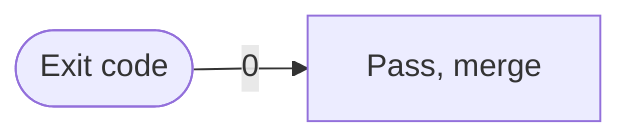

# Content schema

`src/content.config.ts` is the contract. This file explains **what each
collection models and why it is shaped that way** — the reasoning the Zod
definitions cannot carry on their own.

The whole design rests on one idea: **the schema is where honesty is enforced.**
If a claim can be made in the UI, the schema requires the evidence for it. That
is why several fields are mandatory, and why a few are refusals rather than
conveniences.

---

## The shared spine — `baseEntry`

Every archive record (`work`, `lab`, `notes`, `gallery`) extends one base, so a
card, a breadcrumb, a feed item, or an integrity check can be written **once**
against any record without knowing which collection it came from.

| Field                               | Why it exists                                                                                                                    |
| ----------------------------------- | -------------------------------------------------------------------------------------------------------------------------------- |
| `entryId`                           | Globally unique **including across locales** — the ES counterpart takes an `-es` suffix. Integrity fails the build on duplicates |
| `translationKey`                    | Links the EN and ES records. Routing resolves counterparts through this, never through a translated slug                         |
| `slug`                              | Per-locale and genuinely translated (`/es/lab/calculadora-subred/`)                                                              |
| `summary`                           | Capped at 180 chars because it is the card dek, the meta description, and the feed excerpt at once                               |
| `visibility` · `maturity`           | Two separate axes — see below                                                                                                    |
| `topics`                            | Controlled vocabulary from `src/data/taxonomy.ts`; free-text tags would fragment the index                                       |
| `links` · `references` · `evidence` | Outbound links, cross-links to other records, and claims with sources                                                            |
| `documents`                         | Manifest of subposts; the parts live in the `documents` collection                                                               |
| `protection`                        | A deterrent, not authorization. See the static-host boundary in `architecture.md`                                                |
| `featuredRank`                      | Presentation reads it; nothing derives importance on its own                                                                     |
| `statusNote`                        | What the thing does **not** do. Capped at 220 chars so it stays a caveat, not an essay                                           |
| `image` · `imageAlt`                | Banner/preview. Every record type supports one                                                                                   |

### Three status axes that must never be merged

The least obvious decision in the schema, and the easiest to get wrong.

| Axis         | Question it answers                    | Values                                     |
| ------------ | -------------------------------------- | ------------------------------------------ |
| `visibility` | Should anyone see this at all?         | `draft` · `public` · `unlisted`            |
| `maturity`   | How finished is the **write-up**?      | `seed` · `growing` · `stable` · `archived` |
| `lifecycle`  | What state is the **thing itself** in? | per collection, below                      |

A stable tool can have a seed write-up. A polished article can describe an
archived project. Collapsing these into one `status` field — the obvious
shortcut — makes both statements unsayable.

`lifecycle` is deliberately **different per collection**, because the states a
project passes through are not the states a piece of writing passes through:

- **work** — `research · prototype · active · shipped · maintained · archived`
- **lab** — `prototype · active · stable · archived`
- **notes** — `current · superseded · archived`
- **gallery** — `collecting · curated · archived`

The UI never reads these directly. `getLifecycleTone()` in `src/lib/status.ts`
collapses all of them onto one shared tone (`live · progress · archived ·
neutral`) so the status chip speaks one colour language everywhere. **Add a
lifecycle value to that map, not a new colour to a component.**

---

## `work` — things that shipped

Models a built artifact and the evidence that it exists.

| Field                  | Why                                                                                                         |
| ---------------------- | ----------------------------------------------------------------------------------------------------------- |
| `domains` · `surfaces` | Both required, min 1. A project with no domain cannot be filed                                              |
| `technologies`         | The stack, from the taxonomy                                                                                |
| `role`                 | What the author actually did, when that is not obvious                                                      |
| `outcomes`             | Each outcome carries `evidence` with **min 1** — a claimed result without a source cannot be entered at all |
| `operatingConditions`  | Condition → implication pairs. Where the thing stops working                                                |

`outcomes` is the clearest case of the schema enforcing honesty: `PRODUCT.md`
forbids invented metrics, and here that rule is not guidance but a validation
error.

---

## `lab` — things that run

Models something the visitor executes in their own browser. The design problem
is range: an entry can be a 40-line JSON formatter, a locally-run model, an OCR
pass using the camera, or an emulator.

| Field                | Why                                                                                                                                                 |
| -------------------- | --------------------------------------------------------------------------------------------------------------------------------------------------- |
| `kind`               | `tool` \| `experiment`                                                                                                                              |
| `execution`          | `none` \| `local` \| `third-party-network` — **drives the privacy line; that copy is never written by hand**                                        |
| `sendsDataTo`        | URLs. The console extracts and shows the real hostnames                                                                                             |
| `surface`            | `form` \| `canvas` \| `viewport` \| `embed` \| `none` — how the console frames the running thing, so an emulator is not squeezed into a form layout |
| `requires`           | Browser capabilities, verified at runtime by `src/lib/capabilities.ts`                                                                              |
| `downloads`          | `[{ label, bytes }]` — what the browser fetches on first run                                                                                        |
| `steps`              | Ordered setup, shown in the console panel                                                                                                           |
| `inputs` · `outputs` | Optional. A text transform declares them; a camera experiment declares neither and the block disappears                                             |
| `implementationId`   | Bound to a component in `src/implementations/lab.ts`. **Never put a component in frontmatter**                                                      |

**Why `execution` matters more than it looks.** The console's "runs in your
browser / sends data to X" line used to be hardcoded. It was true for the tools
that existed and would have become a lie the moment a networked one shipped.
`PRODUCT.md` treats accurate execution disclosure as a non-negotiable brand
commitment, so it is derived, always.

**Why `requires` is declared, not inferred.** A probe can tell you what the
_browser_ supports; only the author knows what the _entry_ needs. Permission-gated
APIs report `prompts` rather than `supported`, because an API existing is not the
user's consent.

---

## `notes` — things that are read

Models writing. The organising idea is **form**: a manual is not an article and
should not be presented as one.

| Field               | Why                                                                                                                                                                                                                                                    |
| ------------------- | ------------------------------------------------------------------------------------------------------------------------------------------------------------------------------------------------------------------------------------------------------ |
| `kind`              | `note` \| `article` \| `paper` \| `guide` \| `decision` \| `reference` — drives the index colour system, the type-filter routes, and the row structure                                                                                                 |
| `lifecycle`         | `current` \| `superseded` \| `archived`                                                                                                                                                                                                                |
| `supersededBy`      | `translationKey` of the replacement. **Effectively required whenever `lifecycle` is `superseded`**, or the reader is told something is stale and given nowhere to go                                                                                   |
| `level`             | `intro` \| `working` \| `deep`. Most useful on guides and references                                                                                                                                                                                   |
| `series`            | `{ id, order }` for a run of separate notes. `id` must be declared in `src/data/series.ts`, which gives it a display title in both locales; the schema rejects any other id, so a page never prints the slug. A "series" of one note announces nothing |
| `pdf` · `citations` | Rendered as a badge and a count on papers                                                                                                                                                                                                              |

Reading time and subpost titles are **derived, never stored**: `getNotesMeta()`
in `src/lib/notes.ts` reads the documents collection once per page and counts
subposts, because a four-part series is not a two-minute read.

**Part vs series.** A _part_ is a subpost of one entry (`documents`); a _series_
is several notes sharing `series.id`. The copy keeps them apart — "4 parts",
"Part 3 of 4" for subposts; "Part 2 of 3 · Android 17" for series members — and
derives both in `src/lib/series.ts`. A count of one is never shown.

Deliberately not added: `abstract`, `prerequisites`, `canonicalUrl`. Reasonable
fields with no consumer yet, and a field nothing renders is dead weight. Add
them when an entry needs them.

---

## `gallery` — things that are kept

Models a collection of files: photographs, generated images, videos, documents,
archives, and links. The entry itself is thin — `kind`
(`album` \| `shelf` \| `library`) and `lifecycle` — because **the items are not
in the frontmatter.**

```
src/content/gallery/<collection>/
  index.md      the entry: title, summary, topics, prose
  items.yml     one record per asset  →  the galleryItems collection
  assets/       the files themselves
```

**Why a sidecar manifest.** Neither extreme works. Auto-discovery cannot produce
bilingual alt text — a WCAG AA requirement — nor rights, provenance, or the
model that made an image. Inline frontmatter cannot survive a library of
hundreds without turning `index.md` into an unreviewable diff. So the split is:
**the machine fills facts, the human fills meaning.**

`bun run gallery:scan` appends a stub per new asset with `src`, `bytes`,
`format`, image `dimensions`, and `lqip` already filled, and writes a literal
`TODO` everywhere a human is required — so an unfinished record fails validation
instead of shipping a placeholder. `bun run gallery:copy` publishes `assets/` to
`dist/gallery/<collection>/`; a Vite middleware in `astro.config.mjs` serves the
same paths in dev.

### Item types

A discriminated union on `type`. All share `id`, `order`, `origin`, `rights`,
`provenance`, and optional `caption`, `capturedAt`, `topics`, `generation`.

| Type       | Beyond the shared fields                                     |
| ---------- | ------------------------------------------------------------ |
| `image`    | `src`, bilingual `alt`; optional `dimensions`, `exif`        |
| `video`    | `src`, bilingual `alt`; optional `poster`, `durationSeconds` |
| `document` | `src`, bilingual `label`; optional `pages`, `preview`        |
| `archive`  | `src`, bilingual `label`; optional `contents`                |
| `link`     | `href`, bilingual `label`; optional `accessedAt`, `preview`  |

Scanner-filled facts on file-backed types: `bytes`, `format`, and `lqip` — a
16px WebP of the image inlined as a data URI, used as the loading placeholder.
Chosen over BlurHash because it costs no client JavaScript; see `decisions.md`.

### `origin` and `generation` — the point of the collection

```
origin: captured | generated | derived | third-party
```

**`generated` requires a `generation` block** (`tool`, `model`, `prompt`, plus
optional `negativePrompt`, `seed`, `createdAt`), and a `generation` block on any
other origin is a validation error. Both directions are enforced.

A generated image and a photograph are different objects. The schema refuses to
let them look alike, which is what turns this section from a carousel into an
archive that records how each thing was made.

---

## The two sidecar collections

Neither is reachable as a page on its own; both exist because their parents
would otherwise become unmanageable.

- **`documents`** — subposts. One file per part, joined to its parent by
  `parentId`. Carries its own `title`, `summary`, `order`, `topics`, and
  `references`, so a part is a real record rather than a heading.
- **`galleryItems`** — gallery assets, loaded by a **custom Astro loader** that
  reads every `items.yml`. One manifest serves both locales: an asset's size,
  origin, and model do not change by language; only its `alt` and `caption` do,
  and those are bilingual inside the record.

---

## Integrity

`assertTrackedContentIntegrity()` in `src/lib/content.ts` runs before every
build and enforces what Zod cannot express _across_ records: globally unique
entry IDs, bilingual alt/label on every gallery item, non-empty rights and
provenance, unique item IDs, and contiguous ordering. Those rules cover files
and links too, not only images.

## Adding an entry

1. Copy an existing record's shape; replace every stable id (`-es` suffix on the
   Spanish `entryId`).
2. Keep the EN and ES records independent — never merge English into Spanish.
3. For gallery, drop files into `assets/` and run `bun run gallery:scan`.
4. `bun run test:content`, then `bun run build`.

### Diagrams

A ` ```mermaid ` fence is compiled to static SVG at build time by
`scripts/hast-diagrams.mjs` (beautiful-mermaid — flowchart, state, sequence,
class, ER and XY charts). Nothing renders in the reader's browser.

````md

````

- **`title="…"` is required** and becomes the accessible name. The build fails
  without it. Translate it with the rest of the diagram.
- **A node id starting with `gated` is drawn dashed** — the part of a system
  the reader cannot inspect. `classDef` colours apply; `stroke-dasharray` in a
  `classDef` is ignored by the renderer.
- **Fit the column.** Labels are drawn at 13px and never scaled below it, so a
  diagram wider than ~330px scrolls on a phone. Prefer `LR` for a fan-out, few
  nodes, short labels; the prose carries the detail.

### Images with a caption

A plain `.md` note captions an image through its markdown **title**. A
standalone image with a title becomes `<figure data-figure>` with the title as
its `<figcaption>`, at build time, by `scripts/hast-figures.mjs`:

```md
 · Trademark of Google LLC')
```

- **Plain `.md` only.** The step reads hast `img` elements; in `.mdx` the MDX
  pipeline turns local images into JSX nodes first, so a titled image there is
  not known to be captioned. In an `.mdx` note use `Figure.astro` instead.
- **Alt describes, title credits.** The alt text is what a reader who cannot
  see the image needs; the title is the visible caption and ends with
  `Source · Licence` (see `docs/writing-notes.md`). Never put the credit in
  the alt text.
- **Keep files beside the note** in `assets/` and link them relatively. Astro
  optimises them at build (PNG and JPEG ship as WebP with width and height);
  nothing is hotlinked, so the CSP is unaffected.
- The image must be alone in its paragraph. An image without a title still
  gets a figure in the browser, captioned by its alt text
  (`src/lib/entry-enhancements.ts`), which suits images that need no credit.
- A captioned image keeps its own shape: it is drawn `min(22rem, 60vh)` tall
  and centred, its width following its aspect ratio
  (`.prose figure[data-figure]`). A small raster is scaled up to that height,
  so ship photos and screenshots at least that tall, or use SVG. The lightbox
  opens it full size.

### Authoring kit

An `.mdx` entry may import the components in `src/components/mdx/`. Each one
renders static HTML with the site's own styles; none ships JavaScript.

| Component             | Use it for                                                                                                                     |
| --------------------- | ------------------------------------------------------------------------------------------------------------------------------ |
| `Callout.astro`       | A labelled aside — `type` is `note` · `info` · `success` · `warn`, plus an optional `title`. The icon comes from the registry. |
| `Figure.astro`        | An image with an optional caption (`src`, `alt`, `caption`). It joins the entry lightbox.                                      |
| `ReadmeCard.astro`    | A prominent link out to a repository README or other long-form source (`href`, `repo`, `label`).                               |
| `BenchmarkBars.astro` | A measured comparison: a real `<table>` with bars drawn against a fixed `max`.                                                 |

Pass every visible string from the entry, in the entry's language — the kit
does not translate for you. Interactive demos are not part of the kit: they live
in `src/components/demos/` and are rendered through their `*Island.astro`
wrapper with a `locale`, which supplies the translated labels and the no-JS
fallback.

## Adding a field

1. Add it to `content.config.ts` **with a default**, so existing records stay valid.
2. Make the UI treat it as optional.
3. Document it here, and add an entry to `decisions.md` if it changes what the
   site can express.
4. If nothing renders it yet, do not add it.
