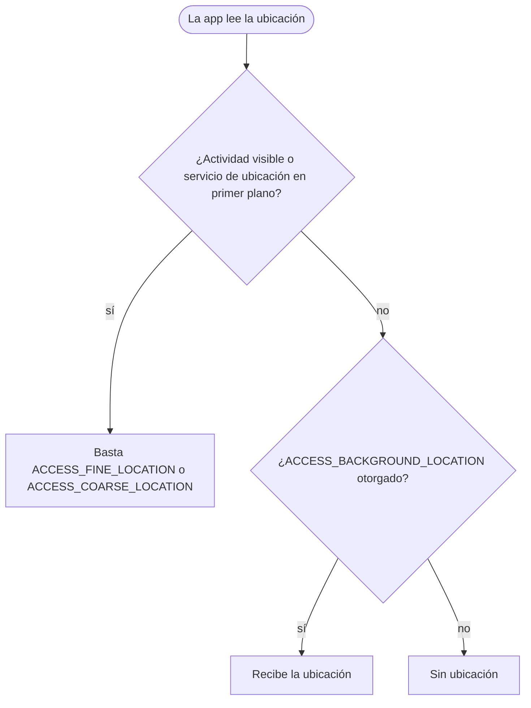

Android 10 es la versión en la que Android dejó de ponerles nombres de postres
a sus versiones. Para quien desarrolla, es la versión de la privacidad: las apps
con target API 29 solo ven sus propios archivos en el almacenamiento compartido,
la ubicación en segundo plano pasó a ser un permiso propio y las apps perdieron
el acceso al IMEI y al número de serie. Los usuarios recibieron la navegación por
gestos y un tema oscuro para todo el sistema.


## De un vistazo

|                                    |                                                                                                                        |
| ---------------------------------- | ---------------------------------------------------------------------------------------------------------------------- |
| Versión                            | Android 10                                                                                                             |
| Nivel de API                       | 29                                                                                                                     |
| Nombre                             | Quince Tart, solo interno. Nombre público: Android 10                                                                  |
| `Build.VERSION_CODES`              | `Q`                                                                                                                    |
| SDK final                          | 5 de junio de 2019 (Beta 4, API 29 final)                                                                              |
| Lanzamiento                        | Despliegue en Pixel y código en AOSP, 3 de septiembre de 2019                                                          |
| Dispositivos de lanzamiento        | OnePlus 7T, anunciado el 26 de septiembre de 2019; Pixel 4 y Pixel 4 XL de Google, anunciados el 15 de octubre de 2019 |
| Plazo de target API en Google Play | Apps nuevas desde el 3 de agosto de 2020, actualizaciones desde el 2 de noviembre de 2020                              |
| Herramientas                       | `compileSdkVersion 29`, Android Studio 3.3 o posterior (ver abajo)                                                     |

La página de configuración del SDK de Android 10 dice que las apps compilan y
se prueban con Android Studio 3.3 o superior, aunque algunos usuarios "may
encounter Gradle sync failures". El anuncio del lanzamiento pedía Android
Studio 3.5 o superior. Ninguna página de Google indica un Android Gradle Plugin
mínimo para API 29; su tabla de compatibilidad empieza en API 33.

Google publicó el SDK final de API 29 con la Beta 4 el 5 de junio de 2019 y ese
mismo día abrió Play a las apps con target API 29. El 3 de septiembre liberó el
código en AOSP y empezó el despliegue a Pixel, Pixel 2, Pixel 3 y Pixel 3a.
Android Police informó del despliegue ese mismo día. El Essential Phone y el
Redmi K20 Pro de Xiaomi también recibieron la actualización el primer día.
OnePlus presentó el 7T como el primer teléfono nuevo con Android 10 y las apps
de Google de fábrica; el Pixel 4 fue el primer teléfono de Google que salió con
esta versión. El boletín de seguridad de febrero de 2023 es el último que
incluye Android 10 entre las versiones de AOSP corregidas; desde marzo de 2023
los boletines empiezan en Android 11. Las seis betas de Android Q, del 13 de
marzo al 7 de agosto de 2019, son las partes que siguen a esta vista general.

## Qué trajo

- **Navegación por gestos.** Un modo totalmente gestual reemplaza la barra de
  navegación: deslizar hacia arriba lleva a inicio y deslizar desde cualquiera
  de los bordes laterales equivale a atrás. Las apps deben dibujar de borde a
  borde y manejar los insets. La barra de tres botones sigue disponible.
- **Tema oscuro.** Un tema oscuro para todo el sistema, que se activa en
  Settings o con el ahorro de batería. Las apps pueden traer su propio tema
  oscuro o activar Force Dark con `android:forceDarkAllowed="true"` para que el
  sistema oscurezca un tema claro.
- **Plegables.** En multiventana, todas las actividades visibles quedan en
  estado resumed, y solo la "topmost resumed" tiene el foco
  (`onTopResumedActivityChanged()`). Llega `android:minAspectRatio`, y
  `resizeableActivity` cambia de significado.
- **Paneles de ajustes.** Las acciones de `Settings.Panel` muestran los ajustes
  de conectividad, Wi-Fi, NFC o volumen en un panel flotante sobre la app.
- **Sharing Shortcuts.** Las apps publican de antemano sus destinos para
  compartir con `ShortcutInfo`, así que la hoja de compartir carga al instante.
  Reemplazan a las APIs de Direct Share, que siguen funcionando con menor
  prioridad.
- **Smart Reply en notificaciones.** El sistema sugiere respuestas y acciones
  con ML en el dispositivo. Una app puede desactivarlo con
  `setAllowGeneratedReplies()` y `setAllowSystemGeneratedContextualActions()`.
- **Live Caption.** Subtitula cualquier contenido que suene en el teléfono, con
  modelos de voz que corren en el dispositivo. No formó parte del lanzamiento
  del 3 de septiembre: Google dijo que llegaría "a los Pixel este otoño".
- **Bubbles.** Una notificación puede flotar como burbuja con
  `setBubbleMetadata()`. En Android 10 era un experimento detrás de una opción
  para desarrolladores.
- **Multimedia y conectividad.** AV1, codificación Opus y HDR10+, captura del
  audio que reproducen otras apps, una API MIDI nativa, fotos con Dynamic
  Depth, soporte para 5G, las APIs `WifiNetworkSpecifier` y
  `WifiNetworkSuggestion`, Wi-Fi Easy Connect y `DnsResolver` para registros
  `SRV` y otros.
- **Dynamic System Updates.** Un dispositivo puede descargar una Generic System
  Image (GSI), arrancarla desde una nueva partición dinámica como sistema
  invitado y volver al sistema instalado sin modificarlo. Google lo activó en
  el Pixel 3 y posteriores desde la Beta 4.
- **Otros añadidos.** Una API térmica en `PowerManager`, Neural Networks API
  1.2, recolección de basura generacional en ART, `foregroundServiceType` y
  Vulkan 1.1 como requisito en dispositivos de 64 bits.

## Seguridad y privacidad

- **Mainline.** Android 10 es la primera versión que actualiza componentes del
  sistema a través de Google Play ("Google Play system updates"). Los primeros
  módulos incluyen ART, Conscrypt, el resolvedor DNS, DocumentsUI, Media,
  Networking, PermissionController y los datos de zonas horarias. Algunos usan
  el nuevo formato APEX, y un paquete de módulos se instala o se revierte
  completo.
- **Cifrado en todo dispositivo nuevo.** El CDD de Android 10 exige que los
  dispositivos que salen con esta versión cifren los datos del usuario con
  cifrado basado en archivos, activado por defecto al terminar la
  configuración. Los dispositivos sin instrucciones AES pueden usar Adiantum, el
  nuevo modo de cifrado que trajo Android 10. Google midió que es unas cinco
  veces más rápido que AES-256-XTS en un ARM Cortex-A7.
- **TLS 1.3 por defecto.** Sus cipher suites no se pueden desactivar y no admite
  0-RTT. Los certificados firmados con SHA-1 dejan de ser de confianza, y se
  eliminaron seis cipher suites SHA-2 CBC.
- **Identificadores no restablecibles.** El IMEI, el número de serie y otros
  identificadores parecidos requieren `READ_PRIVILEGED_PHONE_STATE`, que una app
  de Play no puede tener. Qué hacer está en "Qué cambió para tu app".
- **MAC aleatoria.** Los dispositivos envían por defecto una dirección MAC
  aleatoria a las redes Wi-Fi. Las apps device owner aún pueden leer la de
  fábrica con `getWifiMacAddress()`.
- **Inicio de actividades en segundo plano.** Una app en segundo plano ya no
  puede traer por su cuenta una actividad al frente. Debe publicar una
  notificación.
- **Endurecimiento.** Los binarios del sistema mapean su código como solo
  ejecución, así que leerlo provoca un `SIGSEGV`. Los códecs multimedia
  sumaron sanitizers de límites y de desbordamiento de enteros, y llegaron el
  asignador Scudo y ShadowCallStack. Smart Lock solo puede extender un
  desbloqueo, nunca desbloquear un teléfono bloqueado, y como máximo durante
  cuatro horas.
- **Otros cambios.** WPA3 y Wi-Fi Enhanced Open, y autenticación facial en
  `BiometricPrompt`. Los nuevos límites del portapapeles y de `/proc/net` están
  en "Qué cambió para tu app".

## Permisos

La ubicación ahora tiene tres respuestas: siempre, solo mientras la app está en
uso, o denegar. "En uso" significa que hay una actividad visible o un servicio
en primer plano de tipo `location` en marcha.



Android 10 agregó cuatro permisos que una app puede declarar y cambió lo que
dan varios de los anteriores:

| Permiso                                                                    | Qué cambió en API 29                                                                                                                                            | Qué declarar                                                                                                               | Qué quitar o limitar                                     |
| -------------------------------------------------------------------------- | --------------------------------------------------------------------------------------------------------------------------------------------------------------- | -------------------------------------------------------------------------------------------------------------------------- | -------------------------------------------------------- |
| `ACCESS_BACKGROUND_LOCATION`                                               | Permiso nuevo en tiempo de ejecución para la ubicación sin actividad visible ni servicio en primer plano de tipo `location`; también lo necesitan las geovallas | Decláralo solo para una función que necesite la ubicación en segundo plano; pídelo después de la ubicación en primer plano | Nada; en apps con target 28 o menor lo agrega el sistema |
| `ACCESS_FINE_LOCATION`                                                     | Necesario para las APIs de escaneo de Wi-Fi, Wi-Fi Aware, Wi-Fi Direct, Bluetooth y telefonía; `ACCESS_COARSE_LOCATION` ya no basta                             | Decláralo y pídelo si escaneas                                                                                             | Nada; `WifiNetworkSuggestion` no pide ubicación          |
| `ACCESS_MEDIA_LOCATION`                                                    | Permiso nuevo en tiempo de ejecución; sin él, la ubicación en los datos EXIF de las fotos llega oculta                                                          | Decláralo y pídelo si lees dónde se tomó una foto                                                                          | Nada                                                     |
| `ACTIVITY_RECOGNITION`                                                     | Permiso nuevo en tiempo de ejecución para los sensores step counter y step detector y para el reconocimiento de actividad de Play services                      | Decláralo y pídelo                                                                                                         | Nada                                                     |
| `com.google.android.gms.permission.ACTIVITY_RECOGNITION` (Play services)   | Las apps con target 28 o menor que solo declaran este reciben el permiso de la plataforma automáticamente                                                       | Mantenlo; la guía de la Transition API de Google todavía lo declara                                                        | Nada                                                     |
| `USE_FULL_SCREEN_INTENT`                                                   | Permiso normal nuevo, otorgado al instalar; sin él, el sistema ignora un intent a pantalla completa                                                             | Decláralo si llamas a `setFullScreenIntent()`                                                                              | Nada                                                     |
| `READ_EXTERNAL_STORAGE`                                                    | No hace falta para los archivos propios de la app ni para los medios que creó                                                                                   | Decláralo solo para leer medios de otras apps                                                                              | Nada todavía; Android 13 lo limita                       |
| `WRITE_EXTERNAL_STORAGE`                                                   | Con el almacenamiento acotado no da escritura fuera de los archivos propios de la app                                                                           | Mantenlo para Android 9 y anteriores, y para el modo de almacenamiento heredado                                            | `android:maxSdkVersion="29"`                             |
| `READ_PHONE_STATE`                                                         | Ya no da el IMEI, el número de serie ni identificadores parecidos; esos piden `READ_PRIVILEGED_PHONE_STATE`, que una app de Play no puede tener                 | Mantenlo solo para otros datos del teléfono                                                                                | Quítalo si los identificadores eran su único uso         |
| `READ_FRAME_BUFFER`, `CAPTURE_VIDEO_OUTPUT`, `CAPTURE_SECURE_VIDEO_OUTPUT` | Solo de firma                                                                                                                                                   | Usa `MediaProjection`, que le pregunta al usuario                                                                          | Quítalos; una app normal nunca los obtiene               |
| `SYSTEM_ALERT_WINDOW`                                                      | No se puede otorgar en Android 10 (Go edition); las apps que lo tenían antes de la actualización lo conservan                                                   | Revisa `Settings.canDrawOverlays()` antes de dibujar                                                                       | Nada                                                     |
| `CAMERA`                                                                   | Ahora hace falta para los campos específicos del dispositivo de `getCameraCharacteristics()`                                                                    | Pídelo antes de leer esos metadatos                                                                                        | Nada                                                     |

Un manifiesto para una app que corre en Android 9 y anteriores y en 10 y
posteriores. Conserva solo los bloques que tu app necesita:

```xml
<manifest xmlns:android="http://schemas.android.com/apk/res/android">
    <!-- Ubicación: primer plano en todas las versiones; el segundo plano
         solo se pide en API 29 y superiores -->
    <uses-permission android:name="android.permission.ACCESS_COARSE_LOCATION" />
    <uses-permission android:name="android.permission.ACCESS_FINE_LOCATION" />
    <uses-permission android:name="android.permission.ACCESS_BACKGROUND_LOCATION" />
    <!-- Almacenamiento: escritura solo donde no aplica el almacenamiento acotado -->
    <uses-permission android:name="android.permission.READ_EXTERNAL_STORAGE" />
    <uses-permission
        android:name="android.permission.WRITE_EXTERNAL_STORAGE"
        android:maxSdkVersion="29" />
    <!-- Ubicación sin ocultar en las fotos, desde API 29 -->
    <uses-permission android:name="android.permission.ACCESS_MEDIA_LOCATION" />
    <!-- Reconocimiento de actividad: el permiso de Play services y el de la plataforma -->
    <uses-permission android:name="com.google.android.gms.permission.ACTIVITY_RECOGNITION" />
    <uses-permission android:name="android.permission.ACTIVITY_RECOGNITION" />
    <!-- Llamadas y alarmas con notificaciones a pantalla completa -->
    <uses-permission android:name="android.permission.USE_FULL_SCREEN_INTENT" />

    <application>
        <!-- Ubicación mientras está en uso, desde un servicio en primer plano -->
        <service
            android:name=".NavigationService"
            android:foregroundServiceType="location" />
    </application>
</manifest>
```

Lint `ProtectedPermissions` marca en un manifiesto los permisos de firma, como
los tres de captura de pantalla. La guía de medios de Google usa
`maxSdkVersion="29"` en `WRITE_EXTERNAL_STORAGE`, así que el permiso sigue
cubriendo a una app en modo de almacenamiento heredado en Android 10.

Los permisos de ubicación sobreviven a la actualización desde Android 9. Una
app con target 29 que declara `ACCESS_BACKGROUND_LOCATION` conserva el acceso
en primer y en segundo plano; una que no lo declara conserva solo el de primer
plano. Si subes el target a 29 con la app ya instalada en Android 10, se revoca
el permiso de segundo plano. La primera vez que una app lee la ubicación en
segundo plano, el sistema se lo recuerda al usuario con una notificación.

Las apps con target API 22 o menor muestran una pantalla de revisión de
permisos la primera vez que corren en Android 10. Las apps ya no pueden
consultar cómo se agrupan los permisos en la interfaz.

## Qué cambió para tu app

### Todas las apps en Android 10

| Cambio                                                                               | Qué hacer                                                                                                                             | Cómo comprobarlo   |
| ------------------------------------------------------------------------------------ | ------------------------------------------------------------------------------------------------------------------------------------- | ------------------ |
| Se bloquea el inicio de actividades en segundo plano                                 | Usa una notificación, o un intent a pantalla completa para eventos urgentes como llamadas y alarmas                                   |                    |
| El usuario puede activar la navegación por gestos                                    | Dibuja de borde a borde. Aleja de los bordes la UI deslizable, o excluye hasta 200dp por borde con `setSystemGestureExclusionRects()` |                    |
| La ubicación en segundo plano se otorga aparte                                       | Revisa el permiso antes de cada acceso. El usuario puede bajar la app a "mientras está en uso"                                        |                    |
| El IMEI, el número de serie y similares quedan restringidos                          | Usa identificadores restablecibles, como el ID de publicidad, para analítica y anuncios                                               | Lint `HardwareIds` |
| Las direcciones MAC de Wi-Fi son aleatorias                                          | No uses una dirección MAC como identificador del dispositivo                                                                          |                    |
| Solo la app con foco o el teclado por defecto leen el portapapeles                   | Léelo mientras tu app tiene el foco                                                                                                   |                    |
| No se puede leer `/proc/net`                                                         | Usa `NetworkStatsManager` o `ConnectivityManager`                                                                                     |                    |
| Las búsquedas de contactos ya no se ordenan por frecuencia de contacto               | No dependas de ese orden                                                                                                              |                    |
| TLS 1.3 viene activado y los certificados SHA-1 fallan                               | Prueba tus servidores. Usa `SSLContext.getInstance("TLSv1.2")` solo si debes apagar 1.3                                               |                    |
| Las bibliotecas de Bionic pasaron a `/apex`, detrás de symlinks                      | Si revisas rutas de bibliotecas en `/proc/self/maps`, acepta `/apex/...`                                                              |                    |
| `setSSLSocketFactory(null)` lanza `IllegalArgumentException`                         | Pasa la factoría por defecto de forma explícita                                                                                       |                    |
| Dos broadcasts de Wi-Fi Direct dejan de ser sticky                                   | Lee el estado actual con el método `get()` correspondiente al iniciar                                                                 |                    |
| `split()` ya no devuelve una cadena vacía inicial con una coincidencia de ancho cero | Revisa el código que esperaba ese primer elemento vacío                                                                               |                    |
| `android.preference` queda obsoleto                                                  | Migra a la biblioteca de preferencias de AndroidX                                                                                     |                    |
| Android Beam queda obsoleto                                                          | Usa otra vía para compartir entre dispositivos. Las demás APIs de NFC siguen funcionando                                              |                    |

### Apps con target API 29

| Cambio                                                                                | Qué hacer                                                                                                                              | Cómo comprobarlo                                                                 |
| ------------------------------------------------------------------------------------- | -------------------------------------------------------------------------------------------------------------------------------------- | -------------------------------------------------------------------------------- |
| Almacenamiento acotado por defecto                                                    | Guarda tus archivos en `getExternalFilesDir()`, usa `MediaStore` para medios compartidos y el selector del sistema para otros archivos | Lint `ScopedStorage`                                                             |
| `requestLegacyExternalStorage="true"` conserva el modelo anterior en Android 10       | Úsalo solo como puente; Android 11 lo ignora cuando apuntas a 30                                                                       | Lint `InsecureLegacyExternalStorage`                                             |
| La ubicación de las fotos llega oculta                                                | Pide `ACCESS_MEDIA_LOCATION` y abre la foto con `MediaStore.setRequireOriginal()`                                                      |                                                                                  |
| Se requiere `ACCESS_BACKGROUND_LOCATION`, también para geovallas                      | Decláralo, y pídelo solo para una función que de verdad lo necesite                                                                    |                                                                                  |
| Subir el target en un dispositivo con Android 10 revoca la ubicación en segundo plano | Vuelve a pedirla, en contexto, después de la actualización                                                                             |                                                                                  |
| Los servicios de ubicación en primer plano declaran un tipo                           | Pon `android:foregroundServiceType="location"` en el `<service>`                                                                       |                                                                                  |
| Los identificadores no restablecibles lanzan `SecurityException`                      | Elimina `getImei()`, `getDeviceId()`, `Build.getSerial()` y llamadas similares                                                         | Lint `HardwareIds`                                                               |
| Los escaneos de Wi-Fi, Bluetooth y telefonía piden ubicación precisa                  | Pide `ACCESS_FINE_LOCATION`                                                                                                            |                                                                                  |
| `setWifiEnabled()` devuelve `false`                                                   | Abre el panel de ajustes de Wi-Fi                                                                                                      |                                                                                  |
| `getConfiguredNetworks()` llega vacío y `addNetwork()` devuelve -1                    | Usa `WifiNetworkSpecifier` o `WifiNetworkSuggestion`                                                                                   |                                                                                  |
| El número de serie de un dispositivo USB pide permiso al usuario                      | Pide acceso al dispositivo antes de leerlo                                                                                             |                                                                                  |
| Los intents a pantalla completa piden `USE_FULL_SCREEN_INTENT`                        | Decláralo en el manifiesto                                                                                                             | Logcat: "Use of fullScreenIntent requires the USE_FULL_SCREEN_INTENT permission" |
| Listas actualizadas de interfaces no SDK bloqueadas                                   | Pasa a APIs públicas, o pide una nueva                                                                                                 | Lint `BlockedPrivateApi`, `SoonBlockedPrivateApi`, `DiscouragedPrivateApi`       |
| No se permite `execve()` sobre archivos del directorio de la app                      | Incluye el código nativo dentro del APK                                                                                                |                                                                                  |
| No hay acceso directo a `/dev/ashmem`                                                 | Usa `ASharedMemory` del NDK                                                                                                            |                                                                                  |
| SELinux bloquea las text relocations                                                  | Recompila las bibliotecas nativas sin ellas                                                                                            |                                                                                  |

La salida del almacenamiento acotado, `android:requestLegacyExternalStorage`,
vale `false` por defecto en las apps con target API 29 y `true` por debajo.

## Migrar a API 29

De `targetSdkVersion 28` a 29, en este orden:

1. **Actualiza las herramientas.** Pon `compileSdkVersion 29` y usa Android
   Studio 3.5 o posterior. Si lo saltas, `ACCESS_BACKGROUND_LOCATION` y las
   demás constantes nuevas no compilan. Comprueba: el proyecto compila y lint
   no muestra errores nuevos.
2. **Cambia el acceso a archivos.** Guarda tus archivos en
   `getExternalFilesDir()`, escribe los medios compartidos con `MediaStore` y
   abre otros archivos con el Storage Access Framework. Deja de usar
   `getExternalStorageDirectory()` y `getExternalStoragePublicDirectory()`,
   que Android 10 marcó como obsoletos. `requestLegacyExternalStorage="true"`
   da tiempo solo en Android 10. Si lo saltas, leer y escribir fuera de tus
   archivos falla. Comprueba: lint `ScopedStorage` y una instalación nueva en un
   dispositivo con Android 10 sin el flag heredado.
3. **Separa la ubicación.** Declara `ACCESS_BACKGROUND_LOCATION` solo si una
   función lo necesita y pídelo después de la ubicación en primer plano; pon
   `foregroundServiceType="location"` en los servicios de ubicación en primer
   plano. Si lo saltas, la ubicación en segundo plano y las geovallas dejan de
   funcionar. Comprueba: en Android 10, responde "Allow only while using the
   app" y prueba cada función de ubicación con la app en segundo plano.
4. **Deja los identificadores de hardware.** Reemplaza el IMEI, el número de
   serie y similares por identificadores restablecibles. Si lo saltas, esas
   llamadas lanzan `SecurityException`. Comprueba: lint `HardwareIds`.
5. **Corrige el código de Wi-Fi, Bluetooth y telefonía.** Pide
   `ACCESS_FINE_LOCATION` para escanear, abre el panel de Wi-Fi en lugar de
   `setWifiEnabled()` y agrega redes como sugerencias. Si lo saltas, los
   escaneos y los cambios de red dejan de funcionar. Comprueba: cada flujo de
   conectividad en Android 10.
6. **Declara `USE_FULL_SCREEN_INTENT`** si muestras llamadas entrantes o
   alarmas. Si lo saltas, el sistema ignora el intent a pantalla completa.
   Comprueba: ningún aviso de `fullScreenIntent` en logcat.
7. **Revisa el código nativo y la reflexión.** Sin `execve()` desde el
   directorio de la app, sin text relocations, `ASharedMemory` en lugar de
   `/dev/ashmem` y APIs públicas en lugar de interfaces no SDK. Si lo saltas,
   esto falla en tiempo de ejecución. Comprueba: lint `BlockedPrivateApi` y
   `SoonBlockedPrivateApi`, y prueba las funciones nativas en Android 10.
8. **Prueba el resultado** en un dispositivo o emulador con Android 10 y
   `targetSdkVersion 29`. El framework de compatibilidad que activa cambios
   sueltos llegó en Android 11, así que aquí se prueba el target completo de
   una vez.

Si saltas varios niveles a la vez: haz los pasos de cada versión en orden,
desde [Android 9](/es/notes/android-9-pie/) si tu target es 27 o menos.

## Qué perduró

- **El almacenamiento acotado** pasó a ser obligatorio. Cuando una app apunta a
  Android 11, el sistema ignora `requestLegacyExternalStorage`.
- **La ubicación en segundo plano** se endureció en Android 11: el usuario la
  activa con "Allow all the time" en una pantalla de ajustes, no en el primer
  diálogo.
- **Bubbles** salió de las opciones para desarrolladores en Android 11 y pasó a
  ser la forma de la plataforma de mostrar conversaciones.
- **Mainline** creció con cada versión. Google dio por terminado el soporte de
  Mainline para Android 11 y anteriores en el cuarto trimestre de 2025.
- **Los números** se quedaron. Desde Android 10, cada versión se llama por su
  número. El postre siguió como nombre en clave interno, aunque desde Android
  13 aparece en la constante del SDK (`TIRAMISU`).

## Para saber

- **Por qué se fueron los postres.** El 22 de agosto de 2019, Sameer Samat
  escribió que los nombres "no siempre los entendía toda la comunidad global".
  En algunos idiomas la L y la R suenan igual, así que no era obvio que
  "Lollipop" venía después de KitKat, y los pies y los marshmallows no son
  postres en todas partes.
- **También cambió el logo.** El mismo texto pasó la palabra de verde a negro,
  porque el verde "era difícil de leer, sobre todo para personas con
  discapacidad visual". El robot conservó solo la cabeza, junto a la palabra.

 · Marca registrada de Google LLC')

- **Quince Tart.** En una entrevista de agosto de 2019, Dave Burke y Dan Sandler
  confirmaron que el equipo llama internamente "Quince Tart" a Android 10. Burke
  dijo que el nombre público habría sido "Queen Cake".
- **La constante `Q`** lleva una cita en AOSP: "Why? Why, to give you a taste of
  your future, a preview of things to come. Con permiso, Capitan. The hall is
  rented, the orchestra engaged. It's now time to see if you can dance."
- **El Easter egg.** En la pantalla del logo de Android 10, se arrastra el 1
  sobre el 0 y se gira hasta unos 315 grados, donde encaja. Al hacerlo siete
  veces se abre **Icon Quiz**, que AOSP describe como "a nonogram-style icon
  puzzle" (un puzle de iconos al estilo nonograma). Sus puzles son iconos del
  sistema.
