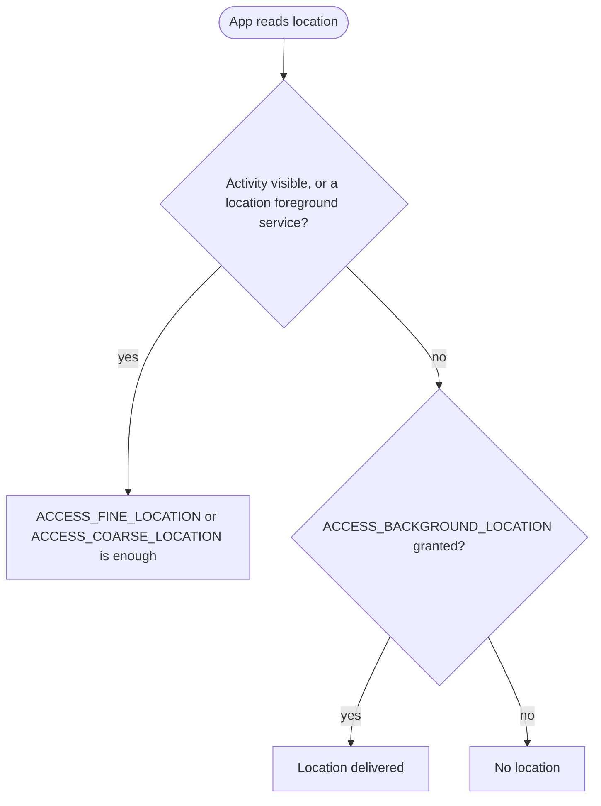

Android 10 is the release where Android stopped naming versions after
desserts. For developers it is the privacy release: apps targeting API 29 see
only their own files on shared storage, background location became a
permission of its own, and apps lost IMEI and serial number. Users got gesture
navigation and a system-wide dark theme.

 · Trademark of Google LLC')

## At a glance

|                                 |                                                                            |
| ------------------------------- | -------------------------------------------------------------------------- |
| Version                         | Android 10                                                                 |
| API level                       | 29                                                                         |
| Name                            | Quince Tart, internal only. Public name: Android 10                        |
| `Build.VERSION_CODES`           | `Q`                                                                        |
| Final SDK                       | 5 June 2019 (Beta 4, final API 29)                                         |
| Release                         | Pixel rollout and AOSP source, 3 September 2019                            |
| Launch devices                  | Pixel 4 and Pixel 4 XL, announced 15 October 2019                          |
| Google Play target-API deadline | New apps from 3 August 2020, updates to existing apps from 2 November 2020 |

Google published the final API 29 SDK with Beta 4 on 5 June 2019 and opened
Play to apps targeting API 29 the same day. On 3 September it released the
source to AOSP and started the rollout to the Pixel, Pixel 2, Pixel 3 and
Pixel 3a. Android Police reported the rollout the same day. The Pixel 4 was
the first Google phone to ship with Android 10.

## What it brought

- **Gesture navigation.** A fully gestural mode replaces the navigation bar:
  swipe up for Home, swipe in from either side for Back. Apps should draw
  edge to edge and handle insets. The three-button bar stays available.
- **Dark theme.** A system-wide dark theme, turned on in Settings or by Battery
  Saver. Apps can ship their own dark theme, or opt in to Force Dark with
  `android:forceDarkAllowed="true"` and let the system darken a light theme.
- **Foldables.** All visible activities in multi-window are resumed, and only
  the "topmost resumed" one has focus (`onTopResumedActivityChanged()`).
  `android:minAspectRatio` is new, and `resizeableActivity` changed meaning.
- **Settings panels.** `Settings.Panel` actions show connectivity, Wi-Fi, NFC
  or volume settings as a floating panel over the app.
- **Sharing Shortcuts.** Apps publish share targets in advance through
  `ShortcutInfo`, so the share sheet loads at once. They replace the Direct
  Share APIs, which still work at a lower priority.
- **Smart Reply in notifications.** The system suggests replies and actions
  with on-device ML. Apps opt out with `setAllowGeneratedReplies()` and
  `setAllowSystemGeneratedContextualActions()`.
- **Live Caption.** Captions any media playing on the phone, with speech models
  that run on the device. It was not part of the 3 September release:
  Google said it was "coming to Pixel devices this fall".
- **Bubbles.** A notification can float as a bubble through `setBubbleMetadata()`.
  In Android 10 it was an experiment behind a developer option.
- **Media and connectivity.** AV1, Opus encoding and HDR10+, audio playback
  capture, a native MIDI API, Dynamic Depth photos, 5G support, the
  `WifiNetworkSpecifier` and `WifiNetworkSuggestion` APIs, Wi-Fi Easy Connect,
  and `DnsResolver` for `SRV` and other records.
- **Smaller additions.** A thermal API in `PowerManager`, Neural Networks API
  1.2, generational garbage collection in ART, `foregroundServiceType`, and
  Vulkan 1.1 as a requirement on 64-bit devices.

## Security and privacy

- **Mainline.** Android 10 is the first release that updates system
  components through Google Play ("Google Play system updates"). The first
  modules include ART, Conscrypt, the DNS resolver, DocumentsUI, Media,
  Networking, PermissionController and time zone data. Some use the new APEX
  format, and a module set installs or rolls back as one unit.
- **Encryption for every new device.** The Android 10 CDD requires devices
  that launch with it to encrypt user data with file-based encryption, on by
  default after setup. Devices without AES instructions may use Adiantum,
  the new encryption mode Android 10 added.
- **TLS 1.3 by default.** Its cipher suites cannot be disabled, and 0-RTT is
  not supported. Certificates signed with SHA-1 are no longer trusted, and
  six SHA-2 CBC cipher suites were removed.
- **Non-resettable identifiers.** IMEI, serial number and similar IDs need
  `READ_PRIVILEGED_PHONE_STATE`, which Play apps cannot hold. What to do is under "What changed for your
  app".
- **MAC address randomization.** Devices send a randomized MAC address to
  Wi-Fi networks by default. Device owner apps can still read the factory
  address with `getWifiMacAddress()`.
- **Background activity starts.** An app in the background can no longer bring
  an activity to the front on its own. It should post a notification instead.
- **Hardening.** System binaries map their code execute-only, so reading it
  crashes with `SIGSEGV`. Media codecs gained bounds and integer-overflow
  sanitizers, and the Scudo allocator and ShadowCallStack arrived. Smart Lock
  can only extend an unlock, never unlock a locked phone, and for at most four
  hours.
- **Smaller changes.** WPA3 and Wi-Fi Enhanced Open, face authentication in
  `BiometricPrompt`, no clipboard access for apps without focus, and no
  `/proc/net` access.

## Permissions

Location now has three answers: all the time, only while the app is in use, or
deny. "In use" means an activity is visible or a foreground service of type
`location` is running.

- **Added: `ACCESS_BACKGROUND_LOCATION`.** Apps targeting API 29 declare it to
  read location in the background, and to use geofences. For apps targeting
  API 28 or lower, the system adds it whenever they declare or request a
  foreground location permission.
- **Added: `ACTIVITY_RECOGNITION`.** A runtime permission for step counting and
  activity detection, needed by the step counter and step detector sensors.
- **Added: `USE_FULL_SCREEN_INTENT`.** A normal permission, granted at install,
  that apps targeting API 29 need for full-screen notification intents.
- **Fine location for scans.** Apps targeting API 29 need
  `ACCESS_FINE_LOCATION` for Wi-Fi, Wi-Fi Aware, Bluetooth and cell scanning
  APIs. Coarse location is no longer enough.
- **Signature only.** `READ_FRAME_BUFFER`, `CAPTURE_VIDEO_OUTPUT` and
  `CAPTURE_SECURE_VIDEO_OUTPUT` became signature permissions. Screen capture
  goes through `MediaProjection`, which asks the user.
- **Old apps.** Apps targeting API 22 or lower show a permissions review screen
  the first time they run on Android 10.
- **Camera metadata.** Device-specific fields from `getCameraCharacteristics()`
  require `CAMERA`.

## What changed for your app

### All apps on Android 10

| Change                                                        | What to do                                                                                                                      |
| ------------------------------------------------------------- | ------------------------------------------------------------------------------------------------------------------------------- |
| Background activity starts are blocked                        | Use a notification, or a full-screen intent for urgent events such as calls and alarms                                          |
| Users can enable gesture navigation                           | Go edge to edge. Keep swipeable UI away from the edges, or exclude up to 200dp per edge with `setSystemGestureExclusionRects()` |
| Background location is a separate grant                       | Check the permission before every access. Users can downgrade an app to "while in use"                                          |
| IMEI, serial and similar IDs are restricted                   | Use resettable IDs, such as the advertising ID, for analytics and ads                                                           |
| TLS 1.3 is on and SHA-1 certificates fail                     | Test your servers. Use `SSLContext.getInstance("TLSv1.2")` only if you must turn 1.3 off                                        |
| Bionic libraries moved to `/apex`, behind symlinks            | If you check library paths in `/proc/self/maps`, accept `/apex/...`                                                             |
| `setSSLSocketFactory(null)` throws `IllegalArgumentException` | Pass the default factory explicitly                                                                                             |
| `android.preference` is deprecated                            | Move to the AndroidX preference library                                                                                         |
| Android Beam is deprecated                                    | Use another way to share between devices. Other NFC APIs keep working                                                           |

### Apps targeting API 29

| Change                                             | What to do                                                                                                          |
| -------------------------------------------------- | ------------------------------------------------------------------------------------------------------------------- |
| Scoped storage by default                          | Keep your files in `getExternalFilesDir()`, use `MediaStore` for shared media and the system picker for other files |
| `ACCESS_BACKGROUND_LOCATION` required              | Declare it, and request it only for a feature that really needs it                                                  |
| Non-resettable IDs throw `SecurityException`       | Remove `getImei()`, `getDeviceId()`, `Build.getSerial()` and similar calls                                          |
| Fine location needed for Wi-Fi and Bluetooth scans | Request `ACCESS_FINE_LOCATION`                                                                                      |
| `setWifiEnabled()` returns `false`                 | Open the Wi-Fi settings panel instead                                                                               |
| Full-screen intents need `USE_FULL_SCREEN_INTENT`  | Declare it in the manifest                                                                                          |
| No `execve()` on files in the app's home directory | Ship native code inside the APK                                                                                     |
| No direct `/dev/ashmem`                            | Use `ASharedMemory` from the NDK                                                                                    |
| Text relocations are blocked by SELinux            | Rebuild native libraries without them                                                                               |

Scoped storage had an escape hatch. An app targeting API 29 can set
`android:requestLegacyExternalStorage="true"` and keep the old storage model on
Android 10. Its default is `false` for apps targeting API 29 and `true` below.

## What lasted

- **Scoped storage** became mandatory. Once an app targets Android 11, the
  system ignores `requestLegacyExternalStorage`.
- **Background location** got stricter in Android 11: users enable it with
  "Allow all the time" on a settings page, not in the first dialog.
- **Bubbles** left the developer options in Android 11 and became the
  platform's way to show conversations.
- **Mainline** grew with each release. Google ended Mainline support for
  Android 11 and lower in the fourth quarter of 2025.
- **Version numbers** stayed. Every release since Android 10 is named by its
  number. The dessert stayed an internal codename, though from Android 13 it
  appears in the SDK constant (`TIRAMISU`).

## Worth knowing

- **Why the desserts went.** On 22 August 2019 Sameer Samat wrote that the
  names "weren't always understood by everyone in the global community". In
  some languages L and R sound the same, so "Lollipop" did not obviously come
  after KitKat, and pies and marshmallows are not desserts everywhere.
- **The logo changed too.** The same post moved the wordmark from green to
  black, because the green "was hard to read, especially for people with
  visual impairments". The robot kept only its head, beside the word.

 · Trademark of Google LLC')

- **Quince Tart.** In an August 2019 interview, Dave Burke and Dan Sandler
  confirmed that the team calls Android 10 "Quince Tart" internally. Burke
  said the public name would have been "Queen Cake".
- **The `Q` constant** carries a quote in AOSP: "Why? Why, to give you a taste
  of your future, a preview of things to come. Con permiso, Capitan. The hall
  is rented, the orchestra engaged. It's now time to see if you can dance."
- **The Easter egg.** On the Android 10 logo screen, you drag the 1 over the 0
  and turn it to about 315 degrees, where it snaps in place. Do it seven times
  and **Icon Quiz** opens, which AOSP describes as "a nonogram-style icon
  puzzle". Its puzzles are system icons.
