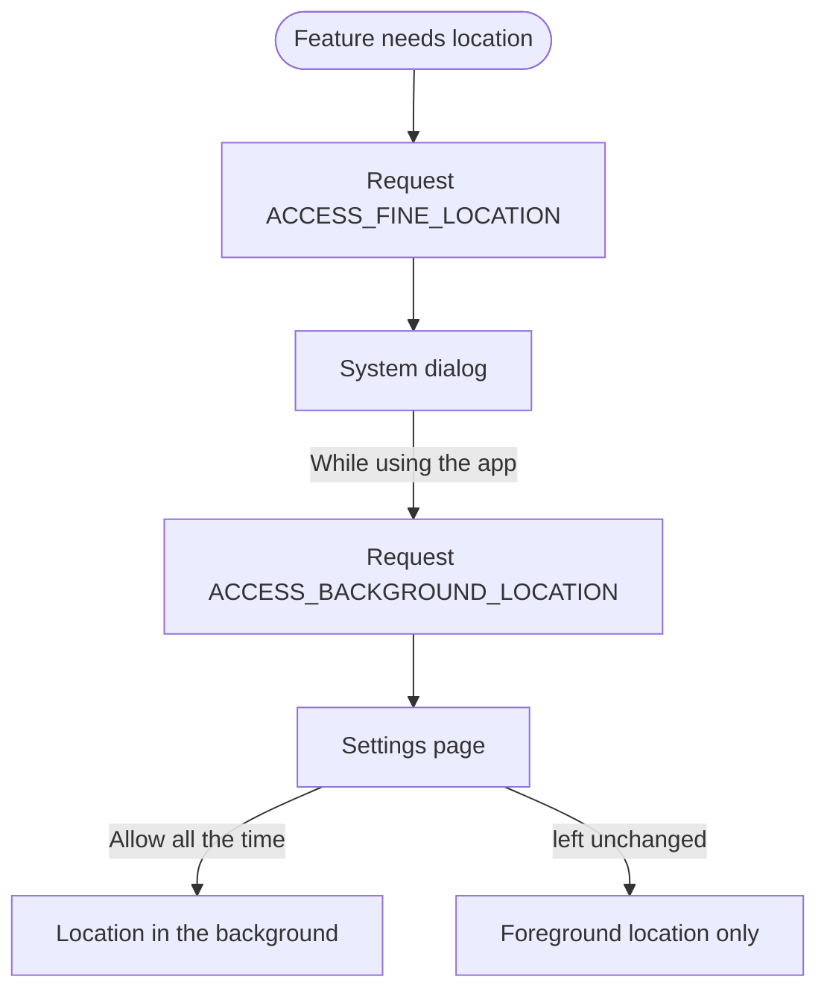

Android 11 is the release where a permission could last for one session. Camera,
microphone and location requests gained "Only this time", and apps nobody opened
for months lost their grants. For developers it closed the scoped storage
opt-out and hid the list of installed apps from apps targeting API 30.

## At a glance

|                                 |                                                                                                |
| ------------------------------- | ---------------------------------------------------------------------------------------------- |
| Version                         | Android 11                                                                                     |
| API level                       | 30                                                                                             |
| Name                            | Red Velvet Cake, internal only. Public name: Android 11                                        |
| `Build.VERSION_CODES`           | `R`                                                                                            |
| Release                         | Pixel rollout began 8 September 2020                                                           |
| Launch devices                  | vivo V20, on sale 30 September 2020; Google's Pixel 5 and Pixel 4a (5G) announced the same day |
| Google Play target-API deadline | New apps from August 2021, updates to existing apps from November 2021                         |
| Toolchain                       | `compileSdkVersion 30`, Android Gradle Plugin 4.1 or a patched older release (below)           |

Google's Android 11 SDK page recommends Android Studio 4.2 or higher and says
3.3 and higher can compile, with possible Gradle sync failures. Older Android
Gradle Plugin versions fail to merge the new `<queries>` element, so Google
shipped 3.3.3, 3.4.3, 3.5.4, 3.6.4 and 4.0.1 with support for it; 4.1 needs no
patch. Google's minimum-versions table for AGP starts at API 33.

Google released Android 11 and pushed its source to AOSP on 8 September 2020,
starting with the Pixel 2, 3, 3a, 4 and 4a: every Pixel except the 2016
originals, as Android Police noted. Google's announcement also named
OnePlus, Xiaomi, OPPO and realme phones. The first phones sold with Android 11
were vivo's V20, which went on sale in Southeast Asia on 30 September. Google
announced its own, the Pixel 5 and Pixel 4a (5G), the same day.

The road there was a month longer than planned. The first developer preview
came out on 19 February 2020. In May, Google added a fourth preview and moved
Beta 1 and every later milestone back about a month. It then postponed the 3
June beta event "to allow people to focus on important discussions around
racial justice", and released Beta 1 on 10 June without one. Each preview and beta has its own
part below this overview.

Dave Burke, Android's VP of engineering, told the All About Android podcast in
July 2020 that his team called the release "RVC", for Red Velvet Cake. He said
the name would not appear outside Google. The SDK constant is just `R`, and
build IDs start with R (`RP1A.200720.009` was the first Pixel build).

## What it brought

- **Conversations.** Messaging notifications get their own section at the top
  of the shade. Users can mark a conversation as priority, per contact rather
  than per app.
- **Bubbles.** Floating chat windows, experimental behind a developer option in
  Android 10, are open to all apps. An app targeting API 30 only gets bubbles
  for notifications linked to a shortcut.
- **Device controls.** A long press on the power button shows controls for
  smart home devices. Apps add theirs with `ControlsProviderService`.
- **Media controls.** Players move into Quick Settings, in a swipeable carousel
  that can resume recent sessions, with an output switcher for speakers and
  headphones.
- **Screen recording.** A built-in recorder in Quick Settings, with audio from
  the microphone, the device or both. Engadget's reviewer was most pleased
  with it, because it replaced a third-party recorder.
- **Wireless debugging.** `adb` connects over Wi-Fi without a USB cable, after
  pairing with a code (`adb pair ipaddr:port`) or a QR code from Android Studio.
- **5G APIs.** Apps can tell when the user is on 5G
  (`TelephonyDisplayInfo`), whether the connection is temporarily unmetered
  (`NET_CAPABILITY_TEMPORARILY_NOT_METERED`), and its estimated bandwidth. The
  emulator gained a 5G network setting in version 30.0.22.
- **Developer tools.** Data access auditing (see below), app exit reasons
  (`ApplicationExitInfo`), per-change compatibility toggles, `adb install
--incremental` for large APKs, and more Kotlin nullability annotations.
- **Smaller additions.** Synchronized keyboard animations
  (`WindowInsetsAnimation.Callback`), waterfall and hinge-angle APIs, NNAPI 1.3,
  low-latency decoding in `MediaCodec`, an NDK image decoder, and wireless
  Android Auto on compatible cars.
- **More APIs.** An NDK Thermal API reports when the device is heating up, so a
  game can cut its load before the CPU throttles. A `CallScreeningService` can
  read the STIR/SHAKEN verification status of an incoming call.
  `ImageDecoder.decodeDrawable()` returns an `AnimatedImageDrawable` for an HEIF
  file with several frames, such as a burst photo.
- **Small things users noticed.** A notification history, off by default, keeps
  "Recently dismissed" notifications that still open their app, and those from
  the "Last 24 hours". Apps can be pinned to the top of the share sheet. Dark
  theme can follow a schedule or sunset. A Wi-Fi network can be saved with
  "Auto-connect" off.

## Security and privacy

- **Data access auditing.** An app registers
  `AppOpsManager.OnOpNotedCallback` and is told each time its own code, or a
  library inside it, touches private data. Attribution tags name the part of the
  app that made the call.
- **Scudo.** Native heap allocations use the Scudo hardened allocator, except on
  low-memory devices. Crashes it catches show up as `Scudo ERROR:`.
- **fdsan aborts.** The file descriptor sanitizer added in Android 10 now stops
  the process on a double close or use after close, instead of logging.
- **Heap pointer tagging.** For apps targeting 30, heap pointers carry a tag
  in their top byte, to prepare for Arm's Memory Tagging Extension. What to
  check is in [the targeting table](#apps-targeting-api-30).
- **Mainline.** Google more than doubled the number of system modules it can
  update through Google Play system updates, with 12 new ones.
- **Hardened identifiers.** `getIccId()` returns an empty string. App usage
  stats move to credential-encrypted storage and stay unreadable until the user
  unlocks the device.
- **Platform.** The Generic Kernel Image (GKI) moves SoC support out of the core
  kernel into modules. Virtual A/B brings seamless updates with less storage.
  GWP-ASan runs in system apps to catch heap bugs.
- **Resume-on-Reboot.** After a reboot to install an OTA update, the device
  can unlock credential-encrypted storage for every app, including apps without
  Direct Boot support, so notifications arrive before the user enters the PIN.
  Devices need the `android.hardware.reboot_escrow` feature for it.

## Permissions

Android 11 added two permissions an app can declare, `MANAGE_EXTERNAL_STORAGE`
and `QUERY_ALL_PACKAGES`, and changed how others are granted or what they
cover:

| Permission                      | What changed in API 30                                                                               | What to declare                                                                     | What to remove or limit                                                  |
| ------------------------------- | ---------------------------------------------------------------------------------------------------- | ----------------------------------------------------------------------------------- | ------------------------------------------------------------------------ |
| Camera, microphone and location | The dialog adds "Only this time"; the grant ends soon after the app leaves the foreground            | Nothing new                                                                         | Nothing                                                                  |
| Any runtime permission          | Two "Deny" taps mean don't ask again; apps targeting 30 lose their grants when unused for months     | Nothing new; check the permission before every access                               | Nothing                                                                  |
| `ACCESS_BACKGROUND_LOCATION`    | Apps targeting 30 request it alone, after foreground location; the user grants it in Settings        | Request it only after `ACCESS_FINE_LOCATION` or `ACCESS_COARSE_LOCATION` is granted | Remove it if no feature needs location in the background                 |
| `READ_PHONE_NUMBERS`            | Required instead of `READ_PHONE_STATE` for `getLine1Number()` and `getMsisdn()` in apps targeting 30 | Declare it if you read the phone number                                             | Nothing                                                                  |
| `READ_PHONE_STATE`              | No longer covers the phone number methods for apps targeting 30                                      | Keep it for other telephony methods                                                 | `android:maxSdkVersion="29"` if you used it only for the number          |
| `READ_EXTERNAL_STORAGE`         | Its group is renamed "Files & Media"; under scoped storage the dialog asks for photos and media      | Keep it to read other apps' media                                                   | Nothing here; Android 13 caps it                                         |
| `WRITE_EXTERNAL_STORAGE`        | Grants no extra access to apps targeting 30                                                          | Keep it only for Android 10 and earlier                                             | `android:maxSdkVersion="29"`                                             |
| `MANAGE_EXTERNAL_STORAGE`       | New "All files access", which the user turns on in Settings                                          | Only if managing files is the app's core function; Google Play reviews it           | Never as a way around scoped storage                                     |
| `QUERY_ALL_PACKAGES`            | New; returns every installed app to apps targeting 30                                                | Prefer `<queries>`; declare it only if the core function needs every app            | `tools:node="remove"` on a copy an SDK merges in; Google Play reviews it |
| `SYSTEM_ALERT_WINDOW`           | The settings intent ignores your package; call screening and screen-capturing apps get it on request | Keep requesting it; tell the user to find your app in the list                      | Nothing                                                                  |
| `WRITE_APN_SETTINGS`            | Privileged; apps targeting 30 need it to read the APN database                                       | Only system apps can hold it                                                        | Stop reading the APN database                                            |

One manifest for an app that runs on Android 10 and earlier and on 11 and
later. Keep only the blocks your app needs:

```xml
<manifest xmlns:android="http://schemas.android.com/apk/res/android"
    xmlns:tools="http://schemas.android.com/tools">

    <!-- Phone number: READ_PHONE_STATE up to API 29, READ_PHONE_NUMBERS from 30.
         Drop maxSdkVersion if you call other telephony methods. -->
    <uses-permission
        android:name="android.permission.READ_PHONE_STATE"
        android:maxSdkVersion="29" />
    <uses-permission android:name="android.permission.READ_PHONE_NUMBERS" />

    <!-- Storage: writing grants nothing extra from API 30 -->
    <uses-permission android:name="android.permission.READ_EXTERNAL_STORAGE" />
    <uses-permission
        android:name="android.permission.WRITE_EXTERNAL_STORAGE"
        android:maxSdkVersion="29" />

    <!-- Location: background is requested separately -->
    <uses-permission android:name="android.permission.ACCESS_FINE_LOCATION" />
    <uses-permission android:name="android.permission.ACCESS_BACKGROUND_LOCATION" />

    <!-- Package visibility: name what you talk to, block a merged full list -->
    <uses-permission
        android:name="android.permission.QUERY_ALL_PACKAGES"
        tools:node="remove" />
    <queries>
        <intent>
            <action android:name="android.intent.action.TTS_SERVICE" />
        </intent>
    </queries>

    <!-- The legacy storage flag still applies on Android 10 only -->
    <application android:requestLegacyExternalStorage="true">
        <service
            android:name=".CallService"
            android:foregroundServiceType="camera|microphone" />
    </application>
</manifest>
```

Google's storage page recommends keeping `requestLegacyExternalStorage` set
for Android 10 devices; Android 11 ignores it for apps targeting 30.

Three changes reach every app, whatever it targets:

- **One-time permissions.** The camera, microphone and location dialogs offer
  "While using the app", "Only this time" and "Deny". A one-time grant lasts
  while the activity is visible and a short while after the app goes to the
  background, or until a foreground service started from the visible activity
  stops.
- **Two denials mean no.** If the user taps "Deny" twice for the same
  permission, the dialog stops appearing. `adb shell dumpsys package <package>`
  shows it as `USER_FIXED`.
- **"Files & Media".** The Storage permission group is renamed. An app using
  scoped storage that asks for `READ_EXTERNAL_STORAGE` gets a dialog about
  photos and media.


For apps that target API 30, permission auto-reset, the two-step background
location request and the phone number permission are rows in
[the targeting table](#apps-targeting-api-30). The per-app switch for
auto-reset is "Remove permissions if app isn't used" in App info >
Permissions.



The system owns both dashed steps. The dialog for background location has no
button to grant it; the user must pick "Allow all the time" on the settings
page.

The overlay permission also changed. `ACTION_MANAGE_OVERLAY_PERMISSION` always
opens the top-level settings list and ignores the package in the intent. Call
screening apps and apps capturing the screen get `SYSTEM_ALERT_WINDOW` on
request.

## What changed for your app

### All apps on Android 11

| Change                                                                                                             | What to do                                                                              | How to check                                                                                                                                         |
| ------------------------------------------------------------------------------------------------------------------ | --------------------------------------------------------------------------------------- | ---------------------------------------------------------------------------------------------------------------------------------------------------- |
| One-time permissions and the two-denial rule                                                                       | Check the permission before every access; expect a denial without a dialog              | `adb shell dumpsys package <package>` shows `USER_FIXED`; `adb shell pm clear-permission-flags <package> <permission> user-set user-fixed` resets it |
| Foreground services started from the background lose camera and microphone, and location without background access | Start them while the app is visible                                                     |                                                                                                                                                      |
| The overlay settings intent ignores the package                                                                    | Tell the user to pick your app in the list                                              | Compat `CHANGE_RESTRICT_SAW_INTENT` (135920175), logged only                                                                                         |
| Scudo is the native allocator, and fdsan aborts                                                                    | Fix memory and file descriptor bugs in native code                                      |                                                                                                                                                      |
| `getIccId()` returns an empty string                                                                               | Use `getSubscriptionId()`                                                               |                                                                                                                                                      |
| App usage stats need an unlocked user                                                                              | Call `UsageStatsManager` after `isUserUnlocked()` returns true                          |                                                                                                                                                      |
| Sharing a content URI                                                                                              | Set `FLAG_GRANT_READ_URI_PERMISSION` or `FLAG_GRANT_WRITE_URI_PERMISSION` on the intent |                                                                                                                                                      |
| Maps v1 shared library removed                                                                                     | Move to the Maps SDK for Android and drop its `<uses-library>`                          |                                                                                                                                                      |
| Apps cannot read other apps' folders under `Android/data`                                                          | Share files through a `FileProvider` or the Storage Access Framework                    |                                                                                                                                                      |

### Apps targeting API 30

| Change                                                                                                                     | What to do                                                                                                  | How to check                                                                                                                   |
| -------------------------------------------------------------------------------------------------------------------------- | ----------------------------------------------------------------------------------------------------------- | ------------------------------------------------------------------------------------------------------------------------------ |
| Scoped storage is enforced; `requestLegacyExternalStorage` is ignored                                                      | Use `MediaStore` and the Storage Access Framework; migrate legacy files before you raise `targetSdkVersion` | Lint `ScopedStorage`; compat `DEFAULT_SCOPED_STORAGE` (149924527) and `FORCE_ENABLE_SCOPED_STORAGE` (132649864)                |
| `WRITE_EXTERNAL_STORAGE` grants nothing extra                                                                              | Write to your own directories or to `MediaStore` collections                                                | Lint `ScopedStorage`                                                                                                           |
| Storage Access Framework pickers refuse storage roots, the Download folder as a tree, and `Android/data` and `Android/obb` | Do not ask the user to pick those locations                                                                 | Compat `RESTRICT_STORAGE_ACCESS_FRAMEWORK` (141600225)                                                                         |
| Other apps' private data directories are closed, even world-readable ones                                                  | Share through a `ContentProvider` or `FileProvider`                                                         | Compat `APP_DATA_DIRECTORY_ISOLATION` (143937733)                                                                              |
| Installed apps are filtered from `getInstalledApplications()` and similar calls                                            | Declare the apps or intents you need in `<queries>`, including TTS and speech recognition                   | Lint `QueryPermissionsNeeded`; compat `FILTER_APPLICATION_QUERY` (135549675); `adb shell pm log-visibility --enable <package>` |
| Unused apps lose their runtime permissions                                                                                 | Check permissions when a feature runs, not once at launch                                                   | The `adb` steps on Google's app hibernation page                                                                               |
| Foreground and background location in one request are ignored                                                              | Ask for background location alone, then send the user to Settings                                           | Compat `BACKGROUND_RATIONALE_CHANGE_ID` (147316723)                                                                            |
| `getLine1Number()` needs `READ_PHONE_NUMBERS`                                                                              | Declare it; cap `READ_PHONE_STATE` if the number was its only use                                           |                                                                                                                                |
| Camera or microphone in a foreground service                                                                               | Add `camera` or `microphone` to `android:foregroundServiceType`                                             | Compat `CAMERA_MICROPHONE_CAPABILITY_CHANGE_ID` (136219221)                                                                    |
| Custom toasts from the background are blocked                                                                              | Use a text toast or a notification; `Toast.addCallback()` reports show and hide                             | Compat `CHANGE_BACKGROUND_CUSTOM_TOAST_BLOCK` (128611929); logcat shows "Blocking custom toast"                                |
| Text toasts are drawn by the system; `setGravity()` and `setMargin()` do nothing                                           | Do not position text toasts                                                                                 | Compat `CHANGE_TEXT_TOASTS_IN_THE_SYSTEM` (147798919)                                                                          |
| Heap pointers carry a tag in the top byte                                                                                  | Fix native code that changes pointer bits                                                                   | Compat `NATIVE_HEAP_POINTER_TAGGING` (135754954)                                                                               |
| APKs signed only with v1 cannot be installed                                                                               | Sign with APK Signature Scheme v2 or higher, and keep v1 for older devices                                  | Android Studio or `apksigner`                                                                                                  |
| A compressed or unaligned `resources.arsc` blocks install                                                                  | Store it uncompressed and 4-byte aligned                                                                    | Compat `RESOURCES_ARSC_COMPRESSED` (132742131)                                                                                 |
| Implicit `IMAGE_CAPTURE` and `VIDEO_CAPTURE` intents go to the system camera only                                          | Name the package to use a third-party camera                                                                |                                                                                                                                |
| Firebase JobDispatcher and `GcmNetworkManager` stop on Android 6.0+                                                        | Move to WorkManager                                                                                         |                                                                                                                                |
| `Editor.clear()` calls `onSharedPreferenceChanged()` with a null key                                                       | Handle a null key in the listener                                                                           | Compat `CALLBACK_ON_CLEAR_CHANGE` (119147584)                                                                                  |
| The accessibility button flag set at runtime is ignored                                                                    | Declare `flagRequestAccessibilityButton` in the service's metadata file                                     | Compat `REQUEST_ACCESSIBILITY_BUTTON_CHANGE` (136293963)                                                                       |
| Reading the APN database needs `WRITE_APN_SETTINGS`                                                                        | Stop reading it; only privileged apps hold that permission                                                  | Compat `APN_READING_PERMISSION_CHANGE_ID` (124107808)                                                                          |
| Non-SDK interfaces on the max-target-q list are blocked                                                                    | Move to public APIs                                                                                         | Compat `HIDE_MAXTARGETSDK_Q_HIDDEN_APIS` (149994052)                                                                           |

Google's compat list marks `DEFAULT_SCOPED_STORAGE` "Enabled for all apps",
while its storage page ties enforcement to the app's target. Turning scoped
storage off for a test needs both scoped storage changes disabled. The list
also holds device admin, telephony and manifest checks that few apps meet.

Scoped storage itself arrived in [Android 10](/notes/android-10/), where an app
could still opt out. From API 30 there is no opt-out, but Android 11 brought
back direct file paths (`File`, `fopen()`) for media an app can already reach,
and added batch edits for media files.

Apps whose core job needs every file, such as file managers, antivirus and
backup apps, can declare `MANAGE_EXTERNAL_STORAGE`. The user enables "Allow
access to manage all files" on a settings page the app opens with
`ACTION_MANAGE_ALL_FILES_ACCESS_PERMISSION`, and `isExternalStorageManager()`
reports the result. Even then, other apps' folders under `Android/data` stay
closed.

Package visibility works the same way. An app that talks to a text-to-speech
engine or a speech recognition service, for example, must declare that intent
in `<queries>`. For the rare app that needs the full list, `QUERY_ALL_PACKAGES`
exists, and lint `QueryAllPackagesPermission` flags it. Google Play reviews
both permissions: All files access from May 2021, and `QUERY_ALL_PACKAGES`
through its Permissions Declaration Form.

## Migrating to API 30

From `targetSdk 29` to 30, in this order:

1. **Update the toolchain.** Set `compileSdkVersion 30` and use AGP 4.1, or
   the patched 3.3.3 to 4.0.1 releases. Skipped, a library that declares
   `<queries>` breaks the manifest merge with "unexpected element `<queries>`".
   Verify: the project builds and the merged manifest shows your queries.
2. **Move files before you raise the target.** Copy data out of shared-storage
   paths into app-specific directories or `MediaStore`, and cap
   `WRITE_EXTERNAL_STORAGE` at `maxSdkVersion="29"`. Skipped, files your app
   wrote under the legacy model become unreachable. Verify: lint
   `ScopedStorage`, then run the app with `DEFAULT_SCOPED_STORAGE` and
   `FORCE_ENABLE_SCOPED_STORAGE` enabled.
3. **Declare package visibility.** List the packages and intents you query or
   start in `<queries>`. Skipped, `PackageManager` calls act as if those apps
   were not installed. Verify: lint `QueryPermissionsNeeded`, then
   `adb shell pm log-visibility --enable <package>` and watch `AppsFilter` in
   logcat.
4. **Split location requests.** Ask for foreground location, then for
   `ACCESS_BACKGROUND_LOCATION` alone, then send the user to Settings.
   Skipped, a combined request grants neither. Verify: run each location flow
   on Android 11.
5. **Type your foreground services.** Add `camera` or `microphone` to
   `android:foregroundServiceType`. Skipped, the service loses camera or
   microphone access. Verify: the feature works with the app in the
   background, or toggle `CAMERA_MICROPHONE_CAPABILITY_CHANGE_ID`.
6. **Fix the phone number permission.** Request `READ_PHONE_NUMBERS` for
   `getLine1Number()`. Skipped, `READ_PHONE_STATE` alone stops covering it.
7. **Check packaging.** Sign with APK Signature Scheme v2 or higher and leave
   `resources.arsc` uncompressed and aligned. Skipped, Android 11 refuses to
   install the app. Verify: install the release build on an Android 11 device.
8. **Go through the smaller rows** of the targeting table that apply to you:
   toasts, camera intents, JobDispatcher, shared preferences, the
   accessibility button, APN access and non-SDK interfaces.
9. **Test the result** on an Android 11 device or emulator with
   `targetSdk 30`. To isolate one change, toggle it on a debuggable build in
   Developer options > "App Compatibility Changes", or with
   `adb shell am compat disable <change ID> <package>`. To see a permission
   dialog again after two denials, clear its flags with
   `adb shell pm clear-permission-flags`.

Skipping several levels at once: do each version's steps in order, starting
from [Android 10](/notes/android-10/) if you target 28 or lower.

## What lasted

- **Auto-reset grew into hibernation.** From Android 12, an unused app also
  loses its jobs, push messages and cache. From December 2021 Google Play
  services brought the permission reset to Android 6.0 to 10.
- **Package visibility** and `<queries>` are still the rule, and Play still
  limits `QUERY_ALL_PACKAGES` to apps whose core function needs it.
- **Storage** kept narrowing. Android 13 replaced `READ_EXTERNAL_STORAGE` with
  `READ_MEDIA_IMAGES`, `READ_MEDIA_VIDEO` and `READ_MEDIA_AUDIO`.
- **Foreground service types**, required here for camera and microphone, became
  mandatory for every foreground service in apps targeting Android 14.
- **Wireless debugging** stayed. Android 17 with adb 37.0.0 added "adb Wi-Fi
  2.0", which reconnects on its own on a trusted network.
- **One-time permissions** and the two-denial rule are unchanged.

## Worth knowing

- The Easter egg is a volume dial with 11 steps that stops at 10. Turn it to
  the top three times and it unlocks: it then reaches 11 and the next stage
  starts. The code says so: "until the dial is "unlocked", you can't turn it all
  the way to 11".
- The next stage is **Cat Controls**, the Android 7.0 cat collector moved into
  the new device controls: a water bowl that fills from 0 to 200 mL, a food
  bowl, and a toy to throw.
- Google's own launch post was titled "Turning it up to 11", and its consumer
  post listed 11 new things.
- The `R` constant in AOSP has a one-word comment, `R.`, right below a
  three-line quotation on Android 10's `Q`.


