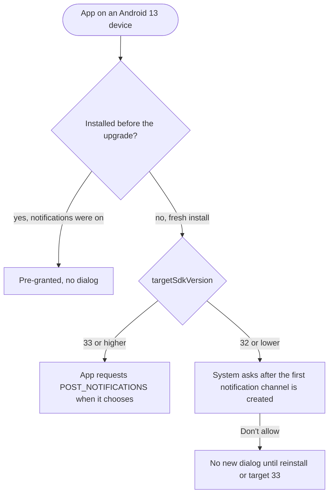

Android 13 is the release where an app had to ask before it could send a
notification. It also split the storage permission into images, video and
audio, and shipped a photo picker that needs no permission. For developers the
rest was a short list: per-app languages, themed icons, and stricter intent
delivery.

## At a glance

|                                 |                                                                    |
| ------------------------------- | ------------------------------------------------------------------ |
| Version                         | Android 13                                                         |
| API level                       | 33                                                                 |
| Name                            | Tiramisu, internal, but visible in the SDK constant                |
| `Build.VERSION_CODES`           | `TIRAMISU`                                                         |
| Release                         | Source in AOSP and Pixel rollout from 15 August 2022               |
| Launch devices                  | Pixel 7 and Pixel 7 Pro, announced 6 October 2022                  |
| Google Play target-API deadline | New apps and app updates from 31 August 2023 (extensions to 1 Nov) |

Google pushed Android 13 to AOSP and began the Pixel rollout on 15 August 2022.
Its announcement named Samsung, Asus, HMD, Motorola, OnePlus, OPPO, Sony,
Xiaomi and others for later that year. Google's first phones sold with it were
the Pixel 7 and Pixel 7 Pro, announced on 6 October and in US stores from
13 October.

The public name is just Android 13. Tiramisu is the internal dessert name, and
from this release it is no longer hidden: the constant is `TIRAMISU`, not a
single letter, and Android Studio's SDK Manager lists the platform as
"Android 13.0 ("Tiramisu")". Build IDs start with T (`TP1A`).

Google announced Android 13 with Developer Preview 1 on 10 February 2022.
Beta 1 followed on 26 April, and Beta 3 reached platform stability on 8 June,
freezing the API 33 SDK and app-facing behaviour. The two developer previews
and four betas are the parts below this overview.

## What it brought

- **Per-app languages.** Users pick a language per app in "App languages",
  while the system stays in another. An app declares
  `android:localeConfig` to appear there and can set the language itself with
  `LocaleManager.setApplicationLocales()`. AppCompat 1.6 backports the API.
- **Themed app icons.** An app that adds a monochrome layer to its adaptive
  icon gets tinted to match the wallpaper, when the user turns on "Themed
  icons" and the launcher supports it. Ars Technica noted that the feature was
  still in beta at launch.
- **Clipboard preview.** Copying shows a small confirmation with a preview of
  the content, like a screenshot thumbnail; tapping it opens an editor.
- **Foreground Services Task Manager.** The bottom of Quick Settings shows how
  many apps run a foreground service, with a "Stop" button for each.
- **Quick Settings placement API.** An app can ask the user, in one system
  dialog, to add its custom tile.
- **Media controls.** For apps targeting 33, the system builds the media player
  buttons from `PlaybackState` actions instead of the notification's action
  list.
- **Audio.** Built-in Bluetooth LE Audio on compatible devices, MIDI 2.0 over
  USB, spatial audio with head tracking, and `AudioManager` APIs that tell an
  app how its audio will be routed.
- **Graphics and text.** `RuntimeShader` with AGSL, COLRv1 vector emoji, up to
  200% faster hyphenation, better line heights for non-Latin scripts, and
  phrase-based Japanese line breaks.
- **Runtime.** JNI calls up to 2.5x faster, mostly non-blocking reference
  processing, and a first set of OpenJDK 11 library APIs (`String.strip()`,
  `Optional.isEmpty()` and more), also sent to Android 12 through the ART
  module. A garbage collector built on the kernel's `userfaultfd` was not in
  the release: Google said it would reach Android 13 devices in a later
  Google Play system update.
- **Wi-Fi 7.** `ScanResult.WIFI_STANDARD_11BE`, new in API 33, lets an app
  tell 802.11be access points apart in scan results. Whether a phone connects
  over Wi-Fi 7 depends on its hardware.
- **Predictive back.** New APIs let an app say ahead of time that it handles
  back, so the system can preview the destination. In Android 13 the animation
  is only behind a developer option.
- **Tablets.** It builds on [Android 12L](/notes/android-12l/): a taskbar
  with an app drawer, and multi-window enabled for all apps on large screens.

## Security and privacy

- **Photo picker.** A system screen where the user picks specific photos or
  videos, and only those reach the app. The app declares no permission. The
  same picker reached Android 11 and 12 through a Google Play system update.
- **Clipboard auto-clear.** The clipboard is wiped a while after the last
  copy. In AOSP the default is `3600000` ms, one hour, adjustable by the
  device through `DeviceConfig`. Apps that copy passwords should set
  `ClipDescription.EXTRA_IS_SENSITIVE` so the preview hides the content.
- **Restricted settings.** An app installed from a local or downloaded file
  cannot be granted accessibility or notification listener access until the
  user opens its App info page and picks "Allow restricted settings". AOSP
  sets this on installs whose source is `PACKAGE_SOURCE_LOCAL_FILE` or
  `PACKAGE_SOURCE_DOWNLOADED_FILE`, so installs made by an app store are not
  flagged.
- **Intent matching.** An exported component of an app targeting 33 only
  receives intents from other apps that match one of its `<intent-filter>`
  elements. See below for what to change.
- **Exported receivers.** `registerReceiver()` takes `RECEIVER_EXPORTED` or
  `RECEIVER_NOT_EXPORTED`, so a runtime receiver no longer has to be open to
  every app.
- **Platform.** Device log access needs the user's approval on each request.
  The Android Virtualization Framework (pKVM) arrives as an optional feature
  for isolated workloads. APK Signature Scheme v3.1 lets key rotation target
  Android 13 and later only. Keystore and KeyMint report errors as typed
  exceptions that say whether a retry can help. Bluetooth and Ultra-wideband
  became Mainline modules, so Google can update them through Google Play
  system updates.

## Permissions

New runtime permissions in Android 13:

| Permission                                                  | Replaces or extends                                   | Granted by                              |
| ----------------------------------------------------------- | ----------------------------------------------------- | --------------------------------------- |
| `POST_NOTIFICATIONS`                                        | Notifications were on by default                      | Runtime dialog                          |
| `READ_MEDIA_IMAGES`, `READ_MEDIA_VIDEO`, `READ_MEDIA_AUDIO` | `READ_EXTERNAL_STORAGE` for other apps' media         | Runtime dialog                          |
| `NEARBY_WIFI_DEVICES`                                       | `ACCESS_FINE_LOCATION` for Wi-Fi scanning and connect | Runtime dialog (`NEARBY_DEVICES` group) |
| `BODY_SENSORS_BACKGROUND`                                   | Extends `BODY_SENSORS` to the background              | Hard-restricted; installer allowlist    |

The notification permission reaches every app, but how depends on the target:

Media sessions and apps that self-manage calls (`Notification.CallStyle`) are
exempt. Foreground services can still start without the permission, but their
notification only shows in the Task Manager.

Images and video share one dialog if requested together. An app that held
`READ_EXTERNAL_STORAGE` gets the new media permissions automatically when it
updates its target.

Two more changes:

- **Exact alarms.** `USE_EXACT_ALARM` is granted at install and cannot be
  revoked, but it is meant only for alarm clocks, timers and calendars, and a
  Google Play policy restricts it to them. Everyone else keeps `SCHEDULE_EXACT_ALARM`, which the user can
  revoke.
- **Giving permissions back.** `Context.revokeSelfPermissionsOnKill()` lets an
  app drop runtime permissions it no longer needs. It takes effect when the
  app's processes are killed, not while it is in the foreground.

## What changed for your app

### All apps on Android 13

| Change                                                                                                 | What to do                                                                       |
| ------------------------------------------------------------------------------------------------------ | -------------------------------------------------------------------------------- |
| New installs start with notifications off                                                              | Target 33 and ask for `POST_NOTIFICATIONS` in context                            |
| The clipboard shows a preview of copied content                                                        | Set `EXTRA_IS_SENSITIVE` on passwords and card numbers; drop your own copy toast |
| Users can stop a foreground service from the Task Manager                                              | Handle being stopped like a user force-stop                                      |
| Foreground service notifications can be swiped away                                                    | Do not rely on the notification staying visible                                  |
| Prefetch jobs run before the predicted next launch                                                     | Check that `setPrefetch()` work still runs when you expect                       |
| An app the user restricts for battery cannot start foreground services; its jobs and alarms do not run | Test with `adb shell cmd appops set <package> RUN_ANY_IN_BACKGROUND ignore`      |
| High-priority FCM that never shows a notification is downgraded                                        | Send normal priority when no notification follows                                |
| The Google app's speech service trampoline is gone                                                     | Use the device's default `SpeechService`, not a hard-coded package               |

### Apps targeting API 33

| Change                                                          | What to do                                                                                    |
| --------------------------------------------------------------- | --------------------------------------------------------------------------------------------- |
| You control when the notification dialog appears                | Request `POST_NOTIFICATIONS` after a user action, not at launch                               |
| `READ_EXTERNAL_STORAGE` no longer gives access to others' media | Request `READ_MEDIA_*`, or use the photo picker for images and video                          |
| Wi-Fi APIs require `NEARBY_WIFI_DEVICES`                        | Declare it with `android:usesPermissionFlags="neverForLocation"` if you never derive location |
| Intents from other apps must match your `<intent-filter>`       | Check exported components; a sender gets `ActivityNotFoundException` on no match              |
| Background body sensor access needs `BODY_SENSORS_BACKGROUND`   | Request it after `BODY_SENSORS`                                                               |
| Advertising ID is zeros without `AD_ID`                         | Declare `com.google.android.gms.permission.AD_ID` if you use it                               |
| `BluetoothAdapter.enable()` and `disable()` return false        | Send the user to Bluetooth settings                                                           |
| `WebView.setForceDark()` is a no-op                             | Let `isLightTheme` drive `prefers-color-scheme`; use `setAlgorithmicDarkeningAllowed()`       |
| No `BOOT_COMPLETED` while the user restricts your battery use   | Do not depend on it for restricted apps                                                       |

Intent matching is not enforced for components without any intent filter,
intents from inside the same app, and intents from the system or root.

## What lasted

- **Granular media access** stayed, and Android 14 narrowed it further:
  `READ_MEDIA_VISUAL_USER_SELECTED` lets the user share only some photos.
- **Exact alarms.** From Android 14, `SCHEDULE_EXACT_ALARM` is denied by
  default for most new installs of apps targeting 33 or higher, which pushes
  apps to `USE_EXACT_ALARM` or inexact alarms.
- **Exported receivers.** The flag that was optional here became mandatory for
  context-registered receivers in apps targeting Android 14.
- **Restricted settings** grew. The Android 15 CDD requires them for device
  admin, display over other apps, usage access, the dialer and SMS roles and
  SMS permissions, besides accessibility and notification listeners.
- **Predictive back** left the developer option in Android 15, for apps that
  opted in.
- The **photo picker** now also reaches Android 4.4 to 10 as a backported
  module through Google Play services.

## Worth knowing

- The Easter egg reuses Android 12's clock; its unlock setting is still called
  `egg_mode_s`. Set the hands to 1:00 and the code logs `"13:00"` before
  bubbles in Material You colours fill the screen. A long press cycles through
  14 emoji sets, from fruit to zodiac signs.
- One set never shipped. AOSP keeps it commented out with the note
  "this one is too much".
- `TIRAMISU` is the first constant spelled out as a dessert since Android
  5.1's `LOLLIPOP_MR1`; 6.0 to 12L used letters. In AOSP its comment is one
  word: "Tiramisu."
- Google first set the API 33 deadline as 1 August 2023 for new apps and
  1 November 2023 for updates. It then moved both to 31 August, "unifying the
  dates to August 31 every year".
