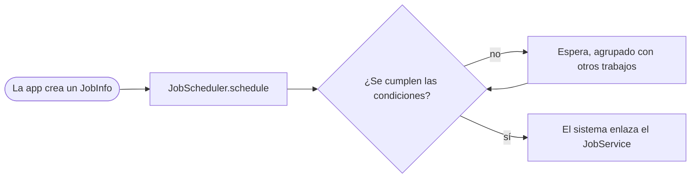

Android 5.0 Lollipop es la versión que cambió el motor y la pintura a la vez.
ART reemplazó a Dalvik como runtime de todas las apps y Material Design
rediseñó el sistema entero. Por debajo, JobScheduler empezó a agrupar el
trabajo en segundo plano, SELinux pasó a imponerse en todos los dominios y los
teléfonos ganaron varios usuarios y un modo invitado.

## De un vistazo

|                                    |                                                                                        |
| ---------------------------------- | -------------------------------------------------------------------------------------- |
| Versión                            | Android 5.0                                                                            |
| Nivel de API                       | 21                                                                                     |
| Nombre                             | Lollipop, público                                                                      |
| `Build.VERSION_CODES`              | `LOLLIPOP`                                                                             |
| Anuncio                            | 15 de octubre de 2014                                                                  |
| SDK final                          | 17 de octubre de 2014                                                                  |
| Lanzamiento                        | 3 de noviembre de 2014, en la Nexus 9. OTA a Nexus anteriores desde el 12 de noviembre |
| Dispositivos de lanzamiento        | Nexus 6 (Motorola), Nexus 9 (HTC) y Nexus Player (Asus)                                |
| Plazo de target API en Google Play | Ninguno. La regla de target API de Play empezó en 2018, con API 26                     |

Google mostró la versión por primera vez como "Android L" en Google I/O, el 25
de junio de 2014. Al día siguiente publicó la L Developer Preview para Nexus 5
y Nexus 7 (2013): era la primera vez que daba a los desarrolladores una versión
de Android antes de su lanzamiento. No tenía nivel de API, y las apps
compiladas contra ella no se podían publicar en Play.

Google anunció Lollipop junto con los tres dispositivos de lanzamiento el 15 de
octubre de 2014. Dos días después publicó el SDK final y abrió Play a las apps
con target API 21. La Nexus 9 salió a la venta con 5.0 el 3 de noviembre. Droid
Life y The Next Web informaron que la OTA para Nexus 5, Nexus 7 (Wi-Fi) y Nexus
10 empezó el 12 de noviembre; el Nexus 4 llegó después. Siguieron dos
versiones de mantenimiento con el mismo nivel de API: 5.0.1 (`LRX22C`) y 5.0.2
(`LRX22G`).

## Qué trajo

El anuncio de Google habla de "over 5,000 new APIs" (más de 5000 API nuevas).
Estas son las que definieron las apps:

- **ART por defecto.** ART compila cada app por adelantado al instalarla, con
  `dex2oat`, en lugar de la compilación just-in-time de Dalvik en cada
  ejecución. Ars Technica señala que debutó como opción en KitKat y que en
  Lollipop es el único runtime. Qué probar está en "Qué cambió para tu app".
- **Material Design.** El tema material, sombras en las vistas,
  `RecyclerView`, transiciones entre actividades, animadores según el estado de
  la vista y drawables vectoriales. Google aplicó el mismo lenguaje visual a
  sus apps en Android, iOS y la web.
- **Notificaciones en la pantalla de bloqueo.**
  `Notification.Builder.setVisibility()` acepta `VISIBILITY_PUBLIC`,
  `VISIBILITY_PRIVATE` o `VISIBILITY_SECRET`, y `setPublicVersion()` aporta una
  copia sin datos sensibles. Las notificaciones de prioridad alta con sonido o
  vibración aparecen como banners heads-up sobre la app actual.
- **Modo prioridad.** Las teclas de volumen ofrecen "All", "Priority" y "None"
  para las interrupciones, y `setCategory()` y `addPerson()` le indican al
  sistema cómo ordenar una notificación.
- **Overview.** Recent Apps pasó a llamarse "Overview", y una app puede poner
  ahí varias tareas con `FLAG_ACTIVITY_NEW_DOCUMENT` o `documentLaunchMode`.
  `ActivityManager.AppTask` las gestiona.
- **Project Volta.** `JobScheduler` (`android.app.job`) ejecuta trabajo cuando
  se cumplen sus condiciones: carga, red sin límite de datos, reposo o un plazo.
  `adb shell dumpsys batterystats` alimenta a Battery Historian. Google dijo que
  Battery saver alarga la batería "by up to 90 minutes" (hasta 90 minutos).
  Ars Technica cuenta que pinta de naranja las barras de estado y de navegación
  y que puede activarse solo al 5 o al 15 % de batería.
- **Camera2.** `android.hardware.camera2` sucede a la clase `Camera`, obsoleta
  desde API 21. Añade ráfagas, ajustes por fotograma, enfoque, ISO y exposición
  manuales, y captura RAW en los dispositivos que la soportan.
- **64 bits.** La plataforma y el NDK r10c añadieron ABIs de 64 bits. El CDD
  exige que un dispositivo con una ABI de 64 bits soporte también su
  equivalente de 32 bits.
- **Fijar pantalla y capturarla.** `Activity.startLockTask()` fija una app en
  la pantalla. `MediaProjection` permite a una app capturar la pantalla después
  de que el usuario acepte un diálogo del sistema.
- **Añadidos menores.** Varias redes a la vez
  (`ConnectivityManager.requestNetwork()`), modo periférico de Bluetooth LE
  (`BluetoothLeAdvertiser`), `MediaSession`, selección de carpetas con
  `OPEN_DOCUMENT_TREE`, `PdfRenderer`, OpenGL ES 3.1 y el Android Extension
  Pack, perfiles administrados para apps de trabajo y propietarios de
  dispositivo (device owners).

Antes de JobScheduler, cada app despertaba el dispositivo con su propio
temporizador. Ahora el sistema retiene los trabajos hasta que se cumplen sus
condiciones y los ejecuta juntos.

Ars Technica destaca que los teléfonos recibieron en esta versión los botones
de linterna y de bloqueo de rotación. El avatar abre el panel de usuarios,
donde un teléfono puede cambiar de usuario o abrir una sesión de invitado.

## Seguridad y privacidad

- **SELinux impuesto en todo.** Android 4.4 fue la primera versión con SELinux
  en modo enforcing. El CDD de 5.0 exige el modo enforcing global y dice: "No
  permissive mode domains are allowed, including domains specific to a
  device/vendor."
- **Cifrado por defecto, al final no del todo.** Google dijo que todo
  dispositivo nuevo con Lollipop vendría cifrado desde el primer arranque. El
  CDD final de 5.0 solo dice que el cifrado "SHOULD be enabled" y que se
  recomienda "very strongly". Google añadió después una actualización a su
  artículo de seguridad de Lollipop: "Due to performance issues on some Android
  partner devices, we are not yet at encryption by default on every new
  Lollipop device." Ars Technica informó del cambio el 2 de marzo de 2015. Las
  Nexus 6 y 9 venían cifradas; los dispositivos actualizados debían activarlo
  en Settings > Security.
- **Cifrado de disco más fuerte.** La contraseña del usuario se protege contra
  fuerza bruta con `scrypt` y, donde es posible, la clave queda ligada al
  keystore de hardware.
- **Smart Lock.** Los trust agents mantienen el teléfono desbloqueado cerca de
  un dispositivo Bluetooth o NFC de confianza, o cuando trusted face reconoce al
  dueño.
- **Varios usuarios en teléfonos.** Las cuentas de usuario y el modo invitado
  llegaron a los teléfonos. El CDD prohíbe los perfiles restringidos en
  dispositivos con telefonía, así que esos siguieron solo en tablets.
- **WebView se actualiza desde Play.** WebView pasó a actualizarse sin una OTA
  del sistema, así que sus parches de seguridad ya no esperan al fabricante.
- **TLS por defecto.** TLS 1.1 y 1.2 activados, AES-GCM activado, forward
  secrecy preferido, y desactivadas las suites MD5, 3DES, export y ECDH de clave
  estática.
- **Endurecimiento nativo.** Todo ejecutable enlazado dinámicamente debe ser
  PIE, lo que hace que ASLR funcione en todos ellos. `FORTIFY_SOURCE` cubre más
  funciones de libc.
- **Tareas recientes.** `ActivityManager.getRecentTasks()` dejó de devolver las
  tareas de otras apps, para proteger la privacidad del usuario.

## Permisos

Lollipop todavía concede todos los permisos al instalar. Las solicitudes en
ejecución llegaron un año después, con
[Android 6.0](/es/notes/android-6-marshmallow/).

- **Los permisos propios son únicos.** Solo una app por dispositivo puede
  definir un nombre de permiso propio, salvo que la otra esté firmada con la
  misma clave. Una app que lo redefina con otra clave no se instala.
- **Permisos de enlace.** Un `JobService` debe protegerse con
  `android.permission.BIND_JOB_SERVICE`, o el sistema lo ignora.
  `BIND_DREAM_SERVICE`, `BIND_TV_INPUT` y `BIND_VOICE_INTERACTION` se añadieron
  con el mismo fin.
- **Acceso de uso.** `android.permission.PACKAGE_USAGE_STATS` lo concede el
  usuario en Settings ("Apps with usage access"), no en el diálogo de
  instalación.
- **Captura de pantalla.** `MediaProjection` no tiene permiso de manifiesto; el
  usuario acepta un diálogo cada vez.
- **Obsoleto.** `GET_TASKS` ya no se aplica.
- **Bluetooth LE.** Anunciar y escanear usa `BLUETOOTH_ADMIN`.

## Qué cambió para tu app

### Todas las apps en Android 5.0

| Cambio                                                                              | Qué hacer                                                                                                                                    |
| ----------------------------------------------------------------------------------- | -------------------------------------------------------------------------------------------------------------------------------------------- |
| ART reemplaza a Dalvik                                                              | Prueba el código JNI con CheckJNI, no guardes punteros a datos de objetos Java y actualiza los ofuscadores que el verificador de ART rechaza |
| Los iconos de notificación se dibujan en blanco; se ignora todo salvo el canal alfa | Usa iconos solo con canal alfa y define un acento con `setColor()`                                                                           |
| Las notificaciones aparecen en la pantalla de bloqueo por defecto                   | Define `setVisibility()` y un `setPublicVersion()` para el contenido sensible                                                                |
| La pantalla de bloqueo ya no muestra controles de `RemoteControlClient`             | Pasa a `MediaSession` y `Notification.MediaStyle` con `VISIBILITY_PUBLIC`                                                                    |
| `getRecentTasks()` solo devuelve tus propias tareas                                 | Usa `getAppTasks()`                                                                                                                          |
| Un nombre de permiso propio duplicado bloquea la instalación                        | Antepón el nombre de tu paquete a tus permisos, o usa un permiso del sistema                                                                 |
| Nuevos valores por defecto de TLS                                                   | Corrige los servidores que solo ofrecen las suites desactivadas                                                                              |
| Se eliminaron los widgets de la pantalla de bloqueo                                 | Quita esa dependencia                                                                                                                        |
| Un intent en un perfil administrado puede no tener quien lo maneje                  | Llama antes a `resolveActivity()` y comparte archivos con una URI `content://`                                                               |

### Apps con target API 21

| Cambio                                                                  | Qué hacer                                                                                     |
| ----------------------------------------------------------------------- | --------------------------------------------------------------------------------------------- |
| `bindService()` lanza una excepción con un `Intent` implícito           | Enlaza con un `Intent` explícito y no le pongas intent filters al servicio                    |
| WebView bloquea el contenido mixto y las cookies de terceros            | Actívalos con `setMixedContentMode()` y `setAcceptThirdPartyCookies()` si los necesitas       |
| WebView dibuja solo las partes de la página que necesita                | Llama a `enableSlowWholeDocumentDraw()` si dibujas o capturas zonas lejos de la parte visible |
| Un `DreamService` debe exigir `BIND_DREAM_SERVICE`                      | Añade el permiso a la declaración del servicio                                                |
| `Spinner` lanza una excepción con un adapter de más de un tipo de vista | Usa un solo tipo de vista                                                                     |

## Qué perduró

- **ART** sigue siendo el runtime. Android 7.0 añadió un compilador JIT con
  perfilado de código, así que ART ahora combina compilación por adelantado y
  just-in-time según cómo se use cada app.
- **JobScheduler** pasó a ser el reemplazo recomendado de los servicios en
  segundo plano y los broadcasts implícitos cuando Android 8.0 limitó ambos.
- **El cifrado** se volvió obligatorio en el CDD de 6.0: los dispositivos con
  bloqueo seguro, salvo los de poca RAM, deben soportarlo, y activarlo por
  defecto si su velocidad AES supera 50 MiB/s.
- **64 bits:** Google Play exigió versiones de 64 bits de las apps con código
  nativo desde el 1 de agosto de 2019, y citó el soporte "since Android 5.0
  Lollipop".
- **La visibilidad de notificaciones**, `MediaSession` y `Camera2` siguen siendo
  las APIs actuales.
- **Android 5.1** (API 22) llegó en marzo de 2015 con su propio nivel de API;
  tiene su propia nota en esta serie.

## Para saber

- La constante `LOLLIPOP` en AOSP lleva el comentario
  `Lollipop. A flat one with beautiful shadows. But still tasty.` Justo encima,
  una constante oculta `L = 21` dice "Temporary until we completely switch to
  LOLLIPOP".
- El Easter egg es **L Land**, un juego al estilo Flappy Bird entre piruletas.
  Toca rápido "Android version" en Settings para ver la piruleta, tócala unas
  veces más y luego mantenla pulsada.
- El código del juego tiene una bandera `DEBUG_IDDQD` que vuelve invencible al
  jugador, con el nombre del truco de modo dios de Doom.
- Al desbloquear el egg, el sistema guarda la hora en
  `Settings.System.EGG_MODE`, con el comentario "For posterity: the moment this
  user unlocked the easter egg".
- El CDD de 5.0 fija la memoria mínima según la densidad de pantalla y la ABI.
  Un teléfono de 32 bits con xhdpi o menos necesita 512 MB disponibles para el
  kernel y el espacio de usuario; con una ABI de 64 bits, 832 MB.

