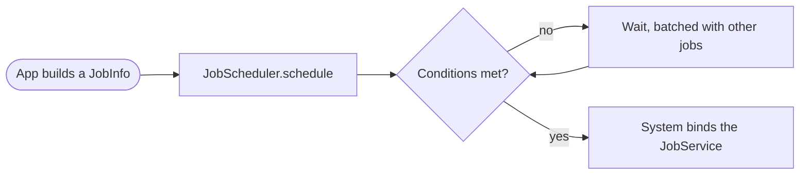

Android 5.0 Lollipop is the release that swapped the engine and the paint at
the same time. ART replaced Dalvik as the runtime for every app, and Material
Design restyled the whole system. Underneath, JobScheduler started batching
background work, SELinux became enforcing for every domain, and phones got
multiple users and a guest mode.

## At a glance

|                                 |                                                                              |
| ------------------------------- | ---------------------------------------------------------------------------- |
| Version                         | Android 5.0                                                                  |
| API level                       | 21                                                                           |
| Name                            | Lollipop, public                                                             |
| `Build.VERSION_CODES`           | `LOLLIPOP`                                                                   |
| Announced                       | 15 October 2014                                                              |
| Final SDK                       | 17 October 2014                                                              |
| Release                         | 3 November 2014, on the Nexus 9. OTA to older Nexus devices from 12 November |
| Launch devices                  | Nexus 6 (Motorola), Nexus 9 (HTC) and Nexus Player (Asus)                    |
| Google Play target-API deadline | None. Play's target-API rule started in 2018, at API 26                      |

Google first showed the release as "Android L" at Google I/O on 25 June 2014.
The L Developer Preview followed the next day for the Nexus 5 and Nexus 7
(2013), the first time Google gave developers an upcoming Android release
early. It had no API level, and apps compiled against it could not be
published on Play. Three preview builds came before the release, each in its own part below: the
[L Developer Preview](/notes/android-5-0-lollipop/l-developer-preview/), the
[Google Fit update](/notes/android-5-0-lollipop/google-fit-preview/) in August
and the [final SDK with its preview images](/notes/android-5-0-lollipop/final-preview-images/)
in October.

Google announced Lollipop with the three launch devices on 15 October 2014. Two
days later it published the final SDK and opened Play to apps targeting API 21.
The Nexus 9 went on sale with 5.0 on 3 November. Droid Life and The Next Web
reported the OTA for the Nexus 5, Nexus 7 (Wi-Fi) and Nexus 10 starting on 12
November; the Nexus 4 came later. Two maintenance releases followed on the
same API level: 5.0.1 (`LRX22C`) and 5.0.2 (`LRX22G`).

## What it brought

Google's launch post counts "over 5,000 new APIs". These are the ones that
shaped apps:

- **ART by default.** ART compiles each app ahead of time at install with
  `dex2oat`, instead of Dalvik's just-in-time compilation on every run. Ars
  Technica notes it debuted as an option in KitKat and is the only runtime in
  Lollipop. What to test is under "What changed for your app".
- **Material Design.** The material theme, view shadows, `RecyclerView`,
  activity transitions, animators driven by view state, and vector drawables. Google applied the same design language to its apps on Android,
  iOS and the web.
- **Notifications on the lock screen.** `Notification.Builder.setVisibility()`
  takes `VISIBILITY_PUBLIC`, `VISIBILITY_PRIVATE` or `VISIBILITY_SECRET`, and
  `setPublicVersion()` supplies a redacted copy. High-priority notifications
  with sound or vibration appear as heads-up banners over the current app.
- **Priority mode.** The volume keys offer "All", "Priority" and "None" for
  interruptions, and `setCategory()` and `addPerson()` tell the system how to
  rank a notification.
- **Overview.** Recent Apps became "Overview", and one app can put several
  tasks there with `FLAG_ACTIVITY_NEW_DOCUMENT` or `documentLaunchMode`.
  `ActivityManager.AppTask` manages them.
- **Project Volta.** `JobScheduler` (`android.app.job`) runs work when its
  conditions hold: charging, unmetered network, idle, or a deadline.
  `adb shell dumpsys batterystats` feeds Battery Historian. Google said Battery
  saver extends battery life "by up to 90 minutes". Ars Technica notes it turns
  the status and navigation bars orange and can switch on by itself at 5 or 15
  percent battery.
- **Camera2.** `android.hardware.camera2` succeeds the `Camera` class,
  deprecated in API 21. It adds bursts, per-frame settings, manual focus, ISO
  and exposure, and RAW capture on devices that support it.
- **64-bit.** The platform and NDK r10c added 64-bit ABIs. The CDD requires a
  device that supports a 64-bit ABI to support its 32-bit equivalent too.
- **Screen pinning and capture.** `Activity.startLockTask()` pins one app to
  the screen. `MediaProjection` lets an app capture the screen after the user
  accepts a system dialog.
- **Smaller additions.** Multiple networks (`ConnectivityManager.requestNetwork()`),
  Bluetooth LE peripheral mode (`BluetoothLeAdvertiser`), `MediaSession`,
  directory selection with `OPEN_DOCUMENT_TREE`, `PdfRenderer`, OpenGL ES 3.1
  and the Android Extension Pack, managed profiles for work apps, and device
  owners.

Before JobScheduler, each app woke the device on its own timer. The system now
holds jobs until their conditions are met and runs them together.

Ars Technica points out that phones got the flashlight and rotation-lock tiles
in this release. The avatar opens the user panel, where a phone can switch
users or start a guest session.

## Security and privacy

- **SELinux enforcing everywhere.** Android 4.4 first used SELinux in
  enforcing mode. The 5.0 CDD requires global enforcing mode and "No
  permissive mode domains are allowed, including domains specific to a
  device/vendor."
- **Encryption by default, then not quite.** Google said every new Lollipop
  device would be encrypted at first boot. The final 5.0 CDD only says
  encryption "SHOULD be enabled", and is "very strongly RECOMMENDED". Google
  later added an update to its Lollipop security post: "Due to performance issues on some Android partner
  devices, we are not yet at encryption by default on every new Lollipop
  device." Ars Technica reported the change on 2 March 2015. The Nexus 6 and
  9 shipped encrypted; upgraded devices had to turn it
  on in Settings > Security.
- **Stronger disk encryption.** The user's password is protected against
  brute force with `scrypt`, and where available the key is bound to the
  hardware keystore.
- **Smart Lock.** Trust agents keep a phone unlocked near a trusted Bluetooth
  or NFC device, or when trusted face recognises the owner.
- **Multiple users on phones.** User accounts and a guest mode came to phones.
  The CDD keeps restricted profiles off devices with telephony, so those stayed
  on tablets.
- **WebView updates through Play.** WebView became updatable without a system
  OTA, so its security fixes no longer wait for the device maker.
- **TLS defaults.** TLS 1.1 and 1.2 on, AES-GCM on, forward secrecy preferred,
  and MD5, 3DES, export and static-key ECDH cipher suites off.
- **Native hardening.** Every dynamically linked executable must be PIE, which
  makes ASLR work for all of them. `FORTIFY_SOURCE` covers more libc functions.
- **Recent tasks.** `ActivityManager.getRecentTasks()` stopped returning other
  apps' tasks, to protect user privacy.

## Permissions

Lollipop still grants every permission at install. Runtime requests arrived a
year later, in [Android 6.0](/notes/android-6-marshmallow/).

- **Custom permissions are unique.** Only one app on a device can define a
  given custom permission name, unless the other app is signed with the same
  key. An app that would redefine it with another key fails to install.
- **Bind permissions.** A `JobService` must be protected with
  `android.permission.BIND_JOB_SERVICE`, or the system ignores it.
  `BIND_DREAM_SERVICE`, `BIND_TV_INPUT` and `BIND_VOICE_INTERACTION` were added
  for the same purpose.
- **Usage access.** `android.permission.PACKAGE_USAGE_STATS` is granted by the
  user in Settings ("Apps with usage access"), not in the install dialog.
- **Screen capture.** `MediaProjection` has no manifest permission; the user
  accepts a dialog each time.
- **Deprecated.** `GET_TASKS` is no longer enforced.
- **Bluetooth LE.** Advertising and scanning use `BLUETOOTH_ADMIN`.

## What changed for your app

### All apps on Android 5.0

| Change                                                         | What to do                                                                                                                  |
| -------------------------------------------------------------- | --------------------------------------------------------------------------------------------------------------------------- |
| ART replaces Dalvik                                            | Test JNI code with CheckJNI, drop pointers to Java object data, and update obfuscators that ART's stricter verifier rejects |
| Notification icons are drawn white; non-alpha channels ignored | Ship alpha-only icons and set an accent with `setColor()`                                                                   |
| Notifications show on the lock screen by default               | Set `setVisibility()` and a `setPublicVersion()` for sensitive content                                                      |
| Lock screens no longer show `RemoteControlClient` controls     | Move to `MediaSession` and `Notification.MediaStyle` with `VISIBILITY_PUBLIC`                                               |
| `getRecentTasks()` returns only your own tasks                 | Use `getAppTasks()`                                                                                                         |
| Duplicate custom permission names block installs               | Prefix permissions with your package name, or use a system permission                                                       |
| New TLS defaults                                               | Fix servers that only offer the disabled cipher suites                                                                      |
| Lock screen widgets removed                                    | Drop the dependency                                                                                                         |
| Intents in a managed profile may find no handler               | Call `resolveActivity()` first, and share files with a `content://` URI                                                     |

### Apps targeting API 21

| Change                                                      | What to do                                                                                     |
| ----------------------------------------------------------- | ---------------------------------------------------------------------------------------------- |
| `bindService()` throws on an implicit `Intent`              | Bind with an explicit `Intent`, and do not give the service intent filters                     |
| WebView blocks mixed content and third-party cookies        | Opt in with `setMixedContentMode()` and `setAcceptThirdPartyCookies()` if needed               |
| WebView draws only the parts of the page it needs           | Call `enableSlowWholeDocumentDraw()` if you draw or capture parts far outside the visible page |
| A `DreamService` must require `BIND_DREAM_SERVICE`          | Add the permission to the service declaration                                                  |
| `Spinner` throws with an adapter of more than one item type | Use a single view type                                                                         |

## What lasted

- **ART** is still the runtime. Android 7.0 added a JIT compiler with code
  profiling, so ART now mixes ahead-of-time and just-in-time compilation by
  how an app is used.
- **JobScheduler** became the recommended replacement for background services
  and implicit broadcasts when Android 8.0 restricted both.
- **Encryption** became a MUST in the 6.0 CDD: devices with a secure lock
  screen, other than low-RAM ones, must support it, and must turn it on by default when their AES speed
  is above 50 MiB/s.
- **64-bit:** Google Play required 64-bit versions of apps with native code
  from 1 August 2019, citing support "since Android 5.0 Lollipop".
- **Notification visibility**, `MediaSession` and `Camera2` are still the
  current APIs.
- **Android 5.1** (API 22) followed in March 2015 with its own API level; it
  has its own note in this series.

## Worth knowing

- The `LOLLIPOP` constant in AOSP carries the comment
  `Lollipop. A flat one with beautiful shadows. But still tasty.` Just above
  it, a hidden constant `L = 21` is marked "Temporary until we completely
  switch to LOLLIPOP".
- The Easter egg is **L Land**, a Flappy Bird-style game played between
  lollipops. Tap "Android version" in Settings quickly to see the lollipop,
  tap it a few more times, then long-press it.
- The game's code has a `DEBUG_IDDQD` flag that makes the player invincible,
  named after Doom's god-mode cheat.
- When you unlock the egg, the system stores the time in
  `Settings.System.EGG_MODE`, with the comment "For posterity: the moment
  this user unlocked the easter egg".
- The 5.0 CDD sets minimum memory by screen density and ABI. A 32-bit phone at
  xhdpi or lower needs 512 MB available to the kernel and userspace; with a
  64-bit ABI it needs 832 MB.

