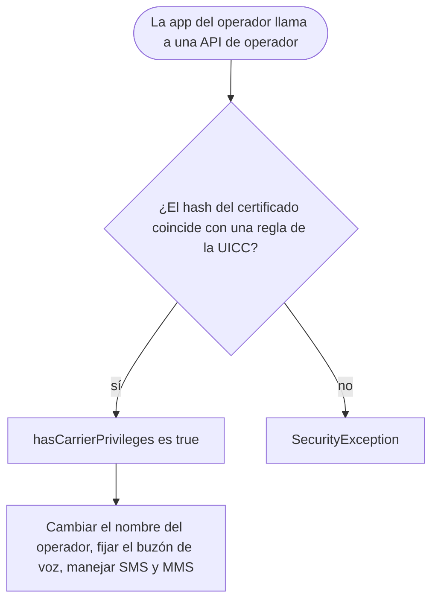

Android 5.1 es una actualización pequeña de Lollipop con su propio nivel de
API. Para el usuario trajo más de una tarjeta SIM en un mismo teléfono, Device
Protection, que mantiene bloqueado un teléfono robado aunque lo restablezcan de
fábrica, y llamadas en HD voice. Para el desarrollador sumó
`SubscriptionManager`, una forma de dar privilegios especiales a las apps del
operador y el aviso de obsolescencia del cliente HTTP de Apache.

 · Marca registrada de Google LLC')

El resto de Lollipop llegó con 5.0 y está en la
[nota de Android 5.0 Lollipop](/es/notes/android-5-0-lollipop/). Esta nota
cubre solo lo que agregó 5.1.

## De un vistazo

|                                    |                                                                                     |
| ---------------------------------- | ----------------------------------------------------------------------------------- |
| Versión                            | Android 5.1 (y 5.1.1)                                                               |
| Nivel de API                       | 22                                                                                  |
| Nombre                             | Lollipop, público (el mismo que 5.0)                                                |
| `Build.VERSION_CODES`              | `LOLLIPOP_MR1`                                                                      |
| Anuncio                            | 9 de marzo de 2015; SDK publicado el 10 de marzo de 2015                            |
| Lanzamiento                        | Actualizaciones para Nexus "en las próximas semanas" desde el 10 de marzo de 2015   |
| Dispositivos de lanzamiento        | Ningún Nexus nuevo. Teléfonos Android One de Indonesia figuraban con 5.1 en febrero |
| Plazo de target API en Google Play | Ninguno. La regla de target API de Play empezó en 2018, con API 26                  |

Google anunció 5.1 en su blog de Android el 9 de marzo de 2015 y dijo que se
estaba "desplegando", sin nombrar dispositivos. Al día siguiente, el blog de
desarrolladores publicó el SDK y anunció actualizaciones en las próximas
semanas para Nexus 4, 5, 6, 7, 9, 10 y Nexus Player. La primera build de AOSP,
LMY47D (`android-5.1.0_r1`), cubre Nexus 5, 6, 7 (2012), 10 y Nexus Player.
Después llegaron builds de Android 5.1.1 con el mismo nivel de API.

Antes del anuncio, el sitio de Android One para Indonesia ya mostraba 5.1 en
las fichas de teléfonos de Evercoss, Mito y Nexian. Android Police lo informó
el 4 de febrero de 2015, y Ars Technica lo llamó un lanzamiento prematuro. La
entrada de Google sobre Android One en Indonesia solo dice "Lollipop".

## Qué trajo

- **Varias tarjetas SIM.** Un dispositivo con dos o más ranuras puede usar más
  de una SIM de operador a la vez. El blog de desarrolladores lo considera
  importante para las regiones donde se estaban adoptando los teléfonos
  Android One.
- **Device Protection.** Un dispositivo perdido o robado sigue bloqueado hasta
  que alguien inicie sesión con la cuenta de Google del dueño, incluso después
  de un restablecimiento de fábrica. Se explica en la sección de seguridad.
- **HD voice.** Llamadas en alta definición entre dispositivos compatibles con
  5.1, como el Nexus 6 en T-Mobile o Verizon.
- **Quick Settings.** El usuario puede conectarse a una red Wi-Fi y controlar
  dispositivos Bluetooth vinculados desde Quick Settings.
- **Android for Work.** El blog de desarrolladores dice que 5.1 "mejora las
  funciones empresariales" para el lanzamiento de Android for Work. El diff de
  la API muestra `DevicePolicyManager#setTrustAgentConfiguration()`, extras de
  aprovisionamiento como `EXTRA_PROVISIONING_ACCOUNT_TO_MIGRATE` y la
  restricción `UserManager.DISALLOW_OUTGOING_BEAM`.

Para desarrolladores, la página de APIs tiene solo tres temas: varias SIM,
servicios de operador y las clases HTTP obsoletas. El diff de la API suma
piezas más pequeñas:

- **`SubscriptionManager`**, con `SubscriptionInfo` y
  `OnSubscriptionsChangedListener`. `getActiveSubscriptionInfoList()` devuelve
  las SIM activas e `isNetworkRoaming(subId)` indica si una está en roaming,
  para que la app reduzca el uso de datos en esa SIM.
- **SMS por SIM.** `SmsManager.getSmsManagerForSubscriptionId()` envía desde la
  SIM elegida.
- **Servicios de operador**, en el nuevo paquete `android.service.carrier` y en
  `TelephonyManager` y `SmsManager`. Ver más abajo.
- **`Activity#getReferrer()`**, que devuelve quién lanzó la actividad: el
  `Intent.EXTRA_REFERRER` o una URI `android-app:` con el paquete que la llamó.
- **`Intent.createChooser()` con un `IntentSender`**, que le dice a tu app qué
  destino eligió el usuario (`EXTRA_CHOSEN_COMPONENT`).
- **Adiciones menores.** `KeyguardManager#isDeviceLocked()`,
  `ConnectivityManager#requestNetwork()` con un `PendingIntent`,
  `VpnService.Builder#setUnderlyingNetworks()` y
  `Settings.ACTION_BATTERY_SAVER_SETTINGS`.

### Privilegios de operador

Una app del operador accede a APIs de telefonía protegidas cuando su
certificado de firma coincide con una regla de acceso guardada en la tarjeta
SIM (UICC). La regla contiene el hash SHA-1 o SHA-256 del certificado y,
opcionalmente, un nombre de paquete. Android la lee de la aplicación de reglas
de acceso (ARA) de la tarjeta o, si no existe, del archivo de reglas de acceso
(ARF).

Con privilegios, una app puede llamar a
`TelephonyManager#setOperatorBrandOverride()`, `setVoiceMailNumber()` y
`setLine1NumberForDisplay()`, y ejecutar un `CarrierMessagingService` al que el
sistema llama para SMS y MMS. La idea de Google era que estas apps pudieran
distribuirse por Google Play. Comprueba con `hasCarrierPrivileges()` antes de
llamar: sin privilegios, estas llamadas lanzan una `SecurityException`.

## Seguridad y privacidad

- **Device Protection (protección contra el restablecimiento de fábrica).**
  Tras un restablecimiento, la configuración inicial pide la cuenta de Google
  que estaba en el dispositivo. Google dijo que llegaría a "la mayoría de los
  teléfonos y tablets Android que salgan con Android 5.1", además de Nexus 6 y
  Nexus 9. El almacenamiento que la sostiene, `PersistentDataBlockService`, ya
  está en el código de AOSP de 5.0.
- **Borrar la protección.** API 22 agrega
  `DevicePolicyManager.WIPE_RESET_PROTECTION_DATA`, un flag de `wipeData()` que
  también borra los datos de la protección. Solo un device owner puede usarlo;
  cualquier otro administrador recibe una `SecurityException`.
- **Cifrado.** El CDD de 5.1 exige soportar cifrado de disco completo en
  dispositivos con bloqueo por PIN o contraseña, pero activarlo por defecto
  sigue siendo un SHOULD, "very strongly RECOMMENDED" y con la expectativa de
  que pase a MUST. El CDD de 6.0 lo volvió MUST para dispositivos con AES lo
  bastante rápido.
- **Verified Boot** también es un SHOULD en el CDD de 5.1. Si el dispositivo lo
  soporta, la verificación debe empezar en una raíz de confianza de hardware y
  llegar hasta la partición del sistema, con SHA-256 y RSA-2048 como mínimo.
- **Cambios menores del CDD.** Con varios usuarios activos y almacenamiento
  externo principal extraíble, la tarjeta SD debe estar cifrada. Una VPN o un
  proxy preinstalado que enrute el tráfico por defecto necesita antes el
  consentimiento del usuario.

La página "Security enhancements by release" de Google tiene secciones para 5.0
y 6.0, pero ninguna para 5.1.

## Permisos

Android 5.1 mantiene el modelo de 5.0: todos los permisos se otorgan al
instalar. Los permisos en ejecución llegaron con
[Android 6.0](/es/notes/android-6-marshmallow/).

- **Agregado.** `BIND_CARRIER_MESSAGING_SERVICE`, que protege un
  `CarrierMessagingService` para que solo el sistema pueda vincularse a él.
- **`READ_PHONE_STATE`** es lo que necesita una app para leer las SIM activas y
  registrar `OnSubscriptionsChangedListener`.
- **Los privilegios de operador** no son un permiso del manifiesto. Los otorga
  la tarjeta SIM según el certificado, como se explicó arriba.

## Qué cambió para tu app

### Todas las apps en Android 5.1

| Cambio                                                                    | Qué hacer                                                                                                  |
| ------------------------------------------------------------------------- | ---------------------------------------------------------------------------------------------------------- |
| `org.apache.http` y `AndroidHttpClient` quedan obsoletos                  | Cambia a `HttpURLConnection`. En Android 6.0 salen del SDK                                                 |
| Un dispositivo puede tener más de una SIM activa                          | No supongas una sola suscripción. Lee `SubscriptionManager` y reacciona a `OnSubscriptionsChangedListener` |
| `Resources.getDrawable(int)` y `getDrawableForDensity()` quedan obsoletos | Usa las sobrecargas que reciben un `Resources.Theme`                                                       |
| `AccountManager.removeAccount(Account, callback, Handler)` queda obsoleto | Usa la sobrecarga que recibe una `Activity`, o `removeAccountExplicitly()`                                 |

### Apps con target API 22

Google no publicó una lista de cambios de comportamiento para apps con target
API 22. La página de 5.1 cubre solo las APIs nuevas y la obsolescencia de HTTP.
En AOSP, la constante `LOLLIPOP_MR1` lleva una broma de una línea en lugar de
la lista de cambios que tiene `LOLLIPOP` (ver abajo).

## Qué perduró

- **Apache HTTP** salió del SDK en Android 6.0 y del bootclasspath en Android 9. La [nota de Android 6.0](/es/notes/android-6-marshmallow/) explica el
  recurso `useLibrary 'org.apache.http.legacy'`.
- **`SubscriptionManager`** sigue siendo la API de varias SIM. `from(Context)`
  quedó obsoleto en API 28 en favor de `getSystemService()`, y desde el SDK 35
  `getActiveSubscriptionInfoList()` nunca devuelve null.
- **Los privilegios de operador** crecieron. API 23 sumó `CarrierConfigManager`
  y reemplazó `BIND_CARRIER_MESSAGING_SERVICE` por `BIND_CARRIER_SERVICES`. Hoy
  las mismas reglas de la UICC cubren `SubscriptionManager`, `EuiccManager`,
  las estadísticas de red y más.
- **Device Protection** sigue ahí. La ayuda de Google dice hoy que un
  dispositivo restablecido pide "cualquier cuenta de Google que se haya
  agregado y sincronizado antes en el dispositivo", y que sin ella no se puede
  usar.

## Para saber

- El comentario de AOSP sobre `LOLLIPOP_MR1` dice:
  `Lollipop with an extra sugar coating on the outside!` Es todo su Javadoc.
- El Easter egg sigue siendo **L Land**, el juego de tocar para volar de 5.0.
  En 5.1 vibra 80 ms cuando chocas con un obstáculo o con el suelo, salvo en
  modo silencio. El código dice: `No interruptions. Not even game haptics.`
- El juego de 5.1 también sumó un interruptor oculto, `DEBUG_IDDQD`, que se lee
  de la etiqueta de log `LLand.iddqd`. Activado, los obstáculos ya no terminan
  la partida y el marcador muestra `??`. En 5.0 estaba apagado en el código.
