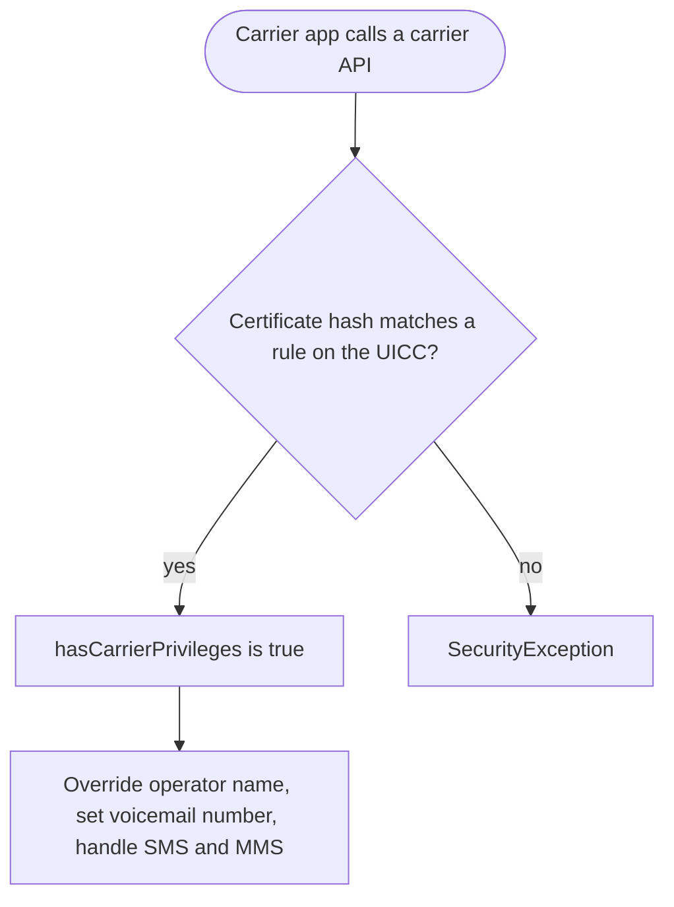

Android 5.1 is a small update to Lollipop with its own API level. For users it
brought more than one SIM card in one phone, Device Protection, which keeps a stolen
phone locked after a factory reset, and HD voice calls. For developers it added
`SubscriptionManager`, a way for carrier apps to hold special privileges, and a
deprecation notice for the Apache HTTP client.

The rest of Lollipop arrived in 5.0 and is covered in the
[Android 5.0 Lollipop note](/notes/android-5-0-lollipop/). This note covers
only what 5.1 added.

## At a glance

|                                 |                                                                                |
| ------------------------------- | ------------------------------------------------------------------------------ |
| Version                         | Android 5.1 (and 5.1.1)                                                        |
| API level                       | 22                                                                             |
| Name                            | Lollipop, public (same name as 5.0)                                            |
| `Build.VERSION_CODES`           | `LOLLIPOP_MR1`                                                                 |
| Announced                       | 9 March 2015; SDK published 10 March 2015                                      |
| Release                         | Nexus updates "over the next few weeks" from 10 March 2015                     |
| Launch devices                  | No new Nexus. Android One phones in Indonesia were listed with 5.1 in February |
| Google Play target-API deadline | None. Play's target-API rule started in 2018, at API 26                        |

Google announced 5.1 on its Android blog on 9 March 2015 and said it was
"rolling out" without naming devices. The next day the developer blog
published the SDK and listed the Nexus 4, 5, 6, 7, 9, 10 and Nexus Player for
updates over the next few weeks. The first AOSP build, LMY47D
(`android-5.1.0_r1`), covers the Nexus 5, 6, 7 (2012), 10 and Nexus Player.
Android 5.1.1 builds followed under the same API level.

Before the announcement, Google's Android One site for Indonesia listed 5.1 on
the spec sheets of phones from Evercoss, Mito and Nexian. Android Police
reported it on 4 February 2015, and Ars Technica called it a premature launch.
Google's own post on Android One in Indonesia says only "Lollipop".

## What it brought

- **Multiple SIM cards.** A device with two or more SIM slots can use more
  than one carrier SIM at a time. The developer blog calls it important for
  the regions where Android One phones were being adopted.
- **Device Protection.** A lost or stolen device stays locked until someone
  signs in with the owner's Google account, even after a factory reset. Covered
  under security below.
- **HD voice.** High-definition calls between compatible 5.1 devices, such as
  the Nexus 6 on T-Mobile or Verizon.
- **Quick Settings.** Users can join a Wi-Fi network and control paired
  Bluetooth devices from Quick Settings.
- **Android for Work.** The developer blog says 5.1 "enhances enterprise
  features" for the Android for Work launch. The API diff shows
  `DevicePolicyManager#setTrustAgentConfiguration()`, provisioning extras such
  as `EXTRA_PROVISIONING_ACCOUNT_TO_MIGRATE`, and the
  `UserManager.DISALLOW_OUTGOING_BEAM` restriction.

For developers, the API page lists only three topics: multiple SIMs, carrier
services and the deprecated HTTP classes. The API diff adds smaller pieces:

- **`SubscriptionManager`**, with `SubscriptionInfo` and
  `OnSubscriptionsChangedListener`. `getActiveSubscriptionInfoList()` returns
  the active SIMs, and `isNetworkRoaming(subId)` tells you if one is roaming,
  so an app can cut data use for that SIM.
- **Per-SIM SMS.** `SmsManager.getSmsManagerForSubscriptionId()` sends from a
  chosen SIM.
- **Carrier services**, in the new `android.service.carrier` package and in
  `TelephonyManager` and `SmsManager`. See below.
- **`Activity#getReferrer()`**, which returns who launched the activity, either
  `Intent.EXTRA_REFERRER` or an `android-app:` URI with the caller's package.
- **`Intent.createChooser()` with an `IntentSender`**, which tells your app
  which target the user picked (`EXTRA_CHOSEN_COMPONENT`).
- **Smaller additions.** `KeyguardManager#isDeviceLocked()`,
  `ConnectivityManager#requestNetwork()` with a `PendingIntent`,
  `VpnService.Builder#setUnderlyingNetworks()` and
  `Settings.ACTION_BATTERY_SAVER_SETTINGS`.

### Carrier privileges

A carrier app gets access to protected telephony APIs when its signing
certificate matches an access rule stored on the SIM card (UICC). The rule
holds the SHA-1 or SHA-256 hash of the certificate, and optionally a package
name. Android reads it from the access rule application (ARA) on the card, or
from the access rule file (ARF) if there is none.

With privileges, an app can call `TelephonyManager#setOperatorBrandOverride()`,
`setVoiceMailNumber()` and `setLine1NumberForDisplay()`, and run a
`CarrierMessagingService` that the system calls for SMS and MMS. Google's
point was that such apps can be distributed through Google Play. Check with
`hasCarrierPrivileges()` before calling: without privileges, these calls throw
a `SecurityException`.

## Security and privacy

- **Device Protection (factory reset protection).** After a reset, setup asks
  for the Google account that was on the device. Google said it would be on
  "most Android phones and tablets shipped with Android 5.1", plus the Nexus 6
  and Nexus 9. The storage behind it, `PersistentDataBlockService`, is already
  in the 5.0 AOSP source.
- **Wiping the protection.** API 22 adds
  `DevicePolicyManager.WIPE_RESET_PROTECTION_DATA`, a flag for `wipeData()`
  that also erases the factory reset protection data. Only a device owner may
  set it; any other admin gets a `SecurityException`.
- **Encryption.** The 5.1 CDD requires full-disk encryption support on devices
  with a PIN or password lock screen, but turning it on by default is still a
  SHOULD, "very strongly RECOMMENDED" and expected to become a MUST. The 6.0
  CDD made it a MUST for devices with fast enough AES.
- **Verified Boot** is also a SHOULD in the 5.1 CDD. When a device supports
  it, verification must start from a hardware root of trust and reach the
  system partition, with SHA-256 and RSA-2048 at least.
- **Smaller CDD changes.** If multiple users are on and the primary external
  storage is removable, the SD card must be encrypted. A preloaded VPN or proxy
  that routes traffic by default needs the user's consent first.

Google's "Security enhancements by release" page has sections for 5.0 and 6.0,
but none for 5.1.

## Permissions

Android 5.1 keeps 5.0's model: every permission is granted at install.
Runtime permissions came in [Android 6.0](/notes/android-6-marshmallow/).

- **Added.** `BIND_CARRIER_MESSAGING_SERVICE`, which protects a
  `CarrierMessagingService` so that only the system can bind to it.
- **`READ_PHONE_STATE`** is what an app needs to read active SIMs and to
  register `OnSubscriptionsChangedListener`.
- **Carrier privileges** are not a manifest permission. The SIM card grants
  them by certificate, as described above.

## What changed for your app

### All apps on Android 5.1

| Change                                                                | What to do                                                                                               |
| --------------------------------------------------------------------- | -------------------------------------------------------------------------------------------------------- |
| `org.apache.http` and `AndroidHttpClient` are deprecated              | Move to `HttpURLConnection`. In Android 6.0 they leave the SDK                                           |
| A device can have more than one active SIM                            | Do not assume one subscription. Read `SubscriptionManager` and react to `OnSubscriptionsChangedListener` |
| `Resources.getDrawable(int)` and `getDrawableForDensity()` deprecated | Use the overloads that take a `Resources.Theme`                                                          |
| `AccountManager.removeAccount(Account, callback, Handler)` deprecated | Use the overload that takes an `Activity`, or `removeAccountExplicitly()`                                |

### Apps targeting API 22

Google published no list of behaviour changes for apps targeting API 22. The
5.1 API page covers new APIs and the HTTP deprecation only. The `LOLLIPOP_MR1`
constant in AOSP carries a one-line joke instead of the change list that
`LOLLIPOP` has (see below).

## What lasted

- **Apache HTTP** left the SDK in Android 6.0 and the bootclasspath in Android 9. The [Android 6.0 note](/notes/android-6-marshmallow/) has the
  `useLibrary 'org.apache.http.legacy'` workaround.
- **`SubscriptionManager`** is still the multi-SIM API. `from(Context)` was
  deprecated in API 28 in favour of `getSystemService()`, and from SDK 35
  `getActiveSubscriptionInfoList()` never returns null.
- **Carrier privileges** grew. API 23 added `CarrierConfigManager` and replaced
  `BIND_CARRIER_MESSAGING_SERVICE` with `BIND_CARRIER_SERVICES`. Today the
  same UICC rules cover `SubscriptionManager`, `EuiccManager`, network stats
  and more.
- **Device Protection** is still there. Google's help today says a reset
  device asks for "any Google Account previously added and synced to the
  device", and cannot be used without it.

## Worth knowing

- The AOSP comment on `LOLLIPOP_MR1` reads:
  `Lollipop with an extra sugar coating on the outside!` That is the whole
  Javadoc.
- The Easter egg is still **L Land**, the tap-to-fly game from 5.0. In 5.1
  it vibrates for 80 ms when you hit an obstacle or the floor, except in
  silent mode. The code
  says: `No interruptions. Not even game haptics.`
- The 5.1 game also gained a hidden switch, `DEBUG_IDDQD`, read from the
  `LLand.iddqd` log tag. With it on, obstacles no longer end the game and the score shows `??`. In 5.0 it was hard-coded off.
