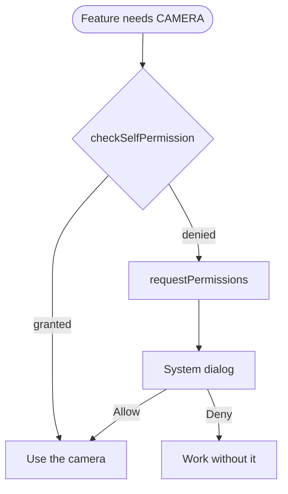

Android 6.0 Marshmallow is the release where apps stopped getting every
permission at install. From API 23, an app asks for a dangerous permission
while it runs, and the user can say no. It also added Doze, which parks
background work on an idle phone, and a security patch level that devices
report as a date.

 · Trademark of Google LLC')

## At a glance

|                                 |                                                                  |
| ------------------------------- | ---------------------------------------------------------------- |
| Version                         | Android 6.0                                                      |
| API level                       | 23                                                               |
| Name                            | Marshmallow, public                                              |
| `Build.VERSION_CODES`           | `M`                                                              |
| Final SDK                       | 17 August 2015                                                   |
| Release                         | Nexus rollout began 5 October 2015                               |
| Launch devices                  | Nexus 5X (LG) and Nexus 6P (Huawei), announced 29 September 2015 |
| Google Play target-API deadline | None. Play's target-API rule started in 2018, at API 26          |

Google published the final SDK on 17 August 2015 and opened Play to apps
targeting API 23 the same day. On 29 September it announced the rollout to the
Nexus 5, 6, 7 (2013), 9, Nexus Player and Android One "starting next week".
Phone Scoop reported the push starting on 5 October.

## What it brought

- **Runtime permissions.** Covered in its own section below.
- **Doze.** An unplugged phone that sits still with the screen off enters
  Doze. Network access stops, wake locks are ignored, and alarms, jobs and
  syncs wait for short maintenance windows.
- **App Standby.** An app the user has not touched for a while, with no
  foreground process or visible notification, loses network access and its
  jobs and syncs while the phone is unplugged.
- **App Links.** With `android:autoVerify="true"` on an intent filter, Android
  6.0 checks `https://<host>/.well-known/assetlinks.json` at install. If it
  matches, links to that site open in the app without the chooser dialog.
- **Fingerprint API.** `FingerprintManager.authenticate()` behind the
  `USE_FINGERPRINT` permission, tied to keys in the Android Keystore.
- **Auto Backup for Apps.** Apps targeting API 23 get their data backed up to
  a private folder in the user's Google Drive, with no code. The limit is 25 MB
  per app, and it does not count against the user's Drive quota.
- **Adoptable storage.** A user can format an SD card as internal storage.
  Apps should ask for paths with `getFilesDir()` and `getCacheDir()` instead of
  hard-coding them.
- **Assist API.** Apps can hand context to the assistant through
  `Activity#onProvideAssistContent()`. Ars Technica describes Google Now on Tap
  as the feature built on it: a long press on home sends the screen to Google.
- **Smaller additions.** Direct Share (`ChooserTargetService`), voice
  interactions (`VoiceInteractor`), the camera torch
  (`CameraManager#setTorchMode()`), `android.media.midi`, Bluetooth stylus
  buttons and 4K display modes.

## Security and privacy

- **Monthly security updates.** On 5 August 2015 Google said Nexus devices
  would get an OTA "each month focused on security". The first public
  bulletin, published 13 August 2015, covered the Stagefright media flaws.
  Nexus devices were promised security patches for three years from launch or
  18 months from last sale on the Google Store, whichever is longer.
- **Security patch level.** API 23 added `Build.VERSION.SECURITY_PATCH`, the
  date of the last security patch the device applied. Settings shows it as
  "Android security patch level" under About phone.
- **Encryption.** The 6.0 CDD requires full-disk encryption on any device
  with a secure lock screen that is not a low-RAM device. If its AES speed is
  above 50 MiB/s, encryption must be on by default after setup.
- **Verified Boot.** Under the same CDD, devices with AES above 50 MiB/s must
  support Verified Boot, from a hardware root of trust up to the system
  partition.
- **Hardware-isolated keys.** A new HAL protects keys used by the fingerprint
  API, the lock screen, device encryption and client certificates against a
  kernel compromise.
- **Fingerprint rules.** The CDD caps the false acceptance rate at 0.002%,
  locks out for at least 30 seconds after five failed tries, and requires
  matching inside the Trusted Execution Environment.
- **Hardware identifiers.** `WifiInfo.getMacAddress()` and
  `BluetoothAdapter.getAddress()` return `02:00:00:00:00:00` for every app.
  Background Wi-Fi and Bluetooth scans use a randomized MAC address.
- **Smaller changes.** SELinux policy got tighter (IOCTL filtering, very
  limited `/proc`). USB defaults to charge-only, and file access needs the
  user's approval. A new `StrictMode` check flags cleartext traffic. Android
  moved from OpenSSL to BoringSSL. Adopted SD cards are encrypted and work in
  one device only.

## Permissions

Permissions now come in two kinds. **Normal** permissions are still granted at
install. **Dangerous** ones (location, contacts, camera, microphone, SMS and
the like) have to be requested at runtime by apps that target API 23.

The system owns the dialog (dashed above), so the app cannot change its text.
Call `shouldShowRequestPermissionRationale()` to know when to explain the
request first. On Android 6.0, a second request after a denial added a
"Never ask again" checkbox.

- **Groups.** Users grant and revoke by permission group. Until Android 8.0,
  a grant also gave the app every other permission from that group declared in
  its manifest.
- **Older apps.** Apps targeting API 22 or lower still get their permissions
  at install. Users can switch them off anyway, for old and new apps alike.
- **Added.** `USE_FINGERPRINT`.
- **Removed.** `READ_HISTORY_BOOKMARKS` and `WRITE_HISTORY_BOOKMARKS`, along
  with `Browser.getAllBookmarks()` and `Browser.saveBookmark()`.
- **Location for scans.** Reading nearby hardware IDs from
  `WifiManager.getScanResults()`, `BluetoothDevice.ACTION_FOUND` or
  `BluetoothLeScanner.startScan()` needs `ACCESS_FINE_LOCATION` or
  `ACCESS_COARSE_LOCATION`.
- **Device owners.** `DevicePolicyManager#setPermissionPolicy()` lets an
  enterprise admin set how runtime permissions are granted.

## What changed for your app

### All apps on Android 6.0

| Change                                                 | What to do                                                                                                                                                                                  |
| ------------------------------------------------------ | ------------------------------------------------------------------------------------------------------------------------------------------------------------------------------------------- |
| Doze and App Standby                                   | Test with `adb shell dumpsys deviceidle force-idle` and `adb shell am set-inactive <package> true`. Use `setAndAllowWhileIdle()` or `setExactAndAllowWhileIdle()` for alarms that must fire |
| Users can switch off permissions for any app           | Test with permissions off, even if you do not target API 23                                                                                                                                 |
| MAC address returns `02:00:00:00:00:00`                | Stop using it as a device ID                                                                                                                                                                |
| Bookmark APIs removed                                  | Keep bookmarks in your own storage                                                                                                                                                          |
| `setStreamSolo()` and `setStreamMute()` deprecated     | Use `requestAudioFocus()` and `adjustStreamVolume()`                                                                                                                                        |
| Keystore drops DSA                                     | Use ECDSA                                                                                                                                                                                   |
| Camera access goes by process priority                 | Handle `onError()` (Camera) or `onDisconnected()` (Camera2)                                                                                                                                 |
| An APK missing a file named in its manifest is corrupt | Re-sign after removing any content                                                                                                                                                          |

The Apache HTTP client left the SDK, so `compileSdkVersion 23` no longer sees
it. Switch to `HttpURLConnection`, or add `useLibrary 'org.apache.http.legacy'`
to `build.gradle`. Devices kept the classes on the bootclasspath until Android 9.

### Apps targeting API 23

| Change                                                                      | What to do                                                                                      |
| --------------------------------------------------------------------------- | ----------------------------------------------------------------------------------------------- |
| Dangerous permissions are requested at runtime                              | `checkSelfPermission()` before each access, `requestPermissions()` when denied                  |
| Auto Backup is on by default                                                | Choose what is backed up with `android:fullBackupContent`, or set `android:allowBackup="false"` |
| Native libraries with text relocations are rejected                         | Rebuild them without text relocations                                                           |
| Stylus buttons report `BUTTON_STYLUS_PRIMARY` and `BUTTON_STYLUS_SECONDARY` | Read them through `MotionEvent#getButtonState()`                                                |

## What lasted

- **Runtime permissions** are still the model. Android 8.0 fixed the
  group-wide grant, Android 10 split out `ACCESS_BACKGROUND_LOCATION`, and
  Android 11 added one-time grants.
- **Doze** grew in Android 7.0: part of it now applies while the phone is
  moving in a pocket with the screen off.
- **Verified Boot** became strictly enforced in Android 7.0: a compromised
  device does not boot.
- **Apache HTTP** left the bootclasspath in Android 9. Apps targeting 9 that
  still need it declare `<uses-library android:name="org.apache.http.legacy"
android:required="false"/>`.
- **Fingerprint:** Android 9 tells apps to move from `FingerprintManager` to
  `BiometricPrompt`.
- **Adoptable storage** could not be combined with file-based encryption on
  Android 7.0 to 8.1. From Android 9, both work together.
- **Monthly bulletins** still ship. Play's target-API requirement, which did
  not exist in 2015, started in 2018 and now moves up every year.

## Worth knowing

- The `M` constant in AOSP carries a one-line comment: `M comes after L.`
- The Easter egg is **Marshmallow Land**, a Flappy Bird-style game. Its code
  allows up to six players (`MAX_PLAYERS = 6`) and runs in a process named
  `:sweetsweetdesserts`.
- `02:00:00:00:00:00` is what every app on Marshmallow reads as the Wi-Fi and
  Bluetooth MAC address.
