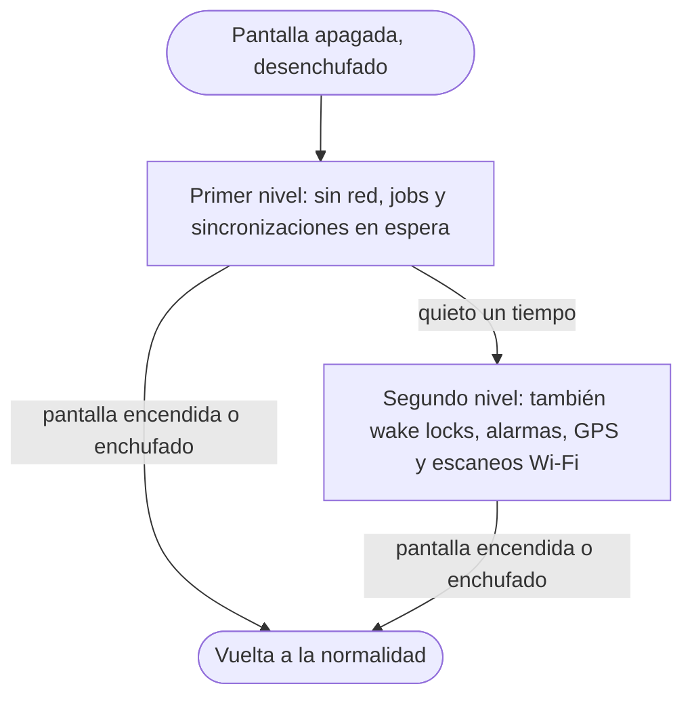

Android 7.0 Nougat es la versión que puso dos apps en la pantalla de un
teléfono. Los usuarios recibieron la multiventana en pantalla dividida,
respuestas escritas dentro de la notificación y un Doze que también actúa con
el teléfono en movimiento. Los desarrolladores recibieron el cifrado por
archivo con Direct Boot, una configuración de seguridad de red declarativa y un
crash para las apps que todavía comparten URIs `file://`.


## De un vistazo

|                                    |                                                                    |
| ---------------------------------- | ------------------------------------------------------------------ |
| Versión                            | Android 7.0                                                        |
| Nivel de API                       | 24                                                                 |
| Nombre                             | Nougat, público                                                    |
| `Build.VERSION_CODES`              | `N`                                                                |
| APIs y SDK finales                 | 15 de junio de 2016                                                |
| Lanzamiento                        | Despliegue en Nexus desde el 22 de agosto de 2016                  |
| Dispositivo de lanzamiento         | LG V20, el primer teléfono nuevo que salió con Nougat              |
| Plazo de target API en Google Play | Ninguno. La regla de target API de Play empezó en 2018, con API 26 |

Google declaró finales las APIs de N el 15 de junio de 2016 y avisó que ya se
podían publicar actualizaciones que compilaran contra API 24, y opcionalmente
la tuvieran como target. El 22 de agosto Dave Burke anunció el despliegue
"starting with Nexus devices": en varias semanas, a Nexus 6, 5X, 6P, 9, Nexus
Player, Pixel C y General Mobile 4G (Android One). Ese mismo día el código
llegó a AOSP y Ars Technica publicó su reseña.

La primera vista previa para desarrolladores salió el 9 de marzo de 2016.
Burke la llamó "early… really early", y el nuevo Android Beta Program la
entregó por OTA a los mismos Nexus y al Pixel C. Sus cinco vistas previas para desarrolladores, de marzo a julio, siguen a esta vista general como partes, de la [Developer Preview 1](/es/notes/android-7-0-nougat/developer-preview-1/) a la [Developer Preview 5](/es/notes/android-7-0-nougat/developer-preview-5/). En el lanzamiento también pasó
Nougat a "a new regular maintenance schedule over the coming quarters". Los
teléfonos con Snapdragon 800 y 801 de Qualcomm, que movían casi todos los
modelos de gama alta de fines de 2013 a fines de 2014, quedaron fuera: Ars
Technica concluyó que una actualización oficial a Nougat era "very difficult if
not completely impossible" para ellos.

## Qué trajo

- **Multiventana.** Dos apps corren lado a lado o una sobre otra en teléfonos y
  tablets. Ars Technica describe el gesto: pulsación larga en el botón de
  recientes y luego se elige la segunda app. Android TV recibió
  picture-in-picture, y el usuario puede arrastrar y soltar contenido entre las
  dos apps.
- **Notificaciones.** Direct Reply pone un campo de texto dentro de la
  notificación. Las notificaciones agrupadas juntan varias alertas de una
  misma app. `MessagingStyle` ordena las conversaciones. Una pulsación larga
  sobre una notificación abre sus controles.
- **Doze en movimiento.** Doze, que llegó en
  [Android 6.0 Marshmallow](/es/notes/android-6-marshmallow/), ahora funciona
  en dos niveles. El primero se aplica siempre que la pantalla está apagada y
  el teléfono desenchufado, aunque esté en un bolsillo.



- **JIT/AOT guiado por perfiles.** ART sumó un compilador JIT que registra los
  métodos más usados de cada app. Los compila por adelantado solo cuando el
  dispositivo está inactivo y cargando. Google dice que apps grandes que
  tardaban minutos en optimizarse en 6.0 ahora se instalan "in just a matter
  of seconds".
- **Vulkan.** La API 3D de bajo costo está en el NDK, en el hardware que la
  soporta. El CDD obliga a todo dispositivo a incluir `libvulkan.so`; uno sin
  Vulkan devuelve cero dispositivos en `vkEnumeratePhysicalDevices`.
- **Data Saver.** Un interruptor que bloquea los datos en segundo plano en
  redes medidas. Las apps lo leen con
  `ConnectivityManager.getRestrictBackgroundStatus()` y escuchan
  `ACTION_RESTRICT_BACKGROUND_CHANGED`.
- **API de mosaicos de Quick Settings.** Las apps agregan mosaicos con
  `TileService` y la clase `Tile`. El usuario puede reordenarlos.
- **"Display size".** Con este ajuste el usuario escala toda la interfaz, no solo el
  texto, hasta un ancho mínimo de `sw320dp`.
- **OpenJDK y Java 8.** Las bibliotecas `java.*` base ahora vienen de OpenJDK
  en lugar de Apache Harmony. El `libcore` de AOSP en `android-7.0.0_r1` tiene
  un árbol `ojluni` que 6.0.1 no tiene. Con el toolchain Jack, las lambdas
  funcionan hasta Gingerbread; los métodos de interfaz por defecto y estáticos
  y los streams requieren API 24.
- **Emoji.** Nougat soporta Unicode 9, con 72 emoji nuevos según Ars Technica,
  y es la primera versión con modificadores de tono de piel. Las apps
  comprueban que un glifo existe con `Paint.hasGlyph()` antes de insertarlo; los
  teclados deberían ofrecer los tonos de piel.
- **Otros añadidos.** Varios idiomas a la vez con `LocaleList`, un subconjunto
  de ICU4J en `android.icu`, bloqueo de números (`BlockedNumberContract`),
  filtrado de llamadas (`CallScreeningService`), OpenGL ES 3.2, el modo VR, la
  ayuda de atajos de teclado, punteros personalizados, la API Frame Metrics y
  Chrome como proveedor de WebView.

## Seguridad y privacidad

- **Cifrado por archivo.** Los archivos se cifran uno por uno en lugar de como
  un único dispositivo de bloques, lo que aísla mejor a cada usuario y perfil.
  El CDD de 7.0 dice que los dispositivos "SHOULD" cumplir el requisito de
  cifrado con FBE.
- **Direct Boot.** Se apoya en FBE. Tras un reinicio el teléfono llega a la
  pantalla de bloqueo, y las alarmas, los mensajes y los servicios de
  accesibilidad marcados con `android:directBootAware` corren antes de que el
  usuario desbloquee. Solo ven el almacenamiento cifrado por dispositivo; el
  cifrado por credencial se abre al desbloquear.
- **Verified Boot estricto.** Android 7.0 aplica Verified Boot de forma
  estricta, así que un dispositivo comprometido no arranca. También corrige la
  corrupción accidental de datos.
- **Actualizaciones sin interrupción.** En algunos dispositivos nuevos, dos
  copias de las particiones del sistema (slots A y B) permiten instalar una
  actualización en segundo plano. Si el slot nuevo no arranca, el dispositivo
  vuelve al anterior. Ars Technica aclara que solo funciona en dispositivos que
  salen de fábrica con 7.0 o posterior.
- **Pila multimedia dividida.** Tras Stagefright, mediaserver se partió en
  varios procesos. El análisis de `libstagefright` corre en un sandbox
  mediacodec con muy pocos permisos. Solo `cameraserver` accede a la cámara y
  solo `audioserver` a Bluetooth. La detección de desbordamiento de enteros
  cubre toda la pila multimedia.
- **CA de confianza.** Las apps con target API 24 confían solo en el almacén de
  CA del sistema. Los certificados que instala el usuario o un administrador
  del dispositivo se ignoran salvo que la app lo permita. Todo dispositivo
  compatible trae el mismo conjunto de CA de AOSP.
- **Configuración de seguridad de red.** Un archivo XML, referenciado con
  `android:networkSecurityConfig`, define las CA de confianza por dominio, las
  reglas de tráfico en claro, los pines de certificados y excepciones solo para
  depuración.
- **Otros cambios.** APK Signature Scheme v2 firma el archivo completo y se
  verifica más rápido. La atestación de claves prueba que una clave vive en
  hardware. Seccomp pasó a ser requisito del CDD, el kernel ganó memoria de
  solo lectura y acceso restringido al espacio de usuario, y el orden de carga
  de bibliotecas se aleatoriza.

## Permisos

No llegaron permisos peligrosos nuevos. Los cambios tocan los archivos y el
acceso acotado.

- **Nuevos.** `BIND_QUICK_SETTINGS_TILE`, `BIND_SCREENING_SERVICE`,
  `BIND_VR_LISTENER_SERVICE` y `BIND_CONDITION_PROVIDER_SERVICE`. Protegen
  servicios a los que se conecta el sistema.
- **Eliminado.** `FLASHLIGHT` salió del SDK.
- **Acceso acotado a carpetas.** `StorageVolume.createAccessIntent()` pide una
  sola carpeta, como `Pictures`, en lugar de todo `READ_EXTERNAL_STORAGE`. El
  usuario la permite o la niega en un diálogo.
- **Archivos privados.** En las apps con target API 24, el directorio privado
  tiene permisos `0700`. `MODE_WORLD_READABLE` y `MODE_WORLD_WRITEABLE` lanzan
  `SecurityException`. Qué hacer está en la sección siguiente.
- **Números bloqueados.** Solo la app de teléfono predeterminada, la de SMS
  predeterminada y las apps del operador pueden leer o escribir la lista.
- **Trazas de métodos.** `Debug.startMethodTracing()` escribe en el directorio
  propio de la app en el almacenamiento compartido, así que ya no necesita
  `WRITE_EXTERNAL_STORAGE`.
- **Copia de seguridad.** Android Backup ahora incluye los permisos otorgados
  en ejecución, según la lista de funciones de Nougat de Google.

## Qué cambió para tu app

### Todas las apps en Android 7.0

| Cambio                                                                  | Qué hacer                                                                                                         |
| ----------------------------------------------------------------------- | ----------------------------------------------------------------------------------------------------------------- |
| El primer nivel de Doze actúa con el teléfono en movimiento             | Sigue la guía de Doze de 6.0; usa Firebase Cloud Messaging para los mensajes                                      |
| Desaparecen `Camera.ACTION_NEW_PICTURE` y `ACTION_NEW_VIDEO`            | Vigila los medios con un job de `JobScheduler` y `JobInfo.Builder.addTriggerContentUri()`                         |
| Las bibliotecas privadas del NDK fuera de una lista corta no cargan     | Usa las APIs públicas del NDK o incluye tu propia copia                                                           |
| `libcutils`, `libcrypto`, `libssl`, `libandroid_runtime`                | Cargan con una advertencia solo si tu target es 23 o menor; inclúyelas ya                                         |
| Cambiar el tamaño de pantalla mata apps en segundo plano con target ≤23 | Restaura el estado bien al volver desde recientes                                                                 |
| Se desactivan las suites de cifrado RC4                                 | Activa TLS 1.2, AES-GCM y ECDHE en el servidor                                                                    |
| Escribir en un socket TCP desde el hilo principal lanza excepción       | Saca el trabajo de red del hilo principal                                                                         |
| Se respeta la visibilidad de las anotaciones                            | Agrega `@Retention(RetentionPolicy.RUNTIME)` a las anotaciones que lees en ejecución                              |
| Apps con target 23 o menor en pantalla dividida                         | Las redimensionables se fuerzan a cambiar de tamaño con un aviso; las de orientación fija ocupan toda la pantalla |

### Apps con target API 24

| Cambio                                                                  | Qué hacer                                                                                                 |
| ----------------------------------------------------------------------- | --------------------------------------------------------------------------------------------------------- |
| Las URIs `file://` que salen de la app lanzan `FileUriExposedException` | Comparte una URI `content://` de `FileProvider` con un permiso temporal                                   |
| `CONNECTIVITY_ACTION` ya no llega a los receivers del manifiesto        | Regístralo en ejecución con `registerReceiver()` o programa el trabajo con `JobScheduler`                 |
| No se confía en las CA agregadas por el usuario                         | Permítelas con una configuración de seguridad de red, o usa `debug-overrides` para un proxy de depuración |
| El directorio privado es `0700`; `MODE_WORLD_*` lanza excepción         | Comparte archivos con `FileProvider`                                                                      |
| `DownloadManager.COLUMN_LOCAL_FILENAME` lanza `SecurityException`       | Abre la descarga con `ContentResolver.openFileDescriptor()`                                               |
| Las bibliotecas privadas de la lista temporal también fallan            | Inclúyelas en el APK o pasa a las APIs del NDK                                                            |
| Las actividades son redimensionables por defecto                        | Prueba en pantalla dividida, o usa `android:resizeableActivity="false"`                                   |
| Desaparecen el proveedor `Crypto` y `SHA1PRNG`                          | Deriva claves con una función de derivación de claves real                                                |
| `TransactionTooLargeException` se relanza como `RuntimeException`       | Mantén pequeño `onSaveInstanceState()`                                                                    |
| Cambió el `serialVersionUID` por defecto de algunas clases              | Declara `serialVersionUID` de forma explícita                                                             |

```mermaid title="Compartir un archivo privado desde una app con target API 24"
flowchart TD
  share([Enviar una foto a otra app]) --> kind{¿Qué URI?}
  kind -- file:// --> crash[FileUriExposedException]
  kind -- content:// de FileProvider --> grant[Intent con FLAG_GRANT_READ_URI_PERMISSION]
  grant --> read[La otra app la lee]
```

## Qué perduró

- **La multiventana** creció: Android 8.0 llevó picture-in-picture a los
  teléfonos, y Android 10 mantiene reanudadas todas las actividades visibles,
  donde 7.0 solo reanudaba la última que se tocó.
- **Los límites en segundo plano** se endurecieron en Android 8.0. Las apps
  con target API 26 ya no pueden declarar en el manifiesto receivers para la
  mayoría de los broadcasts implícitos.
- **La configuración de seguridad de red** sigue siendo el lugar para las
  reglas de confianza. Desde Android 9, las apps con target API 28 bloquean el
  tráfico en claro por defecto.
- **El cifrado por archivo** pasó a ser obligatorio en los dispositivos que
  salen con Android 10. En 7.0 a 8.1 no podía combinarse con el almacenamiento
  adoptable.
- **Las actualizaciones A/B** ganaron streaming en Android 8.0, y Virtual A/B
  reemplazó el esquema original en Android 10.
- **Jack** tampoco duró. En marzo de 2017 Google lo declaró obsoleto y llevó
  el soporte de Java 8 a las herramientas estándar `javac` y `dx`.
- **El acceso acotado a carpetas** no duró. `createAccessIntent()` quedó
  obsoleto en API 29 y devuelve `RESULT_CANCELED` en Android 10.

## Para saber

- La constante `N` en AOSP lleva el comentario `N is for ¯\_(ツ)_/¯.`
- Dentro de Google, N era "New York Cheesecake", según Android Police en marzo
  de 2016. El historial de AOSP en la etiqueta de 7.0 muestra las iniciales en
  ramas como `nyc-dev` y `nyc-release`.
- Google pidió nombres al público en android.com con `#NameAndroidN`, con
  envíos hasta el 8 de junio de 2016. Fue una convocatoria de sugerencias, no
  una votación. Google se reservó la decisión y anunció Nougat el 30 de junio
  de 2016.
- El Easter egg es **Android Neko**, un coleccionista de gatos. Toca tres veces
  seguidas "Android version" en Ajustes, toca el logo cinco veces y luego
  mantenlo pulsado. Un toast muestra un gato: se activó un mosaico oculto de
  Quick Settings.
- El mosaico llena un plato con Bits, Fish, Chicken o un Treat. Un job de
  `JobScheduler` corre a los 15, 30, 60 o 120 minutos, y una notificación dice
  "A cat is here." Mejor comida hace más probable un gato nuevo que uno que
  vuelve: 5 % con Bits, 90 % con un Treat.
