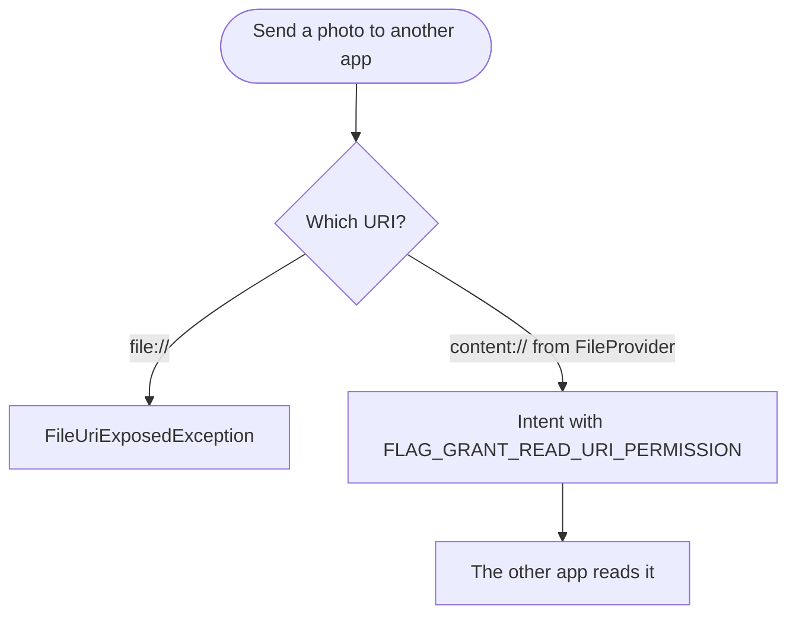

Android 7.0 Nougat is the release that put two apps on one phone screen.
Users got split-screen multi-window, replies typed straight into a
notification, and Doze that also works while the phone moves in a pocket.
Developers got file-based encryption with Direct Boot, a declarative network
security config, and a crash for apps that still share `file://` URIs.


## At a glance

|                                 |                                                                                              |
| ------------------------------- | -------------------------------------------------------------------------------------------- |
| Version                         | Android 7.0                                                                                  |
| API level                       | 24                                                                                           |
| Name                            | Nougat, public                                                                               |
| `Build.VERSION_CODES`           | `N`                                                                                          |
| Final APIs and SDK              | 15 June 2016                                                                                 |
| Release                         | Nexus rollout began 22 August 2016                                                           |
| Launch device                   | LG V20, the first new phone to ship with Nougat                                              |
| Google Play target-API deadline | None. Play's target-API rule started in 2018, at API 26                                      |
| Toolchain                       | `compileSdkVersion 24`, Build Tools 24.0.0 and JDK 8; Android Studio 2.1 for Java 8 features |

Google declared the N APIs final on 15 June 2016 and told developers they
could publish updates that compile against, and optionally target, API 24. On
22 August Dave Burke announced the rollout "starting with Nexus devices": over
several weeks to the Nexus 6, 5X, 6P, 9, Nexus Player, Pixel C and General
Mobile 4G (Android One). The source went to AOSP the same day, and Ars Technica
published its review. Android Police, 9to5Google and Engadget listed the same
devices that day; the 2013 Nexus 5 was not updated.

Google's setup page for the final API 24 SDK asks for `compileSdkVersion 24`,
Build Tools 24.0.0 and JDK 8. Java 8 language features needed the Jack
compiler, supported then only in Android Studio 2.1. Google's current
compatibility table starts at API 33, so no minimum Android Gradle Plugin is
stated for API 24.

The first developer preview came out on 9 March 2016. Burke called it "early…
really early", and the new Android Beta Program delivered it over the air to
the same Nexus devices and the Pixel C. Its five developer previews, from March to July, follow this overview as parts, from [Developer Preview 1](/notes/android-7-0-nougat/developer-preview-1/) to [Developer Preview 5](/notes/android-7-0-nougat/developer-preview-5/). At launch he also moved Nougat to "a
new regular maintenance schedule over the coming quarters". Phones built on
Qualcomm's Snapdragon 800 and 801, which powered most flagships from late 2013
to late 2014, were left out: Ars Technica found an official Nougat update for
them "very difficult if not completely impossible".

## What it brought

- **Multi-window.** Two apps run side by side or one above the other on phones
  and tablets. Ars Technica describes the gesture: long-press the Recents
  button, then pick the second app. Android TV got picture-in-picture, and
  users can drag and drop content between the two apps.
- **Notifications.** Direct Reply puts a text field inside the notification.
  Bundled notifications group several alerts from one app. `MessagingStyle`
  lays out conversations. A long press on a notification opens its controls.
- **Doze on the go.** Doze, added in
  [Android 6.0 Marshmallow](/notes/android-6-marshmallow/), now works in two
  levels. The first applies whenever the screen is off and the phone is
  unplugged, even in a pocket.


- **Profile-guided JIT/AOT.** ART gained a JIT compiler that profiles the
  hot methods of each app. It compiles them ahead of time only when the device
  is idle and charging. Google says large apps that took minutes to optimize on
  6.0 now install "in just a matter of seconds".
- **Vulkan.** The low-overhead 3D API is in the NDK, on hardware that
  supports it. The CDD makes every device ship a `libvulkan.so`; one without
  Vulkan reports zero devices from `vkEnumeratePhysicalDevices`.
- **Data Saver.** A user switch that blocks background data on metered
  networks. Apps read it with `ConnectivityManager.getRestrictBackgroundStatus()`
  and watch for `ACTION_RESTRICT_BACKGROUND_CHANGED`.
- **Quick Settings tile API.** Apps add tiles through `TileService` and the
  `Tile` class. Users can rearrange the tiles.
- **Display size.** Users scale the whole interface, not only the text,
  down to a minimum width of `sw320dp`.
- **OpenJDK and Java 8.** The core `java.*` libraries now come from OpenJDK
  instead of Apache Harmony. AOSP's `libcore` at `android-7.0.0_r1` has an
  `ojluni` tree that 6.0.1 lacks. With the Jack toolchain, lambdas work back to
  Gingerbread; default and static interface methods and streams need API 24.
- **Emoji.** Nougat supports Unicode 9, 72 new emoji by Ars Technica's count,
  and is the first version with skin tone modifiers. Apps check that a glyph
  exists with `Paint.hasGlyph()` before inserting it; keyboards should offer
  the skin tones.
- **Smaller additions.** Multi-locale settings with `LocaleList`, a subset of
  ICU4J under `android.icu`, number blocking (`BlockedNumberContract`), call
  screening (`CallScreeningService`), OpenGL ES 3.2, VR mode, the keyboard
  shortcuts helper, custom pointer icons, the Frame Metrics API, and Chrome as
  the WebView provider.

## Security and privacy

- **File-based encryption.** Files are encrypted one by one instead of as a
  single block device, which isolates each user and profile better. The
  7.0 CDD says devices "SHOULD" meet the encryption requirement with FBE.
- **Direct Boot.** Built on FBE. After a reboot the phone reaches the lock
  screen, and alarm clocks, messages and accessibility services marked
  `android:directBootAware` run before the user unlocks. They see only
  device-encrypted storage; credential-encrypted storage opens after unlock.
- **Strict Verified Boot.** Android 7.0 strictly enforces Verified Boot, so a
  compromised device does not boot. It also corrects accidental data
  corruption.
- **Seamless updates.** On select new devices, two copies of the system
  partitions (slots A and B) let an update install in the background. If the
  new slot fails to boot, the device falls back to the old one. Ars Technica
  notes it only works on devices that launch with 7.0 or later.
- **Media stack split.** After Stagefright, mediaserver was broken up. Parsing
  in `libstagefright` runs in a mediacodec sandbox with very few permissions.
  Camera access lives only in `cameraserver`, and Bluetooth only in
  `audioserver`. Integer overflow checks cover the whole media stack.
- **Trusted CAs.** Apps targeting API 24 trust only the system CA store.
  Certificates installed by the user or by a device admin are ignored unless
  the app opts in. Every compatible device ships the same AOSP CA set.
- **Network security config.** An XML file, referenced by
  `android:networkSecurityConfig`, sets trust anchors per domain, cleartext
  rules, certificate pins, and debug-only overrides.
- **Smaller changes.** APK Signature Scheme v2 signs the whole file and
  verifies faster. Key attestation proves a key lives in hardware. Seccomp
  became a CDD requirement, the kernel got read-only memory and restricted
  access to userspace, and library load order is randomized.

## Permissions

No new dangerous permissions arrived. Android 7.0 added four permissions that
guard services the system binds to, removed one constant, and needs storage
access in fewer places:

| Permission                                                    | What changed in API 24                                                                | What to declare                                                           | What to remove or limit                                                                 |
| ------------------------------------------------------------- | ------------------------------------------------------------------------------------- | ------------------------------------------------------------------------- | --------------------------------------------------------------------------------------- |
| `BIND_QUICK_SETTINGS_TILE`                                    | New; only the system can bind a `TileService` that requires it                        | `android:permission` on the tile's `<service>`, not a `<uses-permission>` | Nothing                                                                                 |
| `BIND_SCREENING_SERVICE`                                      | New; guards a `CallScreeningService`                                                  | `android:permission` on the `<service>`                                   | Nothing                                                                                 |
| `BIND_VR_LISTENER_SERVICE`, `BIND_CONDITION_PROVIDER_SERVICE` | New; guard `VrListenerService` and `ConditionProviderService`                         | `android:permission` on the `<service>`                                   | Nothing; `ConditionProviderService` is deprecated since API 29                          |
| `FLASHLIGHT`                                                  | Removed from the SDK                                                                  | Nothing                                                                   | Drop code that reads `Manifest.permission.FLASHLIGHT`; the constant is gone from API 24 |
| `WRITE_EXTERNAL_STORAGE`                                      | `Debug.startMethodTracing()` writes to the app's own directory and no longer needs it | Nothing new                                                               | Remove it if method tracing was its only use                                            |
| `READ_EXTERNAL_STORAGE`                                       | `StorageVolume.createAccessIntent()` can ask for one folder instead                   | Nothing for scoped directory access                                       | Nothing; scoped directory access was deprecated in API 29                               |
| `DELETE_PACKAGES`                                             | Deleting a package another app installed needs the user's confirmation                | Not for third-party apps                                                  | Nothing; expect `STATUS_PENDING_USER_ACTION` from `PackageInstaller.uninstall()`        |

One manifest for an app that runs on Android 6.0 and earlier and on 7.0 and
later. Keep only the blocks your app needs:

```xml
<manifest xmlns:android="http://schemas.android.com/apk/res/android">

    <!-- Trust rules per domain; read from Android 7.0 on -->
    <application android:networkSecurityConfig="@xml/network_security_config">

        <!-- Share private files as content:// URIs on every version -->
        <provider
            android:name="androidx.core.content.FileProvider"
            android:authorities="${applicationId}.fileprovider"
            android:exported="false"
            android:grantUriPermissions="true">
            <meta-data
                android:name="android.support.FILE_PROVIDER_PATHS"
                android:resource="@xml/filepaths" />
        </provider>

        <!-- Quick Settings tile: the permission goes on the service -->
        <service
            android:name=".MyTileService"
            android:exported="true"
            android:icon="@drawable/ic_tile"
            android:label="@string/tile_label"
            android:permission="android.permission.BIND_QUICK_SETTINGS_TILE">
            <intent-filter>
                <action android:name="android.service.quicksettings.action.QS_TILE" />
            </intent-filter>
        </service>
    </application>
</manifest>
```

The tile and the network security config take effect from Android 7.0. For a
debugging proxy, put its CA under `<debug-overrides>` in
`network_security_config.xml`; it is trusted only while
`android:debuggable` is `true`.

- **Scoped directory access.** `createAccessIntent()` asks for one folder,
  such as `Pictures`, and the user allows or denies it in a dialog.
- **Private files.** For apps targeting API 24, the private data directory is
  `0700` and `MODE_WORLD_READABLE` or `MODE_WORLD_WRITEABLE` throws a
  `SecurityException`. What to do is in
  [the targeting table](#apps-targeting-api-24).
- **Blocked numbers.** Only the default phone app, the default SMS app and
  carrier apps can read or write the blocked list.
- **Backup.** Android Backup now covers runtime permission grants, according
  to Google's Nougat feature list.

## What changed for your app

### All apps on Android 7.0

| Change                                                      | What to do                                                                                  | How to check                                                                      |
| ----------------------------------------------------------- | ------------------------------------------------------------------------------------------- | --------------------------------------------------------------------------------- |
| Doze's first level applies while the phone moves            | Follow the 6.0 Doze guidance; use Firebase Cloud Messaging for messages                     | `adb shell dumpsys deviceidle force-idle`, then `unforce`                         |
| `Camera.ACTION_NEW_PICTURE` and `ACTION_NEW_VIDEO` are gone | Watch media with a `JobScheduler` job and `JobInfo.Builder.addTriggerContentUri()`          |                                                                                   |
| Private NDK libraries outside a short list fail to load     | Use public NDK APIs or bundle your own copy                                                 | `UnsatisfiedLinkError` in logcat; `readelf -dW` lists a `.so` file's dependencies |
| `libcutils`, `libcrypto`, `libssl`, `libandroid_runtime`    | Allowed with a warning only if you target 23 or lower; bundle them now                      | A linker warning in logcat and a toast on the device                              |
| Display size kills background apps targeting 23 or lower    | Restore state cleanly when relaunched from Recents                                          | Change "Display size", then reopen the app from Recents                           |
| RC4 cipher suites are disabled                              | Enable TLS 1.2, AES-GCM and ECDHE on the server                                             |                                                                                   |
| Writing to a TCP socket on the main thread throws           | Move network work off the main thread                                                       | `NetworkOnMainThreadException` in logcat                                          |
| Annotation visibility is enforced                           | Add `@Retention(RetentionPolicy.RUNTIME)` to annotations read at runtime                    |                                                                                   |
| Apps targeting 23 or lower in split-screen                  | Resizable apps are forced to resize with a warning; fixed-orientation apps stay full screen |                                                                                   |

### Apps targeting API 24

| Change                                                                                      | What to do                                                                               | How to check                                            |
| ------------------------------------------------------------------------------------------- | ---------------------------------------------------------------------------------------- | ------------------------------------------------------- |
| `file://` URIs leaving the app throw `FileUriExposedException`                              | Share a `content://` URI from `FileProvider` with a temporary grant                      | `StrictMode` `detectFileUriExposure()` in debug builds  |
| `CONNECTIVITY_ACTION` no longer reaches manifest receivers                                  | Register at runtime with `registerReceiver()`, or schedule the work with `JobScheduler`  |                                                         |
| User-added CAs are not trusted                                                              | Opt in through a network security config, or use `debug-overrides` for a debugging proxy | Lint `AcceptsUserCertificates`, `NetworkSecurityConfig` |
| Private directory is `0700`; `MODE_WORLD_*` throws                                          | Share files through `FileProvider`                                                       | Lint `WorldReadableFiles`, `WorldWriteableFiles`        |
| `DownloadManager.COLUMN_LOCAL_FILENAME` throws `SecurityException`                          | Open the download with `ContentResolver.openFileDescriptor()`                            |                                                         |
| Private libraries on the temporary list fail too                                            | Bundle them or move to NDK APIs                                                          | `UnsatisfiedLinkError` in logcat                        |
| Activities are resizable by default                                                         | Test in split-screen, or set `android:resizeableActivity="false"`                        | Lint `NonResizeableActivity` flags the opt-out          |
| Display size changes reach every process as a configuration change                          | Refresh density-dependent caches such as bitmaps                                         | Change "Display size" while the app runs                |
| The `Crypto` provider and `SHA1PRNG` are gone                                               | Derive keys with a real key derivation function                                          | Lint `DeletedProvider`                                  |
| `TransactionTooLargeException` is rethrown as `RuntimeException`                            | Keep `onSaveInstanceState()` small                                                       |                                                         |
| Default `serialVersionUID` changed for some classes                                         | Declare `serialVersionUID` explicitly                                                    |                                                         |
| A device policy controller's `setCertInstallerPackage()` throws if the installer is missing | Install the delegated certificate installer first                                        |                                                         |



Mark Murphy of CommonsWare found the `file://` ban in the first developer
preview: a `file://` URI as an intent's data, in an extra such as
`EXTRA_OUTPUT` for the camera, or on the clipboard all crash. Google's
behaviour page says the framework enforces a `StrictMode` policy against
them for these apps.

## Migrating to API 24

From `targetSdkVersion 23` to 24, in this order:

1. **Update the toolchain.** Set `compileSdkVersion 24` and Build Tools
   24.0.0, on JDK 8. Skipped, the API 24 classes and constants do not compile.
   Verify: the project builds and lint runs clean of new errors.
2. **Replace `file://` URIs.** Declare a `FileProvider` and share
   `content://` URIs with `FLAG_GRANT_READ_URI_PERMISSION`, including camera
   `EXTRA_OUTPUT` and "Open with" intents. Skipped, every such call crashes
   with `FileUriExposedException`. Verify: enable `detectFileUriExposure()`
   in a debug build and run each share, capture and open flow on Android 7.0.
3. **Move connectivity listeners.** Replace manifest receivers for
   `CONNECTIVITY_ACTION` with `registerReceiver()` while the app runs, or a
   `JobScheduler` job with a network condition. Skipped, the receiver never
   fires. Verify: switch between Wi-Fi and mobile data on an Android 7.0
   device.
4. **Decide on user CAs.** Add a network security config; trust user CAs only
   where you must, and a debugging proxy only under `debug-overrides`.
   Skipped, TLS to servers behind a user-installed CA fails, and so does your
   debugging proxy. Verify: lint `AcceptsUserCertificates` and
   `NetworkSecurityConfig`, then a release build against the proxy.
5. **Bundle native libraries.** Remove links to private platform libraries,
   including ones pulled in by third-party code. Skipped, `System.loadLibrary`
   fails and the app crashes at start. Verify: while still on 23, read logcat
   for linker warnings; `readelf -dW` on each `.so` file.
6. **Check private files and downloads.** Drop `MODE_WORLD_*` and stop reading
   `COLUMN_LOCAL_FILENAME`. Skipped, both throw `SecurityException`. Verify:
   lint `WorldReadableFiles` and `WorldWriteableFiles`.
7. **Go through the smaller rows** of the targeting table that apply to you:
   multi-window resizing, display size, the `Crypto` provider,
   `TransactionTooLargeException`, `serialVersionUID` and device policy
   controllers.
8. **Test the result** on an Android 7.0 device or emulator with
   `targetSdkVersion 24`: split-screen, a "Display size" change, and Doze with
   `adb shell dumpsys deviceidle force-idle`.

Skipping several levels at once: do each version's steps in order, starting
with runtime permissions in
[Android 6.0 Marshmallow](/notes/android-6-marshmallow/) if you target 22 or
lower.

## What lasted

- **Multi-window** grew: Android 8.0 brought picture-in-picture to phones, and
  Android 10 keeps every visible activity resumed, where 7.0 resumed only the
  one last touched.
- **Background limits** tightened in Android 8.0. Apps targeting API 26 can no
  longer declare manifest receivers for most implicit broadcasts.
- **Network security config** is still the place for trust rules. From
  Android 9, apps that target API 28 block cleartext traffic by default.
- **File-based encryption** became mandatory for devices launching with
  Android 10. It could not be combined with adoptable storage on 7.0 to 8.1.
- **A/B updates** got streaming in Android 8.0, and Virtual A/B replaced the
  original layout in Android 10.
- **Jack** did not last either. In March 2017 Google deprecated it and moved
  Java 8 language support into the standard `javac` and `dx` tools.
- **Scoped directory access** did not last. `createAccessIntent()` was
  deprecated in API 29 and returns `RESULT_CANCELED` on Android 10.

## Worth knowing

- The `N` constant in AOSP carries the comment `N is for ¯\_(ツ)_/¯.`
- Inside Google, N was "New York Cheesecake", Android Police reported in
  March 2016. AOSP history at the 7.0 tag shows the initials in branch names
  such as `nyc-dev` and `nyc-release`.
- Google asked the public for names on android.com under `#NameAndroidN`,
  with entries closing on 8 June 2016. It was a call for suggestions, not a
  vote. Google kept the final choice and revealed Nougat on 30 June 2016.
- The Easter egg is **Android Neko**, a cat collector. Tap "Android version"
  in Settings three times quickly, tap the logo five times, then long-press
  it. A toast shows a cat: a hidden Quick Settings tile is now enabled.
- The tile fills a dish with Bits, Fish, Chicken or a Treat. A `JobScheduler`
  job then runs in 15, 30, 60 or 120 minutes, and a notification says
  "A cat is here." Better food makes a new cat likelier than a returning one:
  5% for Bits, 90% for a Treat.
