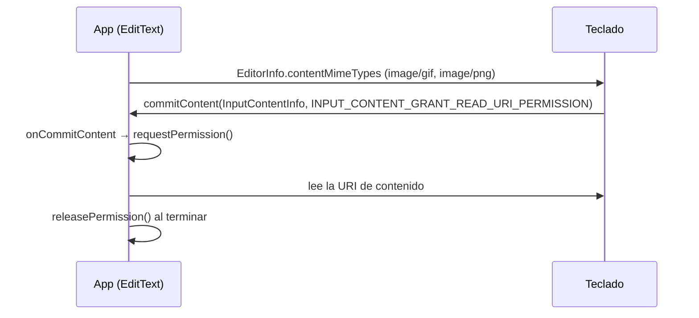

Android 7.1 es la actualización de Nougat que llegó primero al teléfono propio
de Google, el Pixel, dos meses antes que a cualquier Nexus. A los usuarios les
trajo Night Light y las actualizaciones sin interrupción. A los desarrolladores,
API 25 les dio accesos directos en el icono del launcher, iconos redondos y una
forma de que los teclados envíen imágenes.

 · Marca registrada de Google LLC')

## De un vistazo

|                                    |                                                                               |
| ---------------------------------- | ----------------------------------------------------------------------------- |
| Versión                            | Android 7.1 (7.1.1 y 7.1.2 mantuvieron el mismo nivel de API)                 |
| Nivel de API                       | 25                                                                            |
| Nombre                             | Nougat, público (el mismo nombre que 7.0)                                     |
| `Build.VERSION_CODES`              | `N_MR1`                                                                       |
| Play acepta apps con API 25        | 22 de noviembre de 2016, con la Developer Preview 2                           |
| Lanzamiento                        | En el Pixel, octubre de 2016. 7.1.1 llegó a los Nexus desde el 5 de diciembre |
| Dispositivos de lanzamiento        | Pixel y Pixel XL, anunciados y en preventa el 4 de octubre de 2016            |
| Plazo de target API en Google Play | Ninguno. La regla de target API de Play empezó en 2018, con API 26            |

Google anunció el Pixel el 4 de octubre de 2016 con "Android 7.1 Nougat". Las
primeras imágenes de fábrica del Pixel, compilación NDE63H, son de octubre de 2016. El 11 de octubre Google anunció una developer preview para los Nexus
"later this month" y la versión final "in early December". La segunda
compilación de la preview, del 22 de noviembre, permitió publicar en Play apps
con target API 25.

7.1 es una versión menor sobre [Android 7.0](/es/notes/android-7-0-nougat/).
Todo lo que trajo 7.0, desde la multiventana hasta el cifrado por archivo, está
en esa nota.

### Tres versiones, un nivel de API

| Versión | Fecha          | Dispositivos                                                                                                                                                                                  |
| ------- | -------------- | --------------------------------------------------------------------------------------------------------------------------------------------------------------------------------------------- |
| 7.1     | Octubre 2016   | Solo Pixel y Pixel XL                                                                                                                                                                         |
| 7.1.1   | Diciembre 2016 | Pixel, Pixel XL, Nexus 5X, 6P, 6, 9, Nexus Player, Pixel C y General Mobile 4G (Android One). El código llegó a AOSP el mismo día                                                             |
| 7.1.2   | Abril 2017     | Pixel, Pixel XL, Pixel C, Nexus 5X, 6P y Nexus Player. Google la describió como una actualización de mantenimiento: correcciones, optimizaciones y algunos cambios para operadores y usuarios |

El Nexus 6 y el Nexus 9 nunca recibieron 7.1.2. Sus últimas imágenes de fábrica
son compilaciones de 7.1.1 de octubre de 2017.

## Qué trajo

- **Accesos directos (app shortcuts).** Una pulsación larga en el icono del
  launcher muestra acciones que llevan directo a una parte de la app, cada una
  respaldada por un intent. Los estáticos van en `res/xml/shortcuts.xml`,
  referenciado desde la actividad del launcher con un
  `<meta-data android:name="android.app.shortcuts">`. Los dinámicos se publican
  en ejecución con `ShortcutManager` (`Context.SHORTCUT_SERVICE`). La página de
  Google para 7.1 permitía hasta cinco por app, y algunos launchers muestran
  menos.
- **Iconos redondos.** Un atributo nuevo, `android:roundIcon`. Cuando el
  launcher pide un icono, el framework devuelve `android:icon` o
  `android:roundIcon` según la configuración del dispositivo. El launcher del
  Pixel usaba el redondo.
- **Teclados con imágenes.** La Commit Content API permite que un teclado envíe
  un GIF, un sticker o una imagen directamente a un campo de texto. El flujo
  está en [Permisos](#permisos), porque depende de un permiso sobre una URI.
  También llegó en la support library 25.0.0 para versiones anteriores.
- **Night Light.** Tiñe la pantalla de ámbar según un horario o al atardecer.
  Funciona con el Hardware Composer HAL 2.0 en lugar de un shader de GL, así
  que necesita soporte del driver. Ian Lake, de Google, explicó que por eso los
  Nexus no lo tendrían, según Android Police.
- **Intent del gestor de almacenamiento.** `StorageManager.ACTION_MANAGE_STORAGE`
  abre la pantalla del sistema "Free up space", para que una app sin espacio
  deje al usuario liberarlo.
- **Usuario demo.** `UserManager.isDemoUser()` le dice a una app que corre en
  un equipo de exhibición en tienda. AOSP fecha el modo demo para tiendas a
  nivel de sistema en 7.1.1.
- **Daydream VR.** El modo VR llegó con 7.0. 7.1 añadió
  `ActivityManager.setVrThread()`: un hilo por proceso al que el planificador
  da prioridad mientras la app está en modo VR. Google presentó su visor
  Daydream en el mismo evento del 4 de octubre.
- **Añadidos menores.** Paridad de género en los emoji de profesiones (se
  comprueba con `Paint.hasGlyph()`), URL de contexto y título en los metadatos
  de fondos animados, llamadas multi-endpoint y tipos de origen de Visual
  Voicemail para operadores, y las densidades para Wear `DENSITY_260`,
  `DENSITY_300` y `DENSITY_340`.

### Lo que era del Pixel, no de Android

Ars Technica listó lo que Google se guardó para el Pixel: el Pixel Launcher con
su cajón de apps que se abre deslizando hacia arriba, Google Assistant, la copia
ilimitada en calidad original en Google Photos, la pestaña de soporte en
Settings y los nuevos botones de navegación. Los Nexus con 7.1.1 recibieron la
lista de la plataforma. El Nexus 5X y el 6P tampoco tuvieron el gesto de
deslizar en el sensor de huellas para abrir las notificaciones, porque su
sensor no lo permitía, según Android Police.

## Seguridad y privacidad

- **Sin lista nueva de refuerzos.** La página "Security enhancements" de Google
  tiene una entrada para 7.0 y nada para 7.1. El trabajo de plataforma está en
  [7.0](/es/notes/android-7-0-nougat/).
- **Actualizaciones sin interrupción.** Los Pixel fueron los primeros teléfonos
  con actualizaciones A/B: dos ranuras de sistema, una se actualiza en segundo
  plano mientras el teléfono sigue en uso. Si la nueva no arranca, el
  dispositivo vuelve a la anterior. El CDD de 7.1 añadió que los dispositivos
  "SHOULD support A/B system updates"; el CDD de 7.0 no lo decía.
- **Actualizaciones de Google.** Google dijo que los Pixel reciben
  actualizaciones de software y de seguridad "as soon as they're available,
  directly from Google". Ars Technica señaló que la promesa cubría dos años de
  actualizaciones mayores del sistema.
- **El gestor de almacenamiento puede desinstalar sin aviso.** El CDD de 7.1
  prohíbe que alguien distinto al instalador de una app la desinstale sin
  preguntar, con dos excepciones: el verificador de paquetes y el gestor de
  almacenamiento que atiende `ACTION_MANAGE_STORAGE`. Esa segunda excepción es
  nueva en 7.1.

## Permisos

API 25 no añadió ni quitó ningún permiso. El diff de la API para el paquete
`android` solo toca `R.attr`, donde viven los atributos de los accesos directos
y `roundIcon`. Dos funciones se protegen de otra forma:

- **Quién lee los accesos directos.** Los de otra app solo los ve el launcher
  actual, lo que comprueba `LauncherApps.hasShortcutHostPermission()`. Publicar
  los propios no requiere permiso.
- **Contenido del teclado.** El teclado entrega una URI de contenido, no los
  bytes. Activa `INPUT_CONTENT_GRANT_READ_URI_PERMISSION`, que desde API 25 da a
  la app una lectura temporal de esa URI. En 7.0 y anteriores la bandera se
  ignora y el teclado tiene que conceder el acceso por su cuenta.

Google recomienda que el provider del teclado no se exporte
(`android:exported="false"`) y que conceda permisos sobre URIs
(`android:grantUriPermissions="true"`).

## Qué cambió para tu app

### Todas las apps en Android 7.1

| Cambio                                                           | Qué hacer                                                                                        |
| ---------------------------------------------------------------- | ------------------------------------------------------------------------------------------------ |
| Los launchers pueden pedir `android:roundIcon`                   | Incluye `android:icon` y `android:roundIcon`. Image Asset Studio genera los dos                  |
| Una pulsación larga en tu icono puede mostrar accesos directos   | Añade estáticos en `res/xml/shortcuts.xml`, o dinámicos con `ShortcutManager`                    |
| Las llamadas de accesos dinámicos tienen límite en segundo plano | Actualízalos en primer plano. El límite se reinicia cuando la app pasa a primer plano            |
| Los accesos dinámicos no entran en la copia de seguridad         | Vuelve a publicarlos cuando la app se abra por primera vez en un dispositivo nuevo               |
| Los teclados pueden enviar imágenes                              | Declara los tipos MIME con `EditorInfoCompat.setContentMimeTypes()` y maneja `onCommitContent()` |
| En API 25 los teclados conceden lectura por URI                  | En un IME, activa `INPUT_CONTENT_GRANT_READ_URI_PERMISSION` cuando `SDK_INT >= N_MR1`            |
| Falta almacenamiento                                             | Lanza `ACTION_MANAGE_STORAGE` en lugar de fallar                                                 |

### Apps con target API 25

Google no publicó cambios de comportamiento ligados a apuntar a API 25. Su
página de 7.1 no tiene sección de cambios, y el post de la preview solo
recomendaba apuntar a 25 para "test your app with compatibility behaviors
disabled". El trabajo es opcional: accesos directos, iconos redondos y
contenido enriquecido.

## Qué perduró

- **Los accesos directos** siguen siendo el menú de la pulsación larga. Android
  8.0 añadió los accesos fijados con `requestPinShortcut()`, y los fijados no
  tienen límite de cantidad. La mayoría de launchers hoy muestra cuatro a la
  vez.
- **Los iconos redondos** fueron reemplazados en Android 8.0 por los iconos
  adaptativos, que cada dispositivo recorta con su propia forma.
- **Commit Content** tiene sucesor: Google llama a `OnReceiveContentListener`,
  de Android 12, su siguiente versión. También recibe contenido del
  portapapeles y de arrastrar y soltar.
- **Las actualizaciones A/B** crecieron: A/B por streaming en 8.0, y Virtual
  A/B reemplazó a la A/B clásica en Android 10.
- **Night Light** sigue en AOSP, controlado por `ColorDisplayManager`.
- **El modo demo para tiendas** se rehízo alrededor de usuarios demo en Android
  8.1. AOSP dice ahora que ya no tiene soporte desde 8.1.

## Para saber

- El comentario de la constante en AOSP dice `N MR1: Nougat++.`
- 7.1 conservó el Easter egg de 7.0, Android Neko, el de coleccionar gatos:
  `PlatLogoActivity.java` es el mismo archivo en las dos etiquetas de versión.
- Google ya no garantizaba nuevas versiones al Nexus 6 y al 9 después de
  octubre de 2016, señaló Ars Technica. Los dos recibieron 7.1.1 de todos
  modos, y ahí se quedaron.
