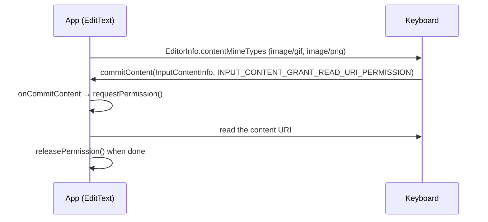

Android 7.1 is the Nougat update that shipped first on Google's own phone, the
Pixel, two months before any Nexus got it. For users it brought Night Light and
seamless updates. For developers, API 25 added app shortcuts on the launcher
icon, round icons and a way for keyboards to send images.

## At a glance

|                                 |                                                                       |
| ------------------------------- | --------------------------------------------------------------------- |
| Version                         | Android 7.1 (7.1.1 and 7.1.2 kept the same API level)                 |
| API level                       | 25                                                                    |
| Name                            | Nougat, public (same name as 7.0)                                     |
| `Build.VERSION_CODES`           | `N_MR1`                                                               |
| Play accepts API 25 apps        | 19 October 2016, with Developer Preview 1                             |
| Release                         | On the Pixel, October 2016. Nexus rollout of 7.1.1 began 5 December   |
| Launch devices                  | Pixel and Pixel XL, announced and opened for pre-order 4 October 2016 |
| Google Play target-API deadline | None. Play's target-API rule started in 2018, at API 26               |
| Toolchain                       | `compileSdkVersion 25`, Android Studio 2.2.2                          |

Google's preview posts asked developers to "update to Android Studio 2.2.2",
download the API 25 platform and set `compileSdkVersion` to 25. They name no
minimum Android Gradle Plugin, so this note gives none.

Google announced the Pixel on 4 October 2016 with "Android 7.1 Nougat" on
board. The first Pixel factory images, build NDE63H, are dated October 2016. On
11 October Google said a developer preview for Nexus devices would come "later
this month" and the final release "in early December". The preview's first
build, on 19 October, already had the final API 25 and opened Play to apps
targeting it. The two developer previews and the two 7.1.2 betas are the four
parts that follow this overview.

7.1 is a point release on top of [Android 7.0](/notes/android-7-0-nougat/).
Everything 7.0 introduced, from multi-window to file-based encryption, is
covered there.

### Three releases, one API level

| Release | Date          | Devices                                                                                                                                                           |
| ------- | ------------- | ----------------------------------------------------------------------------------------------------------------------------------------------------------------- |
| 7.1     | October 2016  | Pixel and Pixel XL only                                                                                                                                           |
| 7.1.1   | December 2016 | Pixel, Pixel XL, Nexus 5X, 6P, 6, 9, Nexus Player, Pixel C and General Mobile 4G (Android One). Source pushed to AOSP the same day                                |
| 7.1.2   | April 2017    | Pixel, Pixel XL, Pixel C, Nexus 5X, 6P and Nexus Player. Google called it a maintenance update: bug fixes, optimizations and a few changes for carriers and users |

The Nexus 6 and Nexus 9 never got 7.1.2. Their last factory images are 7.1.1
builds from October 2017. In 7.1.2 the Pixel C got the Pixel Launcher, round
icons and a tablet recent-apps grid, and every device got a "Battery usage
alerts" screen, Ars Technica reported.

## What it brought

- **App shortcuts.** A long press on a launcher icon shows actions that jump
  into the app, each one backed by an intent. Static shortcuts live in
  `res/xml/shortcuts.xml`, referenced from the launcher activity with a
  `<meta-data android:name="android.app.shortcuts">`. Dynamic ones are
  published at runtime through `ShortcutManager` (`Context.SHORTCUT_SERVICE`).
  Google's 7.1 page allowed up to five per app, and some launchers show fewer.
- **Round icons.** A new `android:roundIcon` attribute. The launcher asks for
  an icon, and the framework returns `android:icon` or `android:roundIcon`
  depending on the device build. The Pixel launcher used the round one.
- **Image keyboards.** The Commit Content API lets a keyboard send a GIF,
  sticker or image straight into a text field. The flow is in
  [Permissions](#permissions), because it rests on a URI grant. It also shipped
  in support library 25.0.0 for older versions.
- **Night Light.** Tints the screen amber on a schedule or at sunset. It runs
  through the Hardware Composer HAL 2.0 instead of a GL shader, so it needs
  driver support. Google's Ian Lake said that is why Nexus phones would not get
  it, as reported by Android Police.
- **Storage manager intent.** `StorageManager.ACTION_MANAGE_STORAGE` opens the
  system "Free up space" screen, so an app short of space can let the user
  clear room.
- **Demo user.** `UserManager.isDemoUser()` tells an app it runs on a store
  demo unit. AOSP dates system-level retail demo mode to 7.1.1.
- **Daydream VR.** VR mode came in 7.0. 7.1 added
  `ActivityManager.setVrThread()`: one thread per process that the scheduler
  favours while the app is in VR mode. Google launched its Daydream headset at
  the same 4 October event.
- **Smaller additions.** Gender parity for profession emoji (check support with
  `Paint.hasGlyph()`), a context URL and title for live wallpaper metadata,
  multi-endpoint calling and Visual Voicemail source types for carriers, and
  Wear densities `DENSITY_260`, `DENSITY_300` and `DENSITY_340`.

### What was Pixel, not Android

Ars Technica listed what Google kept for the Pixel: the Pixel Launcher with its
swipe-up app drawer, Google Assistant, unlimited original-quality Google Photos
backup, the support tab in Settings and the new navigation buttons. Nexus
devices on 7.1.1 got the platform list instead. The Nexus 5X and 6P also missed
the fingerprint swipe to open notifications. Android Police reported that their
sensors could not do it, but Google's 7.1.2 changelog lists "Fingerprint swipe
on 5X/6P", as reported by Ars Technica.

## Security and privacy

- **No new hardening list.** Google's "Security enhancements" page has a 7.0
  entry and nothing for 7.1. The platform work is in
  [7.0](/notes/android-7-0-nougat/).
- **Seamless updates.** The Pixels were the first phones with A/B system
  updates: two system slots, one updated in the background while the phone
  stays in use. If the new slot fails to boot, the device falls back to the old
  one. The 7.1 CDD added that devices "SHOULD support A/B system updates"; the
  7.0 CDD did not say so.
- **Updates from Google.** Google said Pixel phones get software and security
  updates "as soon as they're available, directly from Google". Ars Technica
  noted the promise covered two years of major OS updates.
- **Storage manager may uninstall silently.** The 7.1 CDD forbids anyone but
  an app's installer from uninstalling it without a prompt, with two
  exceptions: the package verifier and the storage manager handling
  `ACTION_MANAGE_STORAGE`. That second exception is new in 7.1.
- **End of security patches.** The October 2019 security bulletin is the last
  that lists 7.1.1 and 7.1.2 among the updated AOSP versions. From November
  2019 the oldest version listed is 8.0.

## Permissions

No permission was added, changed, split, deprecated or removed in API 25, so
there is nothing new to declare or remove. The API diff for the `android`
package touches only `R.attr`, where the shortcut and `roundIcon` attributes
live. Two features are guarded in other ways:

- **Who reads shortcuts.** Another app's shortcuts are visible only to the
  current launcher, checked by `LauncherApps.hasShortcutHostPermission()`.
  Publishing your own needs no permission.
- **Keyboard content.** The keyboard hands over a content URI, not the bytes.
  It sets `INPUT_CONTENT_GRANT_READ_URI_PERMISSION`, which grants the app a
  temporary read on that URI from API 25. On 7.0 and lower the flag is ignored
  and the keyboard has to grant access itself.

Google recommends that the keyboard's provider is not exported
(`android:exported="false"`) and grants URI permissions instead
(`android:grantUriPermissions="true"`).

## What changed for your app

### All apps on Android 7.1

| Change                                                      | What to do                                                                                      | How to check                                                                            |
| ----------------------------------------------------------- | ----------------------------------------------------------------------------------------------- | --------------------------------------------------------------------------------------- |
| Launchers may ask for `android:roundIcon`                   | Ship both `android:icon` and `android:roundIcon`. Image Asset Studio generates both             | The Google APIs emulator image for API 25, which has round icons and the Pixel Launcher |
| Long press on your icon can show shortcuts                  | Add static shortcuts in `res/xml/shortcuts.xml`, or dynamic ones with `ShortcutManager`         | Lint `NewApi` for `ShortcutManager` calls below `minSdk 25`; Lint `ReportShortcutUsage` |
| Dynamic shortcut calls are rate-limited for background apps | Update them from the foreground. Rate limiting resets when the app comes to the foreground      | `adb shell cmd shortcut reset-throttling`                                               |
| Dynamic shortcuts are not backed up                         | Re-publish them when the app first opens on a new device                                        |                                                                                         |
| Keyboards can commit images                                 | Declare MIME types with `EditorInfoCompat.setContentMimeTypes()` and handle `onCommitContent()` |                                                                                         |
| Keyboards on API 25 grant reads per URI                     | In an IME, set `INPUT_CONTENT_GRANT_READ_URI_PERMISSION` when `SDK_INT >= N_MR1`                |                                                                                         |
| Not enough storage                                          | Fire `ACTION_MANAGE_STORAGE` instead of failing                                                 |                                                                                         |

### Apps targeting API 25

None. Google published no behaviour changes tied to targeting API 25: its 7.1
page has no changes section, and the preview posts only advised targeting 25 to
"test your app with compatibility behaviors disabled". Everything in 7.1 is
opt-in: shortcuts, round icons and rich content.

## Migrating to API 25

From `targetSdkVersion 24` to 25, in this order:

1. **Update the toolchain.** Install the API 25 platform and set
   `compileSdkVersion 25`. Skipped, `ShortcutManager` and `android:roundIcon`
   do not compile. Verify: the project builds and lint `NewApi` reports no
   new errors.
2. **Raise `targetSdkVersion` to 25.** No platform behaviour changes with it,
   so nothing breaks. Verify: run the app on an Android 7.1 device or the API
   25 emulator.
3. **Add a round icon.** Generate `android:roundIcon` with Image Asset Studio
   next to `android:icon`. Skipped, nothing breaks. Verify: the Google APIs
   emulator image for API 25 runs the Pixel Launcher. CommonsWare also advised
   checking every other place that shows your own icon.
4. **Add shortcuts if they help your users.** Every `<intent>` in a static
   shortcut needs `android:action`; without it the shortcut does not work.
   Publish dynamic ones from the foreground and re-publish them after a
   restore. Verify: long-press the icon on Android 7.1, reset rate limiting
   with `adb shell cmd shortcut reset-throttling`, and run lint
   `ReportShortcutUsage`.
5. **Accept keyboard images** only if your text fields take them, as in the
   table above.

Skipping several levels at once: do each version's steps in order, starting
from [Android 7.0](/notes/android-7-0-nougat/) if you target 23, or from
[Android 6.0](/notes/android-6-marshmallow/) if you target 22 or lower.

## What lasted

- **App shortcuts** are still the long-press menu. Android 8.0 added pinned
  shortcuts with `requestPinShortcut()`, and pinned ones have no count limit.
  Most launchers now show four at a time.
- **Round icons** were replaced in Android 8.0 by adaptive icons, which the
  device masks to its own shape.
- **Commit Content** has a successor: Google calls Android 12's
  `OnReceiveContentListener` its next version. It also takes content from the
  clipboard and from drag and drop.
- **A/B updates** grew: streaming A/B in 8.0, and Virtual A/B replaced legacy
  A/B in Android 10.
- **Night Light** is still in AOSP, driven by `ColorDisplayManager`.
- **Retail demo mode** was rebuilt around demo users in Android 8.1. AOSP now
  says it is no longer supported since 8.1.

## Worth knowing

- The constant's comment in AOSP reads `N MR1: Nougat++.`
- 7.1 kept the 7.0 Easter egg, the cat-collecting Android Neko:
  `PlatLogoActivity.java` is the same file at both release tags.
- Google no longer guaranteed version updates to the Nexus 6 and 9 after
  October 2016, Ars Technica noted. Both got 7.1.1 anyway, and that is where
  they stopped.
- In 2016 Ars Technica found that Qualcomm was not supporting Nougat on the
  Snapdragon 800 and 801. The Fairphone 2 uses an 801 and still got an official
  7.1.2 update in November 2018. Fairphone says it was the only 801 phone to
  make that upgrade.
