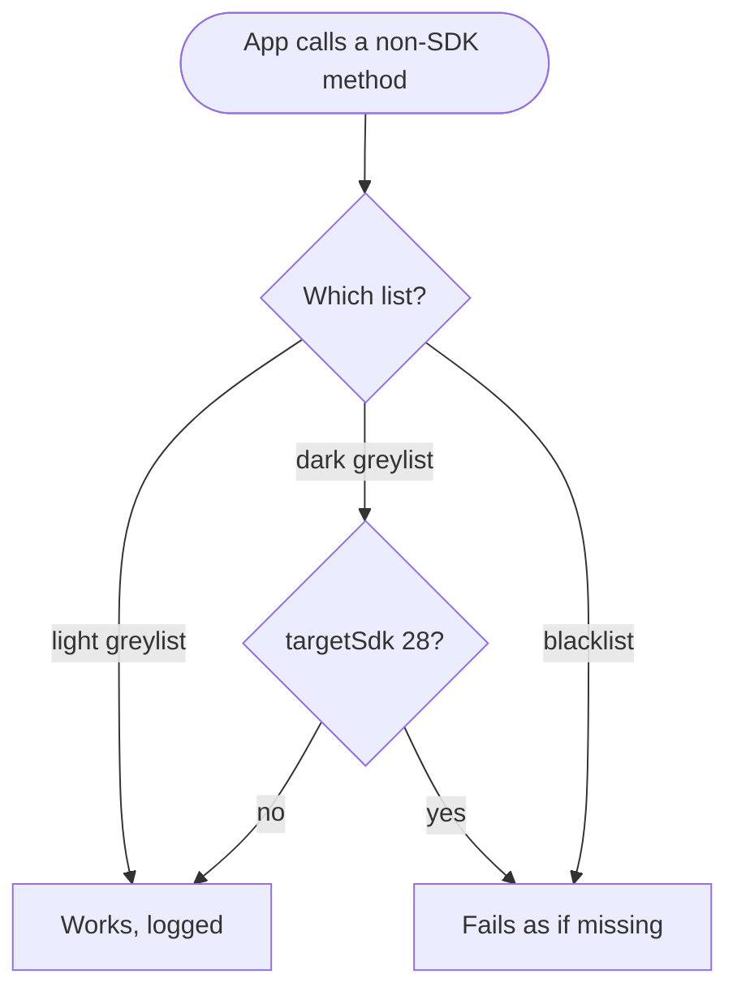

Android 9 Pie is the release that cut idle apps off from the camera, the
microphone and the sensors. Apps targeting API 28 lost cleartext HTTP by
default, and calls into hidden platform APIs started to fail. Users got a
pill-shaped home button with swipe navigation, Adaptive Battery, and the last
dessert name Google used in public.


## At a glance

|                                 |                                                                                      |
| ------------------------------- | ------------------------------------------------------------------------------------ |
| Version                         | Android 9                                                                            |
| API level                       | 28                                                                                   |
| Name                            | Pie, public                                                                          |
| `Build.VERSION_CODES`           | `P`                                                                                  |
| Release                         | Pixel rollout and AOSP source, 6 August 2018                                         |
| Launch devices                  | Pixel, Pixel XL, Pixel 2 and Pixel 2 XL by update; Pixel 3 and Pixel 3 XL came on it |
| Google Play target-API deadline | New apps from August 2019, app updates from November 2019                            |
| Toolchain                       | `compileSdk 28`, the API 28 SDK in Android Studio 3.1 or later                       |

Google's launch post says to install the API 28 SDK into Android Studio 3.1
or use Android Studio 3.2, whose lint metadata was updated for Android 9. No
Google page names a minimum Android Gradle Plugin for API 28.

The first developer preview came out on 7 March 2018; the five preview milestones are the parts below this overview. The beta followed on 8
May, during Google I/O, and thanks to Project Treble it also ran on phones from
Essential, Nokia, Oppo, Sony, Vivo and Xiaomi.

On 6 August 2018 Google pushed the source to AOSP and started the over-the-air
update to Pixel phones. 9to5Google reported the Pixel and Pixel 2 images live
that day, with the August security patch. Essential started pushing the final release to
the Essential Phone the same day. Google promised the update by the
end of fall to devices in the beta from Sony, Xiaomi, HMD Global, Oppo, Vivo,
OnePlus and Essential, and to qualifying Android One phones. AOSP lists the
first Pie builds for Pixel 3 and Pixel 3 XL (`PD1A`) at the September 2018
patch level. AOSP security bulletins listed Android 9 for the last time in
January 2022; from February 2022 they cover Android 10 and later.

## What it brought

- **New system navigation.** A single pill-shaped home button: swipe up for a
  new Overview with full-screen app previews, tap to go home. It was off by
  default, under Settings > Gestures > "Swipe up on home button". Back stayed
  a button, hidden on the home screen.
- **Adaptive Battery.** Built with DeepMind, it uses machine learning to give
  system resources to the apps the user cares about. Underneath are the App
  Standby Buckets, covered under What changed for your app.
- **Display cutout support.** `DisplayCutout` and `getDisplayCutout()` report
  where the notch is. The `layoutInDisplayCutoutMode` window attribute takes
  `DEFAULT`, `SHORT_EDGES` or `NEVER`. Developer options can simulate a cutout
  on any device. The 9 CDD allows cutouts only on the short edges, at most one
  per edge.
- **Smaller user changes.** A rotation button in the navigation bar when
  auto-rotate is off, a screenshot editor, a text magnifier while selecting,
  simplified volume controls, and Adaptive Brightness.
  The clock moved to the left of the status bar to leave room for a notch, and
  quick settings tiles lost their drop-down panels: a long press opens the
  setting instead, as Ars Technica noted.
- **Notifications.** `MessagingStyle` takes a `Person`, shows images with
  `setData()`, keeps reply drafts (`EXTRA_REMOTE_INPUT_DRAFT`) and offers smart
  replies through `RemoteInput.setChoices()`. Users can block whole channel
  groups.
- **Multi-camera API.** Apps can open streams from two or more physical
  cameras at once, or one logical camera that switches between them. External
  USB cameras work through Camera2 on supported devices.
- **Media and images.** `ImageDecoder` replaces `BitmapFactory`, and
  `AnimatedImageDrawable` plays GIF and WebP. HEIF encoding, HDR VP9 Profile 2
  and a Dynamics Processing audio effect joined the platform.
- **Wi-Fi RTT.** On supported hardware, apps with `ACCESS_FINE_LOCATION`
  measure distance to IEEE 802.11mc access points without connecting. Three or
  more give a position typically within 1 to 2 meters.
- **Machine learning and text.** Neural Networks API 1.1 with nine new
  operations, Smart Linkify on top of `TextClassifier`, `PrecomputedText`, and
  Slices and App Actions to show app content in Google surfaces.
- **ART and tracing.** ART's ahead-of-time compiler converts an app's DEX
  files into a more compact form, so apps start faster and use less disk and
  RAM; low-end devices gain the most. System traces can be recorded on the
  device itself and shared as a report, HTML included.
- **Digital Wellbeing.** The Dashboard, App Timer, the new Do Not Disturb and
  Wind Down. It shipped as a Google app from the Play Store, in beta on Pixel
  phones running Android 9.

## Security and privacy

- **Idle apps lose input.** While an app's UID is idle, the microphone reports
  empty audio, `SensorManager` sensors stop sending events, and its cameras
  disconnect with an error. Use a foreground service to keep receiving sensor
  events.
- **TLS by default.** For apps targeting API 28, `isCleartextTrafficPermitted()`
  returns `false` unless the Network Security Configuration allows cleartext
  for a domain. The table for apps targeting API 28 says what to do.
- **Private DNS.** Android 9 upgrades DNS to DNS over TLS when the network's
  server supports it. Users can turn it off or name a provider in "Private DNS"
  under Network & internet. Apps that resolve names themselves can check
  `LinkProperties.isPrivateDnsActive()`.
- **BiometricPrompt.** The system draws one biometric dialog for fingerprint,
  face or iris. Apps should move from `FingerprintManager` to
  `BiometricPrompt`.
- **StrongBox.** A new Keystore backed by a separate secure chip with its own
  CPU, storage and true random number generator. Request it with
  `setIsStrongBoxBacked(true)`; an unsupported key throws
  `StrongBoxUnavailableException`. The 9 CDD only strongly recommends it.
- **Android Protected Confirmation.** On supported devices that launch with
  Android 9, `ConfirmationPrompt` shows a statement the user approves outside
  the main OS. The Trusted Execution Environment then signs it.
- **Keymaster 4.** Secure key import, Triple DES for legacy systems, separate
  patch levels per partition, and `setUnlockedDeviceRequired()` for keys that
  cannot decrypt while the screen is locked.
- **APK Signature Scheme v3.** It can carry a proof-of-rotation record, so an
  app can move to a new signing key.
- **Platform hardening.** Control Flow Integrity in the media framework, NFC
  and Bluetooth, kernel CFI support, more integer overflow sanitizers, and a
  stricter seccomp filter. File-based encryption now works with adoptable
  storage, and metadata encryption arrived where hardware supports it.
- **Lockdown.** "Show lockdown option" in the lock screen settings adds a
  "Lockdown" button to the power menu. It turns off Smart Lock, fingerprint
  unlocking and notifications on the lock screen until the user unlocks with a
  PIN, pattern or password.
- **Encrypted backups.** With a PIN, pattern or password set, Android backups
  are encrypted with a client-side secret, and restoring them needs that
  screen lock.
- **Smaller changes.** A developer option for a randomized MAC address when
  connecting to Wi-Fi, WPS deprecated, Android secure encrypted files (ASEC)
  removed, and hostname checks no longer fall back to the certificate's CN.

## Permissions

Android 9 added four permissions, moved three into a new group and gave two
older ones a new job. The call log and Wi-Fi rules reach every app; the
foreground service and serial number rules reach apps targeting API 28.

| Permission                                                  | What changed in API 28                                                                                | What to declare                                                                                                       | What to remove or limit                                      |
| ----------------------------------------------------------- | ----------------------------------------------------------------------------------------------------- | --------------------------------------------------------------------------------------------------------------------- | ------------------------------------------------------------ |
| `READ_CALL_LOG`, `WRITE_CALL_LOG`, `PROCESS_OUTGOING_CALLS` | Moved from the `PHONE` group to a new `CALL_LOG` group; a `PHONE` grant no longer covers them         | Request them on their own at runtime, or calls throw `SecurityException`                                              | Nothing                                                      |
| `READ_CALL_LOG` for phone numbers                           | Needed to read numbers from the phone state broadcast and `PhoneStateListener`                        | Request it on top of what you already hold                                                                            | Nothing                                                      |
| `FOREGROUND_SERVICE`                                        | New normal permission; apps targeting 28 need it to call `startForeground()`                          | `<uses-permission>` only; it is granted at install                                                                    | Nothing                                                      |
| `READ_PHONE_STATE`                                          | Now the gate for `Build.getSerial()`; `Build.SERIAL` returns "unknown" to apps targeting 28           | Request it only if you need the hardware serial                                                                       | Nothing for 28; Android 10 closes `getSerial()` to Play apps |
| `ACCESS_FINE_LOCATION`, `ACCESS_COARSE_LOCATION`            | One of them is needed for `WifiManager.startScan()` and for SSID and BSSID from `getConnectionInfo()` | Request one at runtime, plus `CHANGE_WIFI_STATE` to scan or `ACCESS_WIFI_STATE` to read; location services must be on | Nothing                                                      |
| `USE_BIOMETRIC`                                             | New normal permission for `BiometricPrompt`                                                           | Declare it when you show `BiometricPrompt`                                                                            | Nothing                                                      |
| `USE_FINGERPRINT`                                           | Deprecated in favour of `USE_BIOMETRIC`                                                               | Keep it while you call `FingerprintManager` on API 27 and lower                                                       | Drop it once nothing calls `FingerprintManager`              |
| `ACCEPT_HANDOVER`                                           | New dangerous permission to continue a call started in another app                                    | Request it at runtime in the calling app that takes the call                                                          | Nothing                                                      |
| `NFC_TRANSACTION_EVENT`                                     | New normal permission to receive NFC transaction events                                               | Declare it if you handle those events                                                                                 | Nothing                                                      |

One manifest for an app that runs on Android 8.1 and earlier and on 9 and
later. Keep only the blocks your app needs:

```xml
<manifest xmlns:android="http://schemas.android.com/apk/res/android">

    <!-- Foreground services: required when targeting API 28 -->
    <uses-permission android:name="android.permission.FOREGROUND_SERVICE" />

    <!-- Call log and phone numbers: their own group from API 28 -->
    <uses-permission android:name="android.permission.READ_PHONE_STATE" />
    <uses-permission android:name="android.permission.READ_CALL_LOG" />

    <!-- Biometrics: the new permission, plus the old one for API 27 and lower -->
    <uses-permission android:name="android.permission.USE_BIOMETRIC" />
    <uses-permission android:name="android.permission.USE_FINGERPRINT" />

    <application
        android:networkSecurityConfig="@xml/network_security_config">

        <!-- Apache HTTP client: required="false" keeps installs on API 23 and lower -->
        <uses-library
            android:name="org.apache.http.legacy"
            android:required="false" />
    </application>
</manifest>
```

With cleartext off by default, `res/xml/network_security_config.xml` names
the only hosts that may still use HTTP:

```xml
<network-security-config>
    <domain-config cleartextTrafficPermitted="true">
        <domain includeSubdomains="true">insecure.example.com</domain>
    </domain-config>
</network-security-config>
```

`android:usesCleartextTraffic` on `<application>` also defaults to `"false"`
for apps targeting 28. From Android 7.0 the platform ignores it whenever a
Network Security Configuration is present, so put the rule in one place.

## What changed for your app

### All apps on Android 9

| Change                                                                              | What to do                                                                                       | How to check                                                                         |
| ----------------------------------------------------------------------------------- | ------------------------------------------------------------------------------------------------ | ------------------------------------------------------------------------------------ |
| App Standby Buckets: active, working set, frequent, rare, never                     | Read your bucket with `UsageStatsManager.getAppStandbyBucket()`                                  | `adb shell am set-standby-bucket <package> rare`                                     |
| Idle apps lose camera, microphone and sensors                                       | Move continuous sensor work into a foreground service                                            |                                                                                      |
| Blacklisted non-SDK interfaces fail; light-greylisted ones log                      | Replace hidden calls with SDK ones; find them with `StrictMode.detectNonSdkApiUsage()`           | Lint `PrivateApi`, `DiscouragedPrivateApi`                                           |
| Foreground apps can scan Wi-Fi 4 times in 2 minutes, all background apps once in 30 | Cache scan results instead of scanning on demand                                                 |                                                                                      |
| `NETWORK_STATE_CHANGED_ACTION` no longer carries SSID or BSSID                      | Call `getConnectionInfo()`                                                                       |                                                                                      |
| With device location off, cell info returns nothing                                 | Handle empty results from `getAllCellInfo()`, `getCellLocation()` and `getNeighboringCellInfo()` |                                                                                      |
| Battery saver applies background limits to every app                                | Test with battery saver on                                                                       | `adb shell dumpsys battery unplug`, then `adb shell settings put global low_power 1` |
| Bouncy Castle versions of many algorithms deprecated                                | Use the Conscrypt provider                                                                       |                                                                                      |
| `FLAG_ACTIVITY_NEW_TASK` enforced again from a non-activity context                 | Add the flag when starting an activity from a service or application context                     |                                                                                      |
| Rotation lock can hold any rotation the top activity supports                       | Do not assume portrait                                                                           |                                                                                      |
| `getCameraIdList()` can list several front or back cameras                          | Let the user choose among them                                                                   |                                                                                      |
| Apps targeting API 16 or lower show a warning when launched                         | Raise `targetSdkVersion` to 17 or higher                                                         |                                                                                      |

The call log and Wi-Fi permission changes also reach every app; they are in
the [permissions table](#permissions).

The bucket limits jobs, alarms and high-priority FCM messages, and in "rare"
also network access. They apply only on battery, and the manufacturer decides
how apps are assigned.

The Wi-Fi background limit used to apply to each app: on Android 8.0 and
[Android 8.1 Oreo](/notes/android-8-1-oreo/), every background app could scan
once in 30 minutes. On Android 9 that one scan is shared by all of them.

The old-app warning reads "This app was built for an older version of Android
and may not work properly." AOSP shows it when `targetSdkVersion` is below
`ro.build.version.min_supported_target_sdk`, which Pie sets to 17.

Non-SDK interfaces fall into lists. The light greylist keeps working, with log
entries and toasts to flag it. The dark greylist fails for apps targeting API
28, and the blacklist fails for every app, with errors such as
`NoSuchMethodError` or `NoSuchFieldException`.



To test, `adb shell settings put global hidden_api_policy_p_apps 1` (and
`hidden_api_policy_pre_p_apps` for older targets) lifts the restriction.

### Apps targeting API 28

| Change                                                                         | What to do                                                                                                            | How to check                                                              |
| ------------------------------------------------------------------------------ | --------------------------------------------------------------------------------------------------------------------- | ------------------------------------------------------------------------- |
| Cleartext traffic blocked by default                                           | Use HTTPS, or set `cleartextTrafficPermitted="true"` for named domains in the Network Security Configuration          | Lint `InsecureBaseConfiguration`; `StrictMode` `detectCleartextNetwork()` |
| `startForeground()` needs `FOREGROUND_SERVICE`                                 | Declare it; it is a normal permission                                                                                 |                                                                           |
| `Build.SERIAL` returns "unknown"                                               | Request `READ_PHONE_STATE` and call `Build.getSerial()`, or stop relying on the serial                                | Lint `HardwareIds`                                                        |
| Apache HTTP client off the bootclasspath                                       | Declare `<uses-library android:name="org.apache.http.legacy" android:required="false"/>`, or bundle a repackaged copy |                                                                           |
| Dark-greylisted non-SDK interfaces fail                                        | Replace them with SDK calls                                                                                           | Lint `BlockedPrivateApi`, `SoonBlockedPrivateApi`                         |
| One WebView data directory per process                                         | Keep WebView in one process, or call `WebView.setDataDirectorySuffix()`                                               |                                                                           |
| Per-app SELinux domains                                                        | Share files through a content provider, not world-readable files                                                      | Lint `WorldReadableFiles`, `SetWorldReadable`                             |
| Built-in DNS clients must honour Private DNS                                   | Use encrypted DNS to the same host, or the system resolver                                                            |                                                                           |
| `getMultipathPreference()` turns false after a daily amount of cell traffic    | Call it and honour the hint before using cell data on Wi-Fi                                                           |                                                                           |
| Zero-area views are not focusable; no implicit initial focus                   | Request initial focus explicitly                                                                                      |                                                                           |
| WebView reads 8-digit hex colours as RGBA and sniffs no MIME types for `file:` | Fix ARGB colours in CSS and give local files their extension                                                          |                                                                           |
| WebView scrolls the root element, not `body`                                   | Read scroll values from `document.scrollingElement`                                                                   |                                                                           |

The `org.apache.http.legacy` library does not exist below API 24; there the
classes sit on the bootclasspath. That is why `android:required="false"` is
mandatory for apps with `minSdkVersion` 23 or lower.

## Migrating to API 28

From `targetSdk 27` to 28, in this order:

1. **Update the toolchain.** Set `compileSdk 28` and install the API 28 SDK
   (Android Studio 3.1 or later; 3.2 has the updated lint). Skipped, the new
   constants such as `FOREGROUND_SERVICE` do not compile. Verify: the project
   builds and lint runs clean of new errors.
2. **Move traffic to HTTPS.** Find every `http://` URL your app and its SDKs
   call; switch them, or allow named hosts in a Network Security
   Configuration. Skipped, those requests fail on Android 9. Verify: enable
   `StrictMode` `detectCleartextNetwork()` in a debug build, run lint
   `InsecureBaseConfiguration`, and walk the network flows on an Android 9
   device.
3. **Declare `FOREGROUND_SERVICE`.** Skipped, `startForeground()` throws
   `SecurityException`. Verify: start each foreground service on Android 9.
4. **Handle the Apache HTTP client.** If your code or a library still uses
   `org.apache.http`, add the `<uses-library>` entry with
   `android:required="false"`, or bundle a repackaged copy. Skipped, the
   classes are missing at runtime. Verify: run the code paths that use it on
   Android 9.
5. **Remove hidden API calls.** Dark-greylisted interfaces stop working when
   you target 28. Verify: lint `BlockedPrivateApi` and `PrivateApi`, then
   `StrictMode` `detectNonSdkApiUsage()` and the "Accessing hidden" warnings
   in logcat while you test.
6. **Replace `Build.SERIAL`.** Request `READ_PHONE_STATE` and call
   `Build.getSerial()`, or better, stop depending on a hardware ID. Skipped,
   you read "unknown". Verify: lint `HardwareIds`.
7. **Go through the smaller rows** of the targeting table that apply to you:
   WebView in several processes, world-readable files, your own DNS client,
   view focus, WebView colours and `file:` MIME types.
8. **Test the result** on an Android 9 device or emulator with
   `targetSdk 28`, including the call log and Wi-Fi permission flows from the
   [permissions table](#permissions).

Skipping several levels at once: do each version's steps in order, starting
from [Android 8.1 Oreo](/notes/android-8-1-oreo/) if you target 26 or lower.

## What lasted

- **Gesture navigation** became full in Android 10: back from an edge swipe,
  home from the bottom, and the default on new devices, with three buttons
  still offered.
- **Non-SDK restrictions** grow every release. Interfaces still allowed in
  Pie but blocked in Android 10 sit on the `max-target-p` list.
- **Background camera and microphone** got stricter in Android 11: a
  foreground service needs the `camera` or `microphone` type, and one started
  from the background cannot use them.
- **Device identifiers:** Android 10 put `Build.getSerial()` and the IMEI
  behind `READ_PRIVILEGED_PHONE_STATE`, which Play apps cannot hold.
- **BiometricPrompt** reached older versions through the AndroidX Biometric
  library, which added `BiometricManager`.
- **Dessert names** ended here. Google dropped them with Android 10.

## Worth knowing

- At launch the Easter egg was still just a "P", as Ars Technica noted: a
  letter drawn over colour rings that change on every launch and resize with
  two fingers. Pixel 3 builds (`android-9.0.0_r11`) swapped it for a drawing
  app labelled `PAINT.APK`.
- In AOSP, `Build.SERIAL` is set by reading a property called `no.such.thing`.
  A comment explains why: a function call stops compilers from inlining the
  value, so the platform can return `"unknown"` to apps targeting API 28.
- Google's own post joked about the name: "Slices (pie...slices...get it?!)".
- When Google retired dessert names in August 2019, one reason it gave was
  that "pies are not a dessert in some places".


