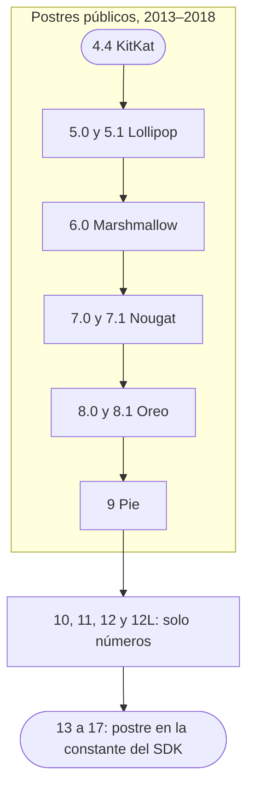

Esta serie tiene una nota por cada versión de Android, de 4.4 KitKat (API 19, 2013) a Android 17 (API 37, 2026). Todas usan las mismas secciones, así que dos
versiones se comparan lado a lado. La tabla sirve para encontrar una versión, y
los hilos de abajo, para seguir un tema, como los permisos, a través de las
dieciocho.

## Todas las versiones de un vistazo

| Versión                                 | Nombre                         | API | Año  | Lo que la define                                                |
| --------------------------------------- | ------------------------------ | --- | ---- | --------------------------------------------------------------- |
| [4.4](/es/notes/android-4-4-kitkat/)    | KitKat, público                | 19  | 2013 | Funciona con 512 MB de RAM (Project Svelte)                     |
| [5.0](/es/notes/android-5-0-lollipop/)  | Lollipop, público              | 21  | 2014 | ART reemplaza a Dalvik; Material Design                         |
| [5.1](/es/notes/android-5-1-lollipop/)  | Lollipop, público              | 22  | 2015 | Varias tarjetas SIM; Device Protection                          |
| [6.0](/es/notes/android-6-marshmallow/) | Marshmallow, público           | 23  | 2015 | Permisos peligrosos pedidos en ejecución                        |
| [7.0](/es/notes/android-7-0-nougat/)    | Nougat, público                | 24  | 2016 | Multiventana en pantalla dividida                               |
| [7.1](/es/notes/android-7-1-nougat/)    | Nougat, público                | 25  | 2016 | Primero en el Pixel; accesos directos de apps                   |
| [8.0](/es/notes/android-8-0-oreo/)      | Oreo, público                  | 26  | 2017 | Límites al segundo plano; canales de notificación               |
| [8.1](/es/notes/android-8-1-oreo/)      | Oreo, público                  | 27  | 2017 | Edición Go para teléfonos con 1 GB de RAM o menos               |
| [9](/es/notes/android-9-pie/)           | Pie, público                   | 28  | 2018 | Las apps inactivas pierden cámara, micrófono y sensores         |
| [10](/es/notes/android-10/)             | Quince Tart, interno           | 29  | 2019 | Scoped storage; permiso de ubicación en segundo plano           |
| [11](/es/notes/android-11/)             | Red Velvet Cake, interno       | 30  | 2020 | Permisos de una sola vez; scoped storage obligatorio            |
| [12](/es/notes/android-12/)             | Snow Cone, interno             | 31  | 2021 | Material You; panel de privacidad                               |
| [12L](/es/notes/android-12l/)           | 12L, público; `S_V2` en código | 32  | 2022 | Barra de tareas y pantalla dividida en pantallas grandes        |
| [13](/es/notes/android-13/)             | Tiramisu, interno              | 33  | 2022 | Permiso de notificaciones; permisos de medios                   |
| [14](/es/notes/android-14/)             | Upside Down Cake, interno      | 34  | 2023 | Foreground services con tipo; fotos elegidas                    |
| [15](/es/notes/android-15/)             | Vanilla Ice Cream, interno     | 35  | 2024 | Edge-to-edge por defecto; espacio privado                       |
| [16](/es/notes/android-16/)             | Baklava, interno               | 36  | 2025 | Las pantallas grandes ignoran el bloqueo de orientación         |
| [17](/es/notes/android-17/)             | Cinnamon Bun, interno          | 37  | 2026 | Diseños adaptables obligatorios; límite de memoria según el RAM |

El año es el de los primeros dispositivos que recibieron la versión. Falta la
API 20 porque existió solo para relojes, como Android 4.4W; la
[nota de KitKat](/es/notes/android-4-4-kitkat/) la cubre. Desde Android 13, el
nombre interno también es la constante de `Build.VERSION_CODES`, como
`TIRAMISU`.

Casi todas las filas tienen dos tipos de cambio: los que alcanzan a cualquier
app en esa versión y los que esperan a que la app apunte a su nivel de API.
Desde 2018, Google Play obliga a adoptar los segundos. Las apps nuevas tuvieron
que apuntar a API 26 desde agosto de 2018 y las actualizaciones desde
noviembre de 2018, y el mínimo sube cada año desde entonces. Desde 2023, los
dos plazos vencen el 31 de agosto.

## Los hilos que cruzan todas las versiones

### Permisos

Hasta [5.1](/es/notes/android-5-1-lollipop/), todos los permisos se concedían
al instalar. [Android 6.0](/es/notes/android-6-marshmallow/) los separó en
normales y peligrosos: las apps con target API 23 piden los peligrosos
mientras se ejecutan, y el usuario puede desactivar permisos en cualquier app.

Cada versión posterior redujo lo que entrega una sola respuesta:

- **8.0.** Conceder un permiso ya no concede todo su grupo, en apps con target
  API 26.
- **10.** La ubicación tiene tres respuestas, y el acceso en segundo plano
  pasa a ser un permiso propio, `ACCESS_BACKGROUND_LOCATION`.
- **11.** Cámara, micrófono y ubicación ofrecen "Only this time". Dos
  rechazos terminan con el diálogo, y las apps sin uso con target API 30
  pierden sus permisos.
- **12.** El diálogo de ubicación ofrece "Approximate". Escanear y conectar
  por Bluetooth pasa a permisos de "Nearby devices" como `BLUETOOTH_SCAN`.
- **13.** Las notificaciones necesitan `POST_NOTIFICATIONS`, y
  `READ_EXTERNAL_STORAGE` se divide en `READ_MEDIA_IMAGES`,
  `READ_MEDIA_VIDEO` y `READ_MEDIA_AUDIO`.
- **14.** El usuario puede compartir solo algunas fotos
  (`READ_MEDIA_VISUAL_USER_SELECTED`). En Android 14, las apps con target
  menor a API 23 ya no se instalan: Google dijo que el malware apunta a API 22
  para esquivar los permisos en ejecución.
  [Android 15](/es/notes/android-15/) subió el mínimo a 24.
- **16.** En apps con target API 36, `BODY_SENSORS` cede su lugar a permisos
  de salud granulares como `READ_HEART_RATE`.
- **17.** El acceso a la red local necesita `ACCESS_LOCAL_NETWORK`, y los
  selectores del sistema para contactos y ubicación reemplazan algunas
  solicitudes de permiso.

### Segundo plano y batería

Las reglas para ejecutarse en segundo plano se endurecieron casi cada año.

- **4.4.** En apps con target API 19, `AlarmManager.set()` es inexacto y se
  agrupa con otras alarmas.
- **5.0.** `JobScheduler` retiene el trabajo hasta que se cumplen sus
  condiciones (cargando, red sin medición, inactivo) y ejecuta los jobs
  juntos.
- **6.0.** Doze frena la red, los wake locks y los jobs en un teléfono quieto,
  y App Standby hace lo mismo con las apps que el usuario no toca.
- **7.0.** El primer nivel de Doze también actúa con el teléfono en movimiento
  en el bolsillo. `CONNECTIVITY_ACTION` deja de llegar a los receivers del
  manifest en apps con target API 24.
- **8.0.** En apps con target API 26, los servicios en segundo plano de una
  app inactiva se detienen, `startService()` desde segundo plano lanza una
  excepción y los receivers del manifest pierden la mayoría de los broadcasts
  implícitos.
- **9.** Los App Standby Buckets (active, working set, frequent, rare)
  limitan jobs, alarmas y mensajes FCM de alta prioridad, por debajo de
  Adaptive Battery.
- **12.** Las apps con target API 31 no pueden iniciar un foreground service
  desde segundo plano, y las alarmas exactas necesitan
  `SCHEDULE_EXACT_ALARM`.
- **14.** Cada foreground service de una app con target API 34 declara un
  tipo y su permiso. Las apps en caché se congelan poco después de salir de la
  pantalla.
- **15.** Los foreground services `dataSync` tienen 6 horas cada 24, en apps
  con target API 35.
- **17.** Reproducir audio necesita una activity visible o un foreground
  service, en cualquier app, y el sistema mata un proceso que supera su límite
  de memoria según el RAM.

### Almacenamiento

[Android 4.4](/es/notes/android-4-4-kitkat/) fue el primero en cerrar el
almacenamiento compartido. Leerlo necesita `READ_EXTERNAL_STORAGE`, la carpeta
`Android/data` propia de la app no necesita permiso, y las apps no pueden
escribir en una tarjeta SD fuera de sus propias carpetas. El storage access
framework (`ACTION_OPEN_DOCUMENT`) deja que el usuario elija el archivo.

- **5.0** suma `ACTION_OPEN_DOCUMENT_TREE` para carpetas enteras, y **6.0**
  deja formatear una tarjeta SD como almacenamiento interno.
- **7.0** lanza `FileUriExposedException` cuando una app con target API 24
  comparte una URI `file://`. Comparte una URI `content://` de
  `FileProvider`.
- **10** vuelve scoped storage el comportamiento por defecto en apps con
  target API 29: solo ven sus propios archivos y los medios compartidos.
  `requestLegacyExternalStorage` lo posterga.
- **11** ignora esa opción en apps con target API 30. Los gestores de archivos
  y las apps de backup pueden pedir `MANAGE_EXTERNAL_STORAGE`, que Play
  revisa.
- **13** reemplaza `READ_EXTERNAL_STORAGE` por tres permisos de medios y trae
  un selector de fotos que no necesita ninguno. **14** deja que el usuario
  elija qué fotos ve una app.

### Actualizaciones de seguridad y endurecimiento de la plataforma

- **SELinux.** Android 4.4 lo impuso en unos pocos dominios del sistema;
  Android 5.0 lo impone en todos, incluidos los del fabricante.
- **Actualizaciones mensuales.** En agosto de 2015 Google prometió una
  actualización de seguridad mensual para los Nexus, y el primer boletín
  público cubrió las fallas de Stagefright.
  [Android 6.0](/es/notes/android-6-marshmallow/) añadió
  `Build.VERSION.SECURITY_PATCH`, la fecha del último parche.
- **Cifrado.** El CDD de 6.0 exige el cifrado activado por defecto en
  dispositivos con pantalla de bloqueo segura y AES por encima de 50 MiB/s.
  [Android 7.0](/es/notes/android-7-0-nougat/) trajo el cifrado por archivo, y
  Android 10 lo exige en todo dispositivo que sale de fábrica con él.
- **Verified Boot y actualizaciones.** Android 7.0 aplica Verified Boot de
  forma estricta, y el Pixel, con [7.1](/es/notes/android-7-1-nougat/), fue el
  primer teléfono con actualizaciones A/B que se instalan en segundo plano.
- **Treble.** [Android 8.0](/es/notes/android-8-0-oreo/) puso una interfaz de
  fabricante estable entre el framework y el código de los fabricantes de
  chips. Los dispositivos que salen con Android 9 pueden ejecutar una imagen
  genérica del sistema.
- **Mainline.** [Android 10](/es/notes/android-10/) actualiza componentes del
  sistema por Google Play system updates. Android 11 sumó 12 módulos, y
  [Android 12](/es/notes/android-12/) convirtió a ART en uno de ellos.
- **Criptografía.** [Android 17](/es/notes/android-17/) genera claves ML-DSA
  en el Keystore y combina una firma poscuántica con una clásica en APK
  Signature Scheme v3.2.

### Nombres

Los nombres de postre fueron públicos y alfabéticos hasta
[Android 9 Pie](/es/notes/android-9-pie/). Google y Nestlé anunciaron juntos
el nombre KitKat el 3 de septiembre de 2013. Para Android N, Google pidió
sugerencias al público, se reservó la decisión y anunció Nougat.

El 22 de agosto de 2019 Google abandonó los postres. Sameer Samat escribió que
"weren't always understood by everyone in the global community": en algunos
idiomas la L y la R suenan igual, y el pie no es un postre en todas partes.
Los nombres siguieron en uso dentro del equipo: Quince Tart para 10, Red Velvet
Cake para 11, Snow Cone para 12. 12L nunca tuvo uno; el código lo llama
`S_V2`.

Desde [Android 13](/es/notes/android-13/), el nombre interno es la constante
del SDK: `TIRAMISU`, `UPSIDE_DOWN_CAKE`, `VANILLA_ICE_CREAM`. Después de la V,
el alfabeto volvió a empezar con `BAKLAVA` para 16 y `CINNAMON_BUN` para 17, y
sus build IDs empiezan con B y C.

## Para saber

- **Comentarios en AOSP.** `Build.java` documenta cada constante, a menudo con
  una broma. `M` dice `M comes after L.`, `N` dice `N is for ¯\_(ツ)_/¯.`, y
  `S_V2`, la de 12L, cita a Enrique V: "Once more unto the breach, dear
  friends, once more."
- **Un proceso dulce.** Los Easter eggs de 4.4 y 6.0 corren en un proceso
  llamado `:sweetsweetdesserts`.
- **12L dice 12.** En Android 12L, `Build.VERSION.RELEASE` devuelve `12`,
  porque la build fija `PLATFORM_VERSION_LAST_STABLE := 12`. Comprueba
  `SDK_INT >= 32`, nunca la cadena de versión.
- **No es Opera.** Los build IDs de Android 8.0 empiezan con `OPR`, que
  aparece en el user agent. Google advirtió que detectar navegadores con
  `/OPR/` puede confundir cualquiera con Opera.
- **`no.such.thing`.** En AOSP, `Build.SERIAL` se obtiene leyendo una
  propiedad con ese nombre. La llamada a una función impide que el compilador
  copie el valor dentro de la app, así Android 9 puede devolver `"unknown"` a
  las apps con target API 28.
