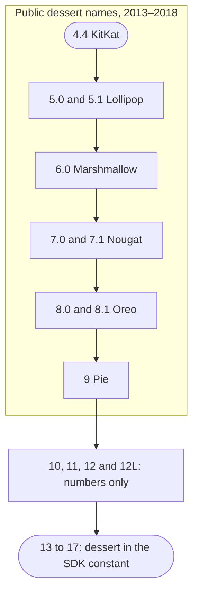

This series has one note per Android release, from 4.4 KitKat (API 19, 2013)
to Android 17 (API 37, 2026). Every note uses the same sections, so two
versions compare side by side. Use the table to find a version, or the threads
below it to follow one subject, such as permissions, across all eighteen.

## All versions at a glance

| Version                              | Name                        | API | Year | What defines it                                   |
| ------------------------------------ | --------------------------- | --- | ---- | ------------------------------------------------- |
| [4.4](/notes/android-4-4-kitkat/)    | KitKat, public              | 19  | 2013 | Runs on 512 MB of RAM (Project Svelte)            |
| [5.0](/notes/android-5-0-lollipop/)  | Lollipop, public            | 21  | 2014 | ART replaces Dalvik; Material Design              |
| [5.1](/notes/android-5-1-lollipop/)  | Lollipop, public            | 22  | 2015 | Multiple SIM cards; Device Protection             |
| [6.0](/notes/android-6-marshmallow/) | Marshmallow, public         | 23  | 2015 | Dangerous permissions asked at runtime            |
| [7.0](/notes/android-7-0-nougat/)    | Nougat, public              | 24  | 2016 | Split-screen multi-window                         |
| [7.1](/notes/android-7-1-nougat/)    | Nougat, public              | 25  | 2016 | First on the Pixel; app shortcuts                 |
| [8.0](/notes/android-8-0-oreo/)      | Oreo, public                | 26  | 2017 | Background limits; notification channels          |
| [8.1](/notes/android-8-1-oreo/)      | Oreo, public                | 27  | 2017 | Go edition for phones with 1 GB of RAM or less    |
| [9](/notes/android-9-pie/)           | Pie, public                 | 28  | 2018 | Idle apps lose camera, microphone and sensors     |
| [10](/notes/android-10/)             | Quince Tart, internal       | 29  | 2019 | Scoped storage; background location permission    |
| [11](/notes/android-11/)             | Red Velvet Cake, internal   | 30  | 2020 | One-time permissions; scoped storage enforced     |
| [12](/notes/android-12/)             | Snow Cone, internal         | 31  | 2021 | Material You; privacy dashboard                   |
| [12L](/notes/android-12l/)           | 12L, public; `S_V2` in code | 32  | 2022 | Taskbar and split screen for large screens        |
| [13](/notes/android-13/)             | Tiramisu, internal          | 33  | 2022 | Notification permission; media permissions        |
| [14](/notes/android-14/)             | Upside Down Cake, internal  | 34  | 2023 | Typed foreground services; selected photos        |
| [15](/notes/android-15/)             | Vanilla Ice Cream, internal | 35  | 2024 | Edge-to-edge by default; private space            |
| [16](/notes/android-16/)             | Baklava, internal           | 36  | 2025 | Large screens ignore orientation locks            |
| [17](/notes/android-17/)             | Cinnamon Bun, internal      | 37  | 2026 | Adaptive layouts required; RAM-based memory limit |

The year is when the release reached its first devices. API 20 is missing
because it existed only for watches, as Android 4.4W; the
[KitKat note](/notes/android-4-4-kitkat/) covers it. From Android 13 on, the
internal name is also the `Build.VERSION_CODES` constant, such as `TIRAMISU`.

Most rows have two kinds of change: those that reach every app on that
version, and those that wait until an app targets its API level. Since 2018,
Google Play has made apps adopt the second kind. New apps had to target
API 26 from August 2018 and updates from November 2018, and the floor has
risen every year since. From 2023 both deadlines fall on 31 August.

## The threads that run through every version

### Permissions

Until [5.1](/notes/android-5-1-lollipop/), every permission was granted at
install. [Android 6.0](/notes/android-6-marshmallow/) split them into normal
and dangerous: apps targeting API 23 ask for a dangerous one while they run,
and users can switch permissions off for any app.

Each release after that narrowed what one answer gives away:

- **8.0.** A grant no longer covers every permission of its group, for apps
  targeting API 26.
- **10.** Location gets three answers, and background access becomes its own
  permission, `ACCESS_BACKGROUND_LOCATION`.
- **11.** Camera, microphone and location offer "Only this time". Two denials
  end the dialog, and unused apps targeting API 30 lose their grants.
- **12.** The location dialog offers "Approximate". Bluetooth scanning and
  connecting move to "Nearby devices" permissions such as `BLUETOOTH_SCAN`.
- **13.** Notifications need `POST_NOTIFICATIONS`, and
  `READ_EXTERNAL_STORAGE` splits into `READ_MEDIA_IMAGES`, `READ_MEDIA_VIDEO`
  and `READ_MEDIA_AUDIO`.
- **14.** Users can share only some photos (`READ_MEDIA_VISUAL_USER_SELECTED`).
  On Android 14, apps targeting below API 23 no longer install: Google said malware targets
  API 22 to dodge runtime permissions. [Android 15](/notes/android-15/) raised
  the floor to 24.
- **16.** For apps targeting API 36, `BODY_SENSORS` gives way to granular
  health permissions such as `READ_HEART_RATE`.
- **17.** Local network access needs `ACCESS_LOCAL_NETWORK`, and system
  pickers for contacts and location replace some permission requests.

### Background work and battery

The rules for running in the background got stricter almost every year.

- **4.4.** For apps targeting API 19, `AlarmManager.set()` is inexact and
  batched with other alarms.
- **5.0.** `JobScheduler` holds work until its conditions are met (charging,
  unmetered network, idle) and runs jobs together.
- **6.0.** Doze parks network access, wake locks and jobs on an idle phone,
  and App Standby does the same for apps the user has not touched.
- **7.0.** Doze's first level also applies in a moving pocket.
  `CONNECTIVITY_ACTION` stops reaching manifest receivers in apps targeting
  API 24.
- **8.0.** For apps targeting API 26, an idle app's background services are
  stopped, `startService()` from the background throws, and manifest receivers
  miss most implicit broadcasts.
- **9.** App Standby Buckets (active, working set, frequent, rare) limit
  jobs, alarms and high-priority FCM messages, under Adaptive Battery.
- **12.** Apps targeting API 31 cannot start a foreground service from the
  background, and exact alarms need `SCHEDULE_EXACT_ALARM`.
- **14.** Every foreground service in an app targeting API 34 declares a type
  and its permission. Cached apps are frozen shortly after leaving the screen.
- **15.** `dataSync` foreground services get 6 hours in every 24, for apps
  targeting API 35.
- **17.** Audio playback needs a visible activity or a foreground service, for
  every app, and a process over its RAM-based memory limit is killed.

### Storage

[Android 4.4](/notes/android-4-4-kitkat/) closed shared storage first.
Reading it needs `READ_EXTERNAL_STORAGE`, an app's own `Android/data` folder
needs no permission, and apps cannot write to an SD card outside their own
folders. The storage access framework (`ACTION_OPEN_DOCUMENT`) lets the user
pick a file instead.

- **5.0** adds `ACTION_OPEN_DOCUMENT_TREE` for whole folders, and **6.0** lets users
  format an SD card as internal storage.
- **7.0** throws `FileUriExposedException` when an app targeting API 24 shares
  a `file://` URI. Share a `content://` URI from `FileProvider`.
- **10** makes scoped storage the default for apps targeting API 29: they see
  only their own files and shared media. `requestLegacyExternalStorage`
  postpones it.
- **11** ignores that flag for apps targeting API 30. File managers and
  backup apps can ask for `MANAGE_EXTERNAL_STORAGE`, which Play reviews.
- **13** replaces `READ_EXTERNAL_STORAGE` with three media permissions and
  ships a photo picker that needs none. **14** lets the user pick which photos
  an app sees.

### Security updates and platform hardening

- **SELinux.** Android 4.4 enforced it for a few system domains; Android 5.0
  enforces it for every domain, vendor ones included.
- **Monthly updates.** In August 2015 Google promised Nexus devices a monthly
  security update, and the first public bulletin covered the Stagefright media
  flaws. [Android 6.0](/notes/android-6-marshmallow/) added
  `Build.VERSION.SECURITY_PATCH`, the date of the last patch.
- **Encryption.** The 6.0 CDD requires encryption on by default on devices
  with a secure lock screen and AES above 50 MiB/s. [Android 7.0](/notes/android-7-0-nougat/) brought
  file-based encryption, and Android 10 requires it on every device that
  launches with it.
- **Verified Boot and updates.** Android 7.0 enforces Verified Boot strictly,
  and the Pixel, on [7.1](/notes/android-7-1-nougat/), was the first phone
  with A/B updates that install in the background.
- **Treble.** [Android 8.0](/notes/android-8-0-oreo/) put a stable vendor
  interface between the framework and the chip makers' code. Devices launching
  with Android 9 can run a generic system image.
- **Mainline.** [Android 10](/notes/android-10/) updates system components
  through Google Play system updates. Android 11 added 12 modules, and
  [Android 12](/notes/android-12/) made ART one of them.
- **Cryptography.** [Android 17](/notes/android-17/) generates ML-DSA keys in
  the Keystore and pairs a post-quantum signature with a classical one in APK
  Signature Scheme v3.2.

### Names

The dessert names were public and alphabetical through
[Android 9 Pie](/notes/android-9-pie/). Google and Nestlé announced the
KitKat name together on 3 September 2013. For Android N, Google asked the public for
suggestions, kept the choice, and announced Nougat.

On 22 August 2019 Google dropped the desserts. Sameer Samat wrote that they
"weren't always understood by everyone in the global community": in some
languages L and R sound the same, and pies are not a dessert everywhere. The
names stayed in use inside the team: Quince Tart for 10, Red Velvet Cake for
11, Snow Cone for 12. 12L never had one; the code calls it `S_V2`.

From [Android 13](/notes/android-13/), the internal name is the SDK constant:
`TIRAMISU`, `UPSIDE_DOWN_CAKE`, `VANILLA_ICE_CREAM`. After V, the alphabet
started over with `BAKLAVA` for 16 and `CINNAMON_BUN` for 17, and their build
IDs start with B and C.

## Worth knowing

- **AOSP comments.** `Build.java` documents each constant, often with a joke.
  `M` reads `M comes after L.`, `N` reads `N is for ¯\_(ツ)_/¯.`, and 12L's
  `S_V2` quotes Henry V: "Once more unto the breach, dear friends, once more."
- **A sweet process.** The Easter eggs of 4.4 and 6.0 run in a process named
  `:sweetsweetdesserts`.
- **12L says 12.** On Android 12L, `Build.VERSION.RELEASE` returns `12`,
  because the build sets `PLATFORM_VERSION_LAST_STABLE := 12`. Check
  `SDK_INT >= 32`, never the version string.
- **Not Opera.** Android 8.0 build IDs start with `OPR`, which appears in the
  user agent. Google warned that browser detection matching `/OPR/` can mistake
  any browser for Opera.
- **`no.such.thing`.** In AOSP, `Build.SERIAL` is set by reading a property
  with that name. The function call stops compilers from inlining the value, so
  Android 9 can return `"unknown"` to apps targeting API 28.
